# Eka: plugins for Zynthian

**English** · [Русский](README.ru.md)

Twelve LV2 plugins for [Zynthian](https://zynthian.org), each with its own touch widget: an audio looper, a MIDI
looper, a generative arpeggiator, a granular sampler, a West Coast synth, a live granular effect, a four-voice pitch harmonizer, a rhythmic multi-effect shaper, a single-band live compressor, a 4-band parametric equalizer, a stereo/polyrhythmic live delay and a 16-pad drum sampler & sequencer. They are made to play live on a
Raspberry Pi 5 and to work together in one setup.

> Tested on: Zynthian **Vangelis** (stable 2610), Raspberry Pi 5, V5 kit, 800x480 touch screen.
> Other versions/hardware are untested.

## The plugins

### [Eka Tape](plugins/tape): live audio looper

Parts of stereo tracks, played with the feet: record, overdub without limits, undo / redo, Lock tracks into the
next part, non-destructive loop Trim, speed and pitch per track, a mixer, sessions saved with their sound. Follows the Zynthian tempo like tape.

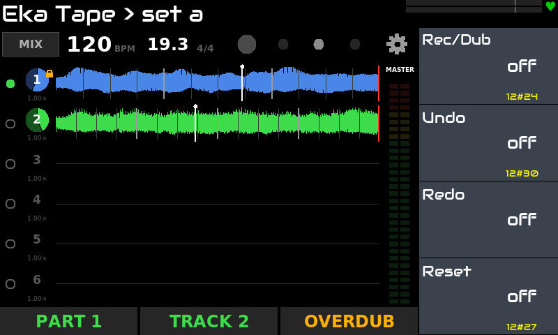

### [Eka Roll](plugins/roll): MIDI looper

Records and overdubs notes and controller moves in layers, locked to the Zynthian transport; quantize, transpose
per layer, 16 slots on disk, export to a MIDI file and to a Zynthian sequencer pattern.

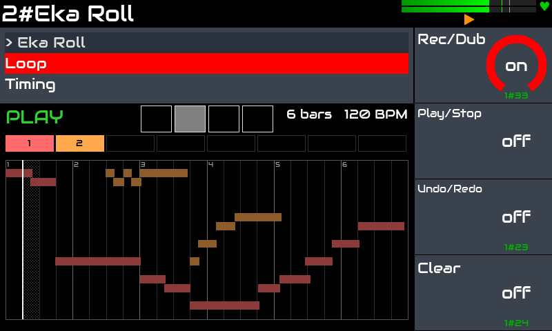

### [Eka Bloom](plugins/bloom): generative arpeggiator

A 16-step pattern with probability, pitch, velocity, gate and ratchets, every row with its own length; scales and
degrees, a Turing-Machine-style note loop, slow mutation; live effects on pads (roll, fill, drop…) and an XY pad.

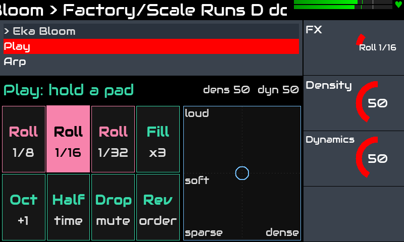

### [Eka Mist](plugins/mist): granular sampler

Every note grows a cloud of grains from a sample: position and scan, grain size and density, pitch quantized to a
scale, a filter per voice, LFOs and envelopes on a modulation grid. 8 voices, a bounded grain pool.

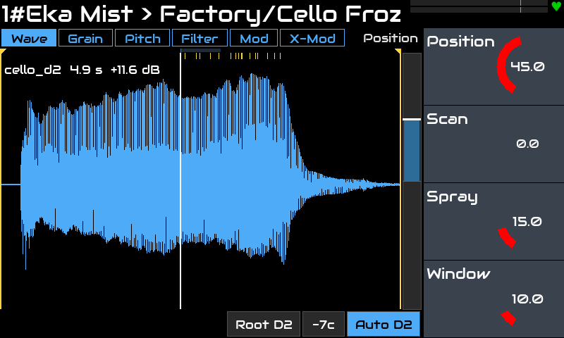

### [Eka Fold](plugins/fold): polyphonic West Coast synth

A complex oscillator pair with FM, AM and Sync, a wavefolder, a lopass gate on a vactrol model, function
generators, a mod matrix, and a string / delay / resonator in every voice. Up to 8 voices.

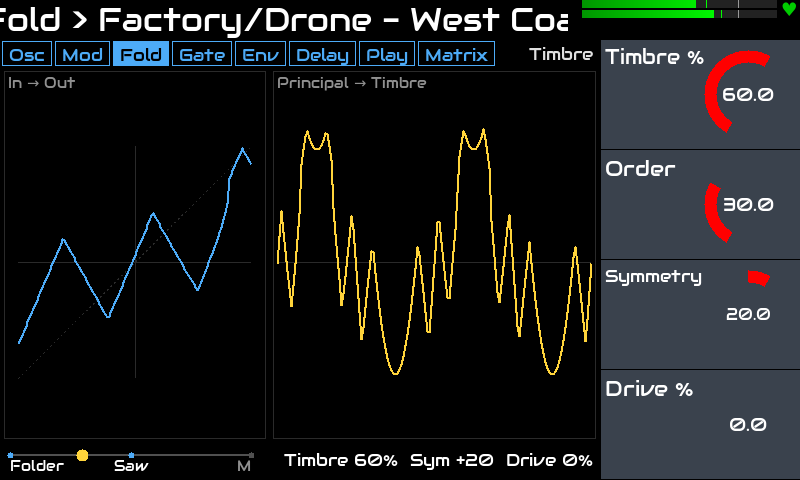

### [Eka Grain Flow](plugins/grainflow): live granular effect

Three streams turn live audio into evolving clouds: partial or full Freeze, source scanning, wide stereo grains,
quantized pitch, two tempo-aware LFOs and an input envelope on a modulation grid. 25 factory presets.

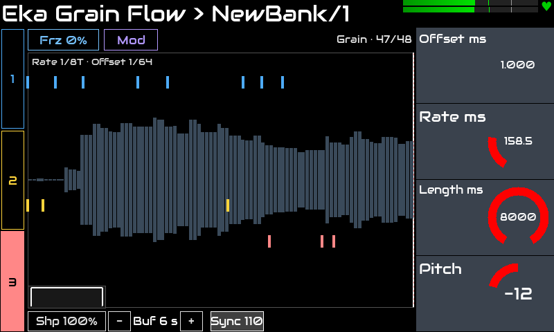

### [Eka Weave-4](plugins/weave4): four-voice pitch harmonizer

Four harmony voices plus dry signal: independent intervals, 14 chord types with voice leading, diatonic scales, or
MIDI-driven target notes with an embedded input pitch tracker; per-voice tempo-synced delay, fine detune / humanize,
HPF/LPF filters, four scenes (A–D) and 9 factory presets.

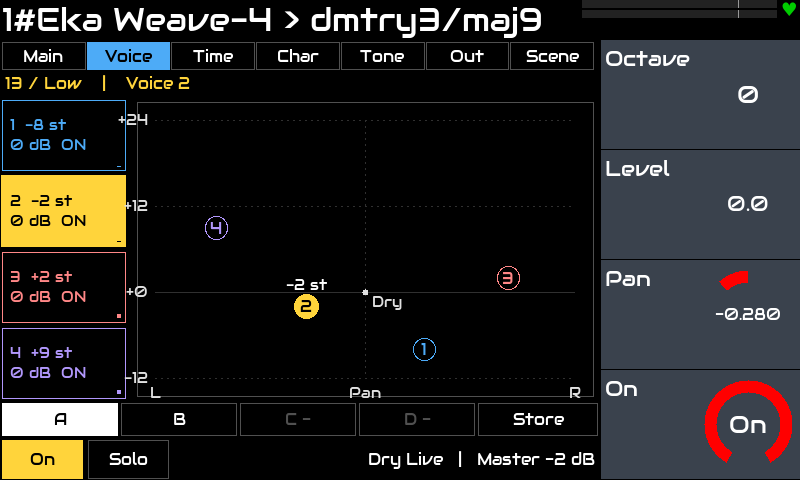

### [Eka Pulse](plugins/pulse): rhythmic multi-effect shaper

Four polyrhythmic shaper slots (`TIME`, `DRIVE & CRUSH`, `FILTER`, `GATE & SPACE`) with independent `1..16` step lengths, Linkwitz-Riley `Low Split` crossover with `Low Duck`, Audio/MIDI triggers, `Env → Depth`, a live `Perform` tab (3×3 momentary pads + XY pad + four scenes A–D) and 24 factory presets.

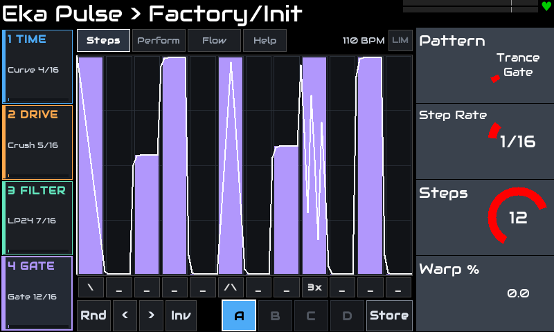

### [Eka Press](plugins/press): single-band live compressor

Four compressor characters (`Clean`, `Opto`, `Punch`, `Glue`), `SC HPF` (`20..500 Hz`), `Stereo Link`, `Auto Release`, `SC Listen`, analog `Drive`, `Auto Makeup`, parallel `Mix`, `-0.3 dBFS` `Soft Clip`, click-free `Bypass`, an interactive Transfer Curve + scrolling Gain-Reduction timeline widget, and 10 factory presets.

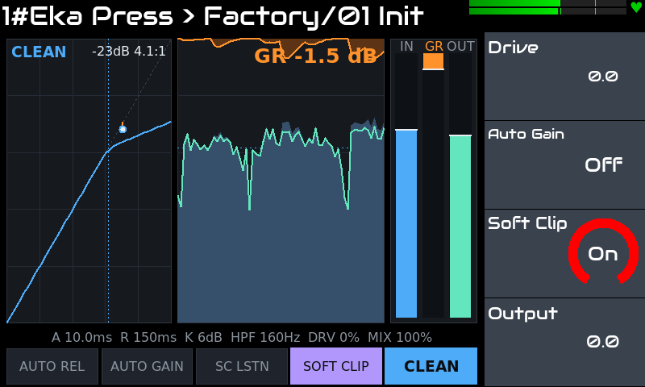

### [Eka Q-4](plugins/q4): 4-band live parametric equalizer

Four 64-bit parametric bands (`Shelf`, `Bell`, `Pultec`, `Notch`, `Air`, `Off`), Butterworth `HPF`/`LPF` (`12`/`24 dB/oct`), `1 kHz` `Tilt`, global `Scale`, per-band `Solo` audition, perceptual `AutoGain`, click-free `Bypass`, a zero-latency 24-band live spectrum analyzer behind an interactive touch EQ graph, and 10 factory presets.

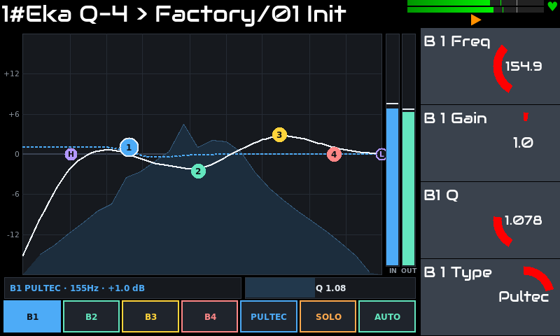

### [Eka Echo](plugins/echo): stereo & polyrhythmic live delay

Independent L/R Hermite-interpolated delay (`5..2500 ms`) with BPM sync (`1/64..1 bar`), four characters (`Clean`, `Tape` with capstan motor inertia, `BBD`, `Diff`), three stereo routings (`Stereo`, `PingPong`, `Cross`), loop `HPF`/`LPF`, `Drive`, `Diffuse`, LFO modulation, `Duck`, `Freeze`, `Trails`, a dedicated live **FX** X-Y screen (`Time FX`, `Filter FX`, `Wash FX`, `SNAP 0` spring mode, MIDI-mappable `FX Zero`), and 10 factory presets.

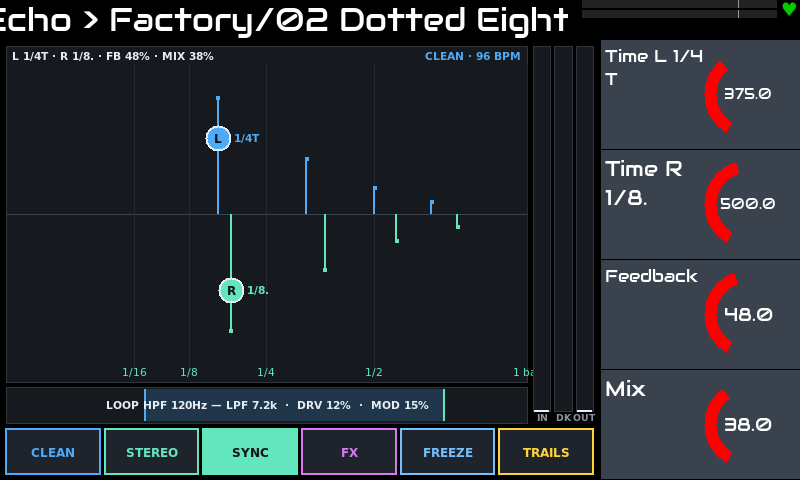

### [Eka Pads](plugins/pads): 16-pad drum sampler & polyrhythmic scene sequencer

Bitwig Drum Machine-style 4×4 drum sampler built for pad controllers (like M-VAVE SMC-PAD Pocket): 16 independent pads with async WAV/FLAC loading, anti-aliased sinc pitch, decay, bipolar DJ filter, punch, drive/crush, choke groups, bipolar `Width`, 4 stereo `Aux` sends to Zynthian Mixbuses, a 4-slot per-pad modulation matrix (2 LFOs + Env Follower), Auto-Select syncing Zynthian's 4 encoders to the last hit pad, and a polyrhythmic 32-step scene sequencer with live Overdub, per-step velocity/chance/ratchets, and one-tap export to ZynSeq.

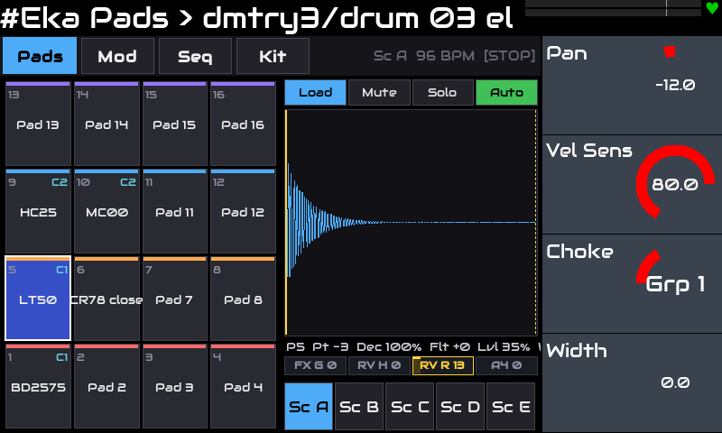

## A setup

A typical chain: **Pads** drives the beat (with per-pad Aux sends into **Echo** or **Pulse**), **Roll** records the chords, **Bloom** turns them into a moving arpeggio, **Fold** or **Mist** plays it, **Weave-4** adds four-voice harmony to your live instrument (or follows the chords from **Roll**), **Grain Flow** and **Echo** reshape the audio, **Tape** loops the sound together with your instrument, **Q-4** sculpts the tone and clears resonances, and **Press** shapes the live input or glues the mix. Each plugin also works on its own.

## Installation

On the Zynthian (SSH as root):

```bash
git clone https://github.com/dmtry3/zynthian-eka.git
cd zynthian-eka
sudo make install-bloom          # one plugin: tape, roll, bloom, mist, fold, grainflow, weave4, pulse, press, q4, echo or pads
sudo make install                # or all of them
systemctl restart zynthian
```

Update later:

```bash
cd /root/zynthian-eka && git pull && sudo make install && systemctl restart zynthian
```

Every plugin builds on the device and installs its LV2 bundle into `/usr/local/lib/lv2` and its
widget into `zyngui/widgets_user`; nothing in Zynthian's own files is changed. `sudo make uninstall-<plugin>`
or `sudo make uninstall` removes them. Each plugin's README has the details.

## Building on any Linux

```bash
make                 # all plugins
make bloom           # one plugin
make -C plugins/bloom test
```

## License

GPL-3.0-or-later, see [LICENSE](LICENSE) (and the `LICENSE` file of each plugin). Third-party code and samples are listed in the plugins'
`THIRD_PARTY.md` and `samples/CREDITS.md`.
