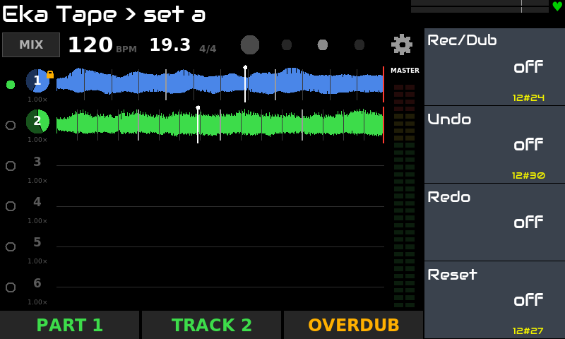
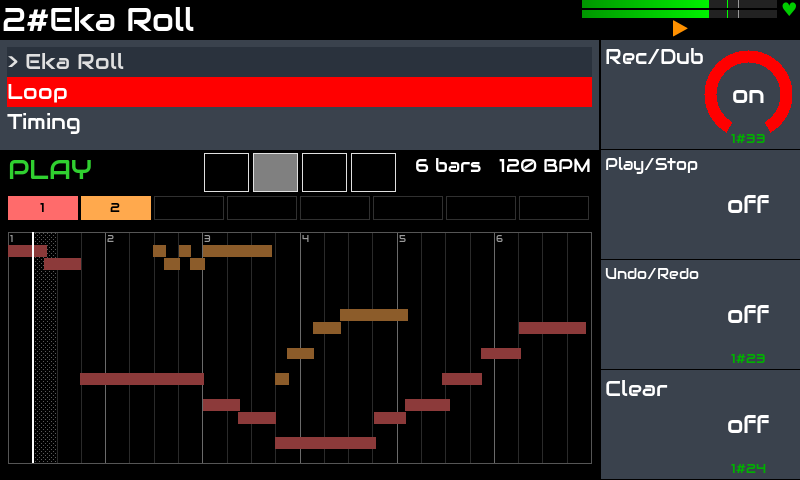
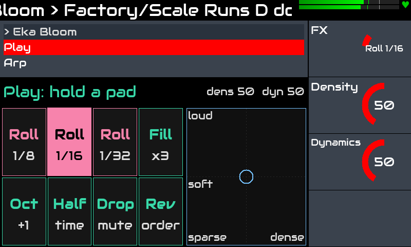
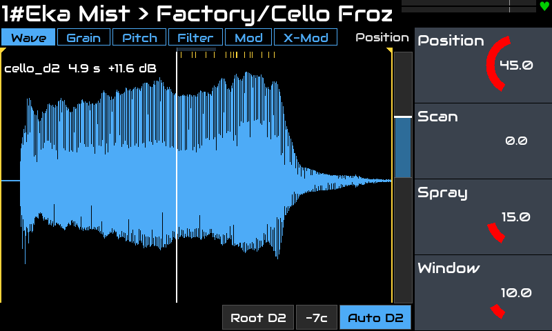
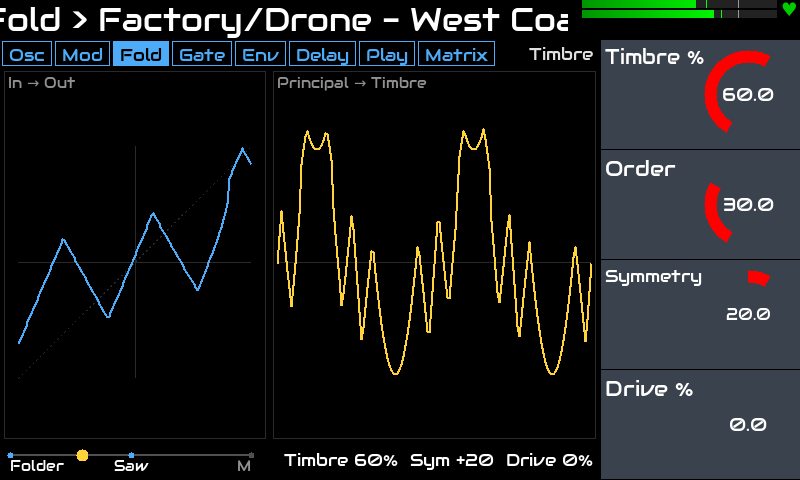

# Eka: plugins for Zynthian

**English** · [Русский](README.ru.md)

Five LV2 plugins for [Zynthian](https://zynthian.org), each with its own touch widget: an audio looper, a MIDI
looper, a generative arpeggiator, a granular sampler and a West Coast synth. They are made to play live on a
Raspberry Pi 5 and to work together in one setup.

> Tested on: Zynthian **Vangelis** (stable 2610), Raspberry Pi 5, V5 kit, 800x480 touch screen.
> Other versions/hardware are untested.

## The plugins

### [Eka Tape](plugins/tape): live audio looper

Parts of stereo tracks, played with the feet: record, overdub without limits, undo / redo, Lock tracks into the
next part, speed and pitch per track, a mixer, sessions saved with their sound. Follows the Zynthian tempo like tape.



### [Eka Roll](plugins/roll): MIDI looper

Records and overdubs notes and controller moves in layers, locked to the Zynthian transport; quantize, transpose
per layer, 16 slots on disk, export to a MIDI file and to a Zynthian sequencer pattern.



### [Eka Bloom](plugins/bloom): generative arpeggiator

A 16-step pattern with probability, pitch, velocity, gate and ratchets, every row with its own length; scales and
degrees, a Turing-Machine-style note loop, slow mutation; live effects on pads (roll, fill, drop…) and an XY pad.



### [Eka Mist](plugins/mist): granular sampler

Every note grows a cloud of grains from a sample: position and scan, grain size and density, pitch quantized to a
scale, a filter per voice, LFOs and envelopes on a modulation grid. 8 voices, a bounded grain pool.



### [Eka Fold](plugins/fold): polyphonic West Coast synth

A complex oscillator pair with FM, AM and Sync, a wavefolder, a lopass gate on a vactrol model, function
generators, a mod matrix, and a string / delay / resonator in every voice. Up to 8 voices.



## A setup

A typical chain: **Roll** records the chords, **Bloom** turns them into a moving arpeggio, **Fold** or **Mist**
plays it, and **Tape** loops the sound together with your instrument. Each plugin also works on its own.

## Installation

On the Zynthian (SSH as root):

```bash
git clone https://github.com/dmtry3/zynthian-eka.git
cd zynthian-eka
sudo make install-bloom          # one plugin: tape, roll, bloom, mist or fold
sudo make install                # or all of them
systemctl restart zynthian
```

Update later:

```bash
cd /root/zynthian-eka && git pull && sudo make install && systemctl restart zynthian
```

Every plugin builds on the device and is installed by symlinks (the LV2 bundle into `/usr/local/lib/lv2`, the
widget into `zyngui/widgets_user`); nothing in Zynthian's own files is changed. `sudo make uninstall-<plugin>`
or `sudo make uninstall` removes the links. Each plugin's README has the details.

## Building on any Linux

```bash
make                 # all plugins
make bloom           # one plugin
make -C plugins/bloom test
```

## License

GPL-3.0-or-later, see the `LICENSE` file of each plugin. Third-party code and samples are listed in the plugins'
`THIRD_PARTY.md` and `samples/CREDITS.md`.
