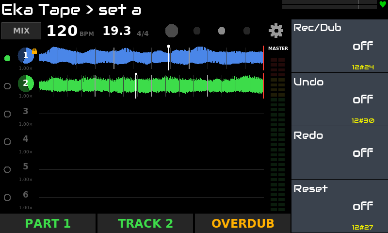
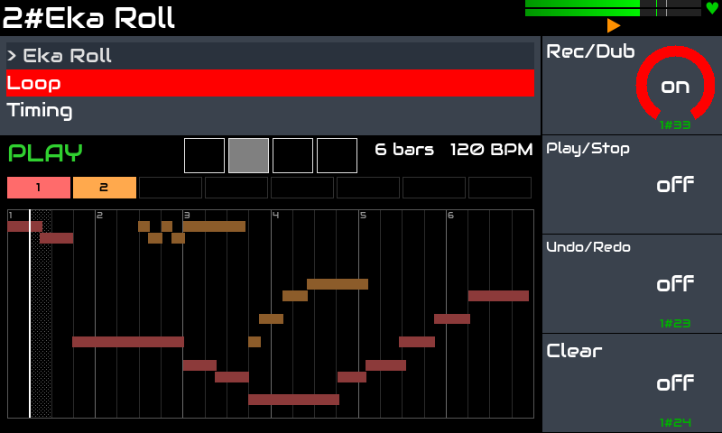
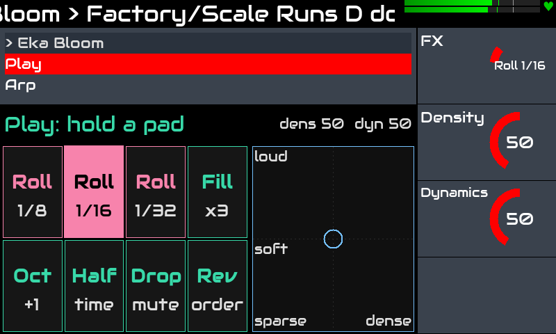
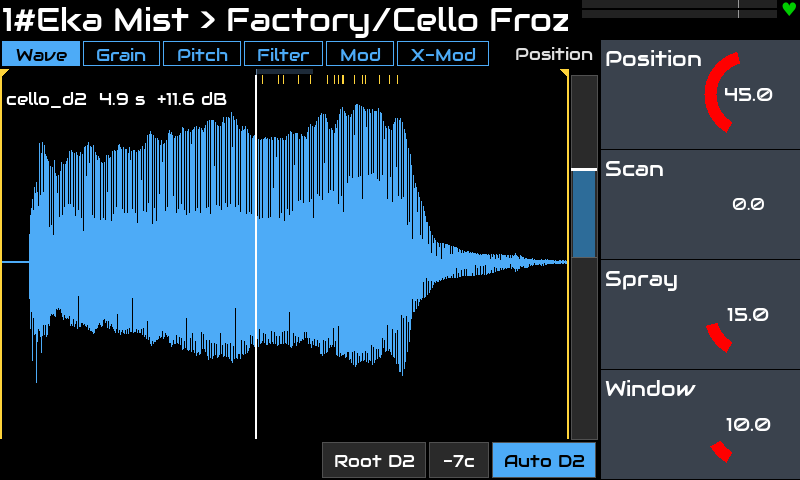
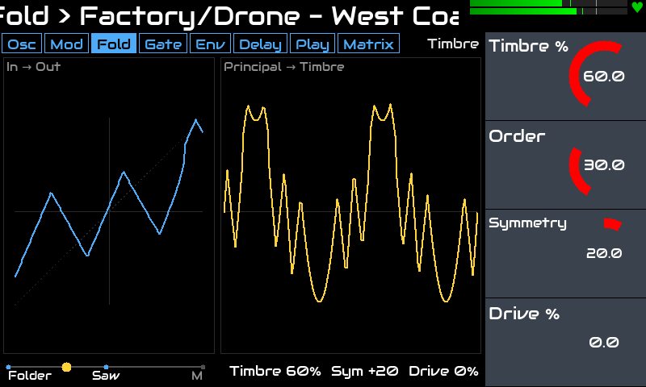

# Eka: плагины для Zynthian

[English](README.md) · **Русский**

Пять LV2-плагинов для [Zynthian](https://zynthian.org), у каждого свой виджет для тачскрина: аудио-лупер,
MIDI-лупер, генеративный арпеджиатор, гранулярный сэмплер и синтезатор West Coast. Сделаны для живой игры на
Raspberry Pi 5 и для работы вместе в одном сетапе.

> Проверено на: Zynthian **Vangelis** (stable 2610), Raspberry Pi 5, набор V5, тачскрин 800x480.
> Другие версии и железо не проверялись.

## Плагины

### [Eka Tape](plugins/tape): аудио-лупер для живой игры

Парты из стерео-дорожек, управление ногами: запись, овердабы без предела, undo / redo, Lock дорожек в следующий
парт, скорость и высота у каждой дорожки, микшер, сессии вместе со звуком. Следует за темпом Zynthian, как лента.



### [Eka Roll](plugins/roll): MIDI-лупер

Пишет и наслаивает ноты и движения контроллеров слоями, по транспорту Zynthian; квантование, транспонирование
слоёв, 16 слотов на диске, экспорт в MIDI-файл и в паттерн секвенсора Zynthian.



### [Eka Bloom](plugins/bloom): генеративный арпеджиатор

Паттерн из 16 шагов: вероятность, высота, громкость, gate и дробь, у каждого ряда своя длина; гаммы и ступени,
петля нот в духе Turing Machine, медленная мутация; живые эффекты на пэдах (roll, fill, drop…) и XY-пад.



### [Eka Mist](plugins/mist): гранулярный сэмплер

Каждая нота растит облако зёрен из сэмпла: позиция и скан, размер и плотность зёрен, высота с притяжением к ладу,
фильтр в каждом голосе, LFO и огибающие на сетке модуляции. 8 голосов, ограниченный пул зёрен.



### [Eka Fold](plugins/fold): полифонический синт West Coast

Пара осцилляторов с FM, AM и Sync, волновой фолдер, lopass gate на модели вактрола, функциональные генераторы,
матрица модуляции и струна / дилей / резонатор в каждом голосе. До 8 голосов.



## Сетап

Типичная цепочка: **Roll** пишет аккорды, **Bloom** превращает их в живое арпеджио, его играет **Fold** или
**Mist**, а **Tape** закольцовывает звук вместе с вашим инструментом. Каждый плагин работает и сам по себе.

## Установка

На Zynthian (SSH под root):

```bash
git clone https://github.com/dmtry3/zynthian-eka.git
cd zynthian-eka
sudo make install-bloom          # один плагин: tape, roll, bloom, mist или fold
sudo make install                # или все
systemctl restart zynthian
```

Обновление:

```bash
cd /root/zynthian-eka && git pull && sudo make install && systemctl restart zynthian
```

Каждый плагин собирается на устройстве и ставится ссылками (бандл LV2 в `/usr/local/lib/lv2`, виджет в
`zyngui/widgets_user`); файлы самого Zynthian не меняются. `sudo make uninstall-<плагин>` или
`sudo make uninstall` убирают ссылки. Подробности — в README каждого плагина.

## Сборка на любом Linux

```bash
make                 # все плагины
make bloom           # один плагин
make -C plugins/bloom test
```

## Лицензия

GPL-3.0-or-later, см. файл `LICENSE` в каждом плагине. Сторонний код и сэмплы перечислены в `THIRD_PARTY.md` и
`samples/CREDITS.md` плагинов.
