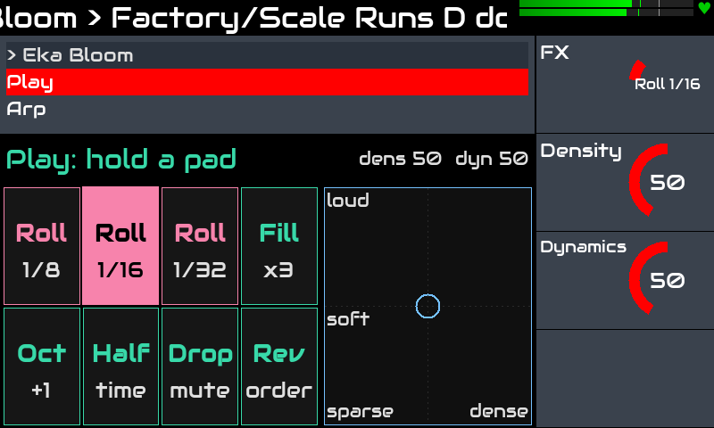
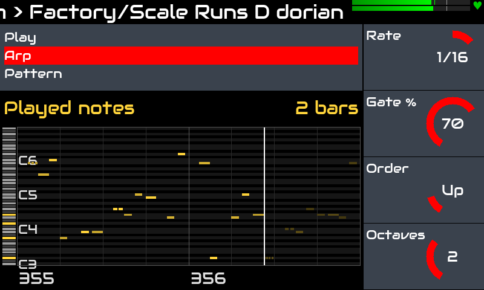
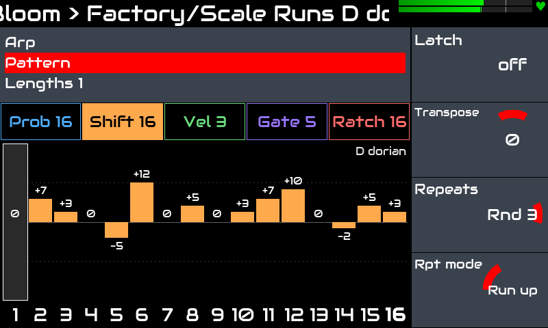
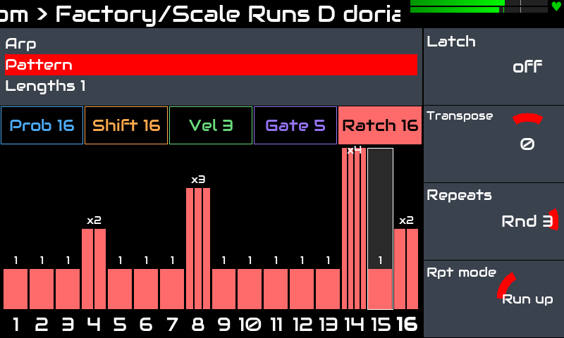
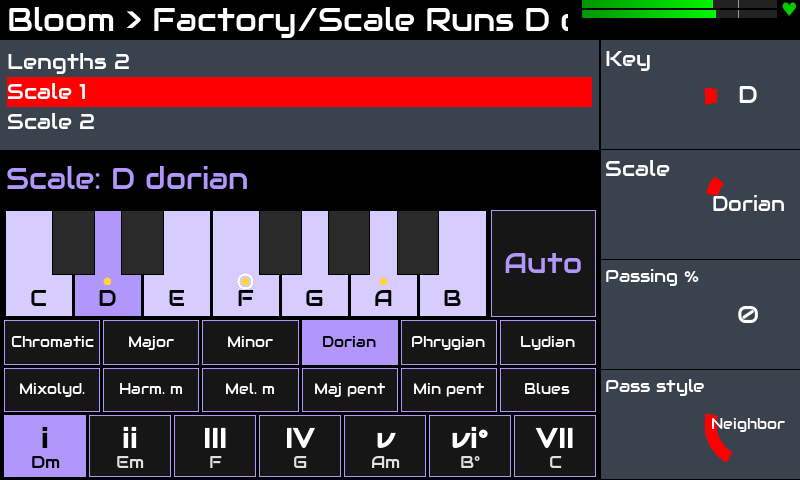

# Eka Bloom для Zynthian

[English](README.md) · **Русский**

**Генеративный арпеджиатор** для [Zynthian](https://zynthian.org): **LV2-плагин (MIDI tool)**, который ставится
перед синтом, и **виджет** для тачскрина Zynthian — живые эффекты на пэдах, ролл сыгранных нот, клавиатура для
тональности и аккордов гаммы, редактор 16 шагов паттерна.

> Проверено на: Zynthian **Vangelis** (stable 2610), Raspberry Pi 5, набор V5, тачскрин 800x480.
> Другие версии и железо не проверялись.

## Возможности

- **Паттерн** из 16 шагов, пять рядов: **Prob** (вероятность), **Shift** (высота, липнет к гамме), **Vel**,
  **Gate** (или Tie) и **Ratch** (1–4 ровных удара в шаге). У каждого ряда **своя длина** (полиритмия);
  **Ratch every** играет дробь только на каждом N-м проходе, как сбивку.
- **Семь порядков нот:** Up, Down, Up-Down, Down-Up, As played, Random и **Loop** — петля позиций в аккорде в духе
  Turing Machine; Octaves 1–4, Latch, Transpose, **повторы** с пробежками, октавами или эхом.
- **Гаммы и ступени:** 12 гамм, Key или *Auto* (нижняя зажатая клавиша), **проходящие ноты** перед нотами
  аккорда и **Degree**: один зажатый аккорд ходит по аккордам тональности (C-E-G на IV играет F-A-C).
- **Мутация:** петля нот и шаги медленно уходят от нарисованного; *Reset* — начать заново.
- **Грув:** свинг с четырьмя рисунками, Drunk, Accent.
- **Живые эффекты**, пока палец на пэде: **Roll** 1/8 · 1/16 · 1/32 (beat repeat), **Fill**, **Oct+**,
  **Half time**, **Drop**, **Rev**; **XY-пад** для плотности и динамики. Отпустил — снова в сетке.
- **По транспорту:** шаги идут по сетке песни Zynthian, пока она играет, и по своим часам в темпе Zynthian,
  пока стоит.
- **6 заводских пресетов**; свои пресеты и снапшоты Zynthian хранят весь паттерн.
- **Виджет**, который следует за страницей энкодеров: пэды Play, ролл сыгранных нот (Arp), клавиатура и ступени
  (Scale), редактор шагов с метками мутации и плейхедом каждого ряда.

## Скриншоты

| | |
|---|---|
|  |  |
| **Play:** держишь пэд — эффект, XY-пад — плотность и динамика | **Arp:** ноты, которые Bloom сыграл на самом деле |
|  |  |
| **Pattern:** ряд паттерна, здесь Shift в ре дорийском | **Ratch:** удары в шаге, по тонкому столбику на удар |
|  | |
| **Scale:** тап по тонике, гамме, ступени | |

## Установка

На Zynthian (собирается прямо на устройстве):

```bash
git clone https://github.com/dmtry3/zynthian-eka.git
cd zynthian-eka/plugins/bloom
sudo ./scripts/install.sh
sudo systemctl restart zynthian
```

`install.sh` собирает плагин и ставит две ссылки:
- `/usr/local/lib/lv2/eka-bloom.lv2` → `build/eka-bloom.lv2`;
- виджет в `/zynthian/zynthian-ui/zyngui/widgets_user/`.

Ещё он обновляет кэш списка пресетов Zynthian для этого плагина. Больше в Zynthian ничего не меняется.
Удаление: `sudo ./scripts/uninstall.sh`, он удаляет только ссылки.

Обновление:

```bash
git pull && sudo ./scripts/install.sh && sudo systemctl restart zynthian
```

В Zynthian добавь **Eka Bloom** в цепочку как MIDI tool перед синтом. Он будет в категории *Other*:
плагин не может задать категорию сам, её можно поменять в webconf → Engines.

## Как играет

Зажимаешь аккорд, арпеджиатор играет его ноты по одной на шаг.

**Транспорт.**
- **Остановлен:** арп идёт по своим часам в темпе Zynthian, первая нота звучит сразу, как нажал клавишу.
- **Запущен:** шаги привязаны к сетке песни, новый аккорд вступает на ближайшем шаге сетки.
  Старт транспорта или переход в другое место обрывает звучащую ноту.

**Порядок нот** считается от последней сыгранной ноты. Если добавить в аккорд ноту, Up продолжит вверх
с того места, где был, а не начнёт заново.

**Прочий MIDI.** Ноты выходят на канале той клавиши, от которой они взяты. Остальной MIDI (CC, pitch bend…)
проходит насквозь. All Notes Off / All Sound Off (CC 123 / 120) ещё и сбрасывают зажатые и защёлкнутые ноты.

## Контроллеры

Контроллеры разложены по страницам по четыре:

| Страница | Контроллер | Значения | Что делает |
|---|---|---|---|
| Play | FX | Off, Roll 1/8, Roll 1/16, Roll 1/32, Fill, Oct+, Half, Drop, Rev | живой эффект (пэды ставят его, пока палец на пэде) |
| | Density | 0–100 (50 = как нарисовано) | играет меньше или больше шагов |
| | Dynamics | 0–100 (50 = как нарисовано) | тише и короче или громче и длиннее |
| Arp | Rate | 1/4, 1/8, 1/8T, 1/16, 1/16T, 1/32 | длина шага |
| | Gate % | 5–100 | длина ноты в долях шага, если у шага не задана своя |
| | Order | Up, Down, Up‑Down, Down‑Up, As played, Random, Loop | порядок нот аккорда (см. ниже) |
| | Octaves | 1–4 | на сколько октав повторить аккорд |
| Pattern | Latch | вкл/выкл | аккорд продолжает играть после отпускания клавиш |
| | Transpose | −2 … +2 октавы | прибавляется к каждой ноте в самом конце |
| | Repeats | 1–5, Rnd 3, Rnd 5 | сколько шагов играет каждая нота аккорда |
| | Rpt mode | Same, Run up, Run down, Octave, Echo | что делают повторы |
| Lengths | Prob len, Shift len, Vel len, Gate len, Ratch len | 1–16 | длина каждого ряда паттерна (полиритмия) |
| | Ratch every | 1–8 | дробь только на каждом N-м проходе ряда Ratch (последнем из каждых N) |
| Scale | Key | C … B, Auto | тоника (Auto — нижняя зажатая клавиша) |
| | Scale | Chromatic, Major, Minor, Dorian, Phrygian, Lydian, Mixolydian, Harm minor, Mel minor, Major pent, Minor pent, Blues | гамма для Shift, Run, дрейфа и проходящих |
| | Passing % | 0–100 | шанс проходящей ноты перед новой нотой аккорда |
| | Pass style | Neighbor, Leap, Approach, Mixed | какая проходящая |
| | Degree | I … VII | арп сдвигается на столько нот гаммы вверх (не при Chromatic) |
| Mutate | Notes % | 0–100 | только Order = Loop: шанс, что шаг петли получит новую ноту |
| | Loop len | 1–16 | только Order = Loop: длина петли нот |
| | Steps % | 0–100 | в любом Order: шанс, что шаг паттерна сдвинется |
| | Reset | переключатель | при любом переключении: убрать накопленный сдвиг и сделать новую петлю нот |
| Groove | Swing % | 50–75 | задержка свингованных шагов (50 = ровно) |
| | Swing feel | Pairs, Fours, Drag, Threes | какие шаги задерживаются и насколько |
| | Drunk % | 0–100 | тайминг медленно «плывёт» позже сетки (до ¼ шага) |
| | Accent % | 0–100 | незадержанные шаги громче, задержанные тише и короче |

### Order

- **Up / Down:** снизу вверх или сверху вниз, и по кругу.
- **Up‑Down / Down‑Up:** вверх и вниз, крайние ноты не повторяются.
- **As played:** в порядке нажатия клавиш, октава за октавой.
- **Random:** случайная нота аккорда, одна и та же два раза подряд не бывает.
- **Loop:** в духе Turing Machine. Петля из *Loop len* шагов хранит не ноты, а позиции в аккорде
  (нижняя, средняя, верхняя…), поэтому на новом аккорде рисунок сохраняется, а ноты новые.
  - *Notes %* — шанс, что шаг петли при проигрывании получит новую случайную позицию: при 0 % петля
    заморожена, при 100 % каждая нота новая.
  - Петля переживает отпускание клавиш и смену аккорда, а новая бывает после каждого запуска Zynthian или по *Reset*.

### Latch

- **Включён:** отпущенные клавиши продолжают играть. Новый аккорд, нажатый после того, как все клавиши
  были отпущены, заменяет старый.
- **Выключен:** играют только те клавиши, что ещё зажаты.

Latch удобно повесить на кнопку MIDI-контроллера (MIDI learn в Zynthian). Если нужно, чтобы он работал
только пока кнопка зажата, включи momentary в настройках привязки.

### Repeats

Каждая нота аккорда играет несколько шагов сетки, и только потом порядок нот идёт дальше: Up с *Repeats 2*
даёт `C C E E G G`. *Rnd 3* / *Rnd 5* выбирают для каждой новой ноты случайно 1–3 / 1–5 повторов.

- Повтор — обычный шаг: строки паттерна идут дальше, так что у повторов свои вероятность, сдвиг,
  громкость и gate (и полиритмия продолжает крутиться). Промолчавший шаг тоже считается повтором.
- *Rpt mode* меняет повторы (первая нота не меняется):
  - **Same:** та же нота.
  - **Run up / Run down:** каждый повтор на ступень гаммы выше / ниже (с Chromatic — на полутон):
    в C major Up с 3 повторами даёт `C D E  E F G  G A B`.
  - **Octave:** каждый второй повтор на октаву выше (`C C' C C'`).
  - **Echo:** каждый повтор тише предыдущего (70 % громкости).
- Порядок Loop и его мутация сдвигаются один раз на ноту аккорда, а не на каждый повтор.

### Groove

Шаги можно только задержать, но не сыграть раньше (плагин не заглядывает вперёд).

- **Swing %** — полная задержка: 50 % = ровно, 75 % = полшага. Полезные значения: 57 % ≈ септоль,
  60 % ≈ квинтоль, 67 % ≈ триольный свинг. Свинг считается по шагам арпеджио (*Rate*): при 1/16 свингуют
  шестнадцатые. Позиции идут от сетки песни, так что при запущенном транспорте свинг совпадает с барабанами Zynthian.
- **Swing feel** — доля полной задержки для каждой позиции шага:
  - **Pairs:** `0 1` (классический свинг).
  - **Fours:** `0 ½ 1 ½` (свинг восьмыми при шагах шестнадцатыми).
  - **Drag:** `0 ⅓ ⅔ 1` (доля тянется и возвращается на сильной).
  - **Threes:** `0 1 0` (группы по 3 шага: 3 против 4).
- **Drunk %** — дополнительная задержка до ¼ шага, которая медленно блуждает: несколько нот тянутся,
  потом догоняют. После каждого запуска Zynthian — другая.
- **Accent %** — громкость и gate по рисунку. На 100 % незадержанные позиции идут к velocity 127,
  полностью задержанные — до 30 % своей громкости и половины своего gate (задержанные на ½ — посередине).
  Работает и при Swing 50 % — тогда это чисто акцентный грув; укорочение слышно даже на синтах,
  которые не реагируют на velocity. Лиги остаются лигами.
- Gate отсчитывается от начала самой ноты; нота, которая налезла бы на следующую, обрезается ею.

## Паттерн (виджет)

Виджет следует за страницей энкодеров: на **Play** — пэды живых эффектов, на **Arp** — ролл сыгранных
нот, на **Scale** — клавиатура, гаммы и ступени, на остальных страницах — редактор 16 шагов паттерна
для тачскрина.

**Страница Scale.** Тап по клавише клавиатуры задаёт Key (*Auto* — по нижней зажатой клавише), тап по
кнопке — гамму. Ноты гаммы подсвечены, тоника ярче, на зажатых клавишах точка, на звучащей сейчас ноте
кольцо. Нижний ряд — **ступени** гаммы (i, ii°, III … с аккордами в этой тональности): тап сдвигает весь
арп на столько нот гаммы вверх, так что один зажатый аккорд ходит по аккордам тональности (C-E-G в до
мажоре на IV играет F-A-C). То же — ручка *Degree* на странице Scale; при Chromatic она не действует.

**Страница Play: эффекты, пока держишь палец.** Ничего не сохраняется: отпустил — Bloom снова в сетке.
Касание одно; можно вести палец с пэда на пэд, эффект меняется.

| Пэд | Пока держишь |
|---|---|
| Roll 1/8 · 1/16 · 1/32 | последняя нота строчит с этой скоростью по сетке (beat repeat); паттерн ждёт |
| Fill x3 | каждый шаг играет 3 удара |
| Oct +1 | на октаву выше |
| Half time | шаги вдвое длиннее |
| Drop | тишина; паттерн идёт дальше и вступает вовремя |
| Rev | порядок нот наоборот |

**XY-пад** справа: слева направо — *Density* (реже: играет меньше шагов; чаще: играют даже шаги с
Prob 0), снизу вверх — *Dynamics* (тихо и коротко — громко и длинно). Отпустил — середина. Те же три
ручки (FX, Density, Dynamics) есть на странице энкодеров Play; 50 — нейтрально.

- **Вкладки Prob · Shift · Vel · Gate · Ratch** выбирают ряд, на каждой подписана длина ряда.
- **Касание или протяжка по столбику** задаёт значение шага по высоте, быстрый свайп заполняет
  шаги между касаниями.
- **Двойной тап по столбику** возвращает шаг к значению по умолчанию.
- **Тап по номеру шага** под столбиками задаёт длину текущего ряда.
- **Плейхед:** шаг, который играет сейчас, подсвечен в каждом ряду (у рядов свои длины).
- **Метки мутации:** белая черта на столбике показывает, что шаг играет сейчас после мутации;
  сам столбик остаётся нарисованным.

**Страница Arp: ролл.** На странице энкодеров Arp виджет показывает ноты, которые Bloom сыграл на самом деле (с мутацией, проходящими нотами, повторами и
дробью), в окне 2 такта по сетке песни. Плейхед идёт слева направо: ноты этого прохода яркие (ярче —
громче), прошлый проход виден тускло впереди плейхеда, пока не перезапишется. Полоса клавиш слева
подсвечивает зажатые клавиши; светлые строки — ноты гаммы (белые клавиши при Chromatic). Диапазон по
высоте подстраивается под ноты целыми октавами. **Тап по роллу** переключает 1 / 2 / 4 такта.


| Ряд | Значения | По умолчанию | Смысл |
|---|---|---|---|
| Prob | 0–100 % | 100 | шанс, что шаг сыграет |
| Shift | −24 … +24 полутона | 0 | прибавляется к выбранной ноте аккорда |
| Vel | 0–200 % | 100 | от громкости клавиши (результат 1–127) |
| Gate | Global, 5–100 %, Tie | Global | длина ноты; Global — по ручке Gate % |
| Ratch | 1–4 | 1 | удары внутри шага (дробь); рисуется столькими тонкими столбиками |

**Ratch.** Шаг с 2–4 ударами играет свою ноту столько раз, ровно и с той же громкостью: 2 — вдвое
быстрее, 3 — триоль, 4 — вчетверо быстрее. Каждый удар получает gate шага в долях своей длины; с Tie
удары идут вплотную, а последний связывается со следующим шагом. Удары кончаются к следующему шагу
сетки, поэтому шаг, сдвинутый свингом, играет их плотнее. У молчащего шага ударов нет; если отпустить
клавиши, оставшиеся удары не играют. Ratch не мутирует.
**Ratch every** делает дробь реже: при 4 она звучит только на каждом 4-м проходе ряда Ratch (последнем
из четырёх, как сбивка перед повтором фразы), в остальных проходах шаги играют по одному удару. Виджет
показывает проход (*every 4 · pass 2/4*) и приглушает удары, пока они ждут.

**Tie.** Нота держится до следующего шага.
- Если следующая нота той же высоты, она просто продолжается (несколько Tie подряд — одна длинная нота).
- Если другая, она включается раньше, чем выключится предыдущая (legato). На моно-синтах с legato или
  portamento это звучит одной фразой.
- Tie кончается на молчащем шаге или когда клавиши отпущены.

**Полиритмия.** Каждый ряд идёт по кругу своей длины по общему счётчику шагов: например, ноты через
3 шага и акценты через 4 снова сойдутся через 12. Счётчик стартует с первой клавиши после того, как
все были отпущены. *Loop len* — ещё одна такая длина, для Order = Loop.

## Гаммы

Когда выбрана гамма, Shift остаётся в полутонах, но прилипает к гамме:
- **В виджете** Shift принимает только интервалы гаммы от тоники. В A minor это 0, 2, 3, 5, 7, 8, 10, 12
  и так же вниз. На вкладке Shift подписана гамма.
- **В плагине** сдвинутая нота, которая попала мимо гаммы (нота аккорда может быть любой), переезжает на
  ближайшую ноту гаммы; при равном расстоянии — в сторону сдвига.
- **Shift 0** оставляет сыгранную ноту как есть, даже если её нет в гамме.
- **При смене гаммы** виджет переносит шаги Shift в новую гамму. Между семиступенными гаммами
  сохраняется ступень (minor +3 → major +4), в остальных случаях берётся ближайшее разрешённое значение.
- **Key: Auto** берёт тонику из нижней зажатой клавиши, так что лад едет за басом: Dorian от D на аккорде Dm,
  от E на Em. На вкладке Shift виджета тогда написано «Auto».

### Проходящие ноты

Когда порядок переходит к новой ноте аккорда, с шансом *Passing %* один шаг сначала играет проходящую,
а следующий разрешается в ноту аккорда (порядок ждёт, как при повторе):
- **Neighbor:** соседняя ступень гаммы вверх или вниз. **Leap:** на 2–3 ступени вверх или вниз.
  **Approach:** полутон снизу (единственная нота вне гаммы, и она сразу разрешается). **Mixed:** любая из них.
- В C major, аккорд C‑E‑G, Up, Approach: `B C  D# E  F# G`.
- С *Repeats* проходящая встаёт перед всей серией. Она проходит через Shift, дрейф и Transpose как нота
  аккорда, так что при одинаковом Shift на двух шагах разрешение точное.
- С Chromatic ступень — полутон. Случайный выбор берётся из генератора мутации.

## Мутация

**Steps %** работает в любом Order. Когда шаг играет, с этим шансом один из его рядов сдвигается на
шажок, и это слышно сразу:

| Ряд | Один шажок | Дальше всего от нарисованного |
|---|---|---|
| Prob | 20 % | 3 шажка |
| Shift | соседняя нота гаммы (в Chromatic — полутон) | 3 шажка |
| Vel | 20 % | 3 шажка |
| Gate | 5 % (Global считается от Gate %, Tie выше не идёт) | 4 шажка |

- У предела шаг может идти только обратно, поэтому паттерн «дышит» и остаётся узнаваемым.
- **0 %** замораживает паттерн в том виде, до которого он дорос.
- **Reset** возвращает всё к нарисованному.
- **Касание шага** в виджете обнуляет сдвиг этого ряда этого шага.
- Сам нарисованный паттерн не меняется.

## Пресеты

Пресеты — через обычный список пресетов Zynthian и *Save preset*. Пресет хранит все контроллеры и
весь паттерн. В банке **Factory**:

- **Init:** всё по умолчанию.
- **Accent Bass:** акценты, пропуски, Tie и октавные скачки.
- **Polyrhythm 7‑3‑4‑5:** длины рядов 7/3/4/5, Up‑Down на 2 октавы.
- **Turing A minor:** Order = Loop в A minor с медленной мутацией нот.
- **Breathing C major:** паттерн в C major с мутацией шагов.
- **Scale Runs D dorian:** случайные повторы (Rnd 3), бегущие вверх по гамме от каждой ноты аккорда.

Снапшоты тоже работают: Zynthian сохраняет и контроллеры, и паттерн.

Что не сохраняется: выросшая мутация (сдвиги шагов и петля нот). Она живёт, только пока работает плагин.

## Сборка и тесты без Zynthian

Нужны `gcc`, `pkg-config`, `lv2-dev` (и `python3-tk` для проверки виджета).

```bash
./scripts/build.sh               # build/eka-bloom.lv2
./scripts/test.sh                # тесты логики арпеджиатора (src/arp_core.c, без LV2)
python3 test/widget_preview.py   # сценарии касаний виджета; --show открывает окно
python3 scripts/gen_presets.py   # пересоздать lv2/presets.ttl и lv2/manifest.ttl
```

Логи на устройстве: `journalctl -u zynthian`.

## Лицензия

GPL-3.0-or-later, см. [LICENSE](LICENSE). Изменения: [CHANGELOG.md](CHANGELOG.md).
