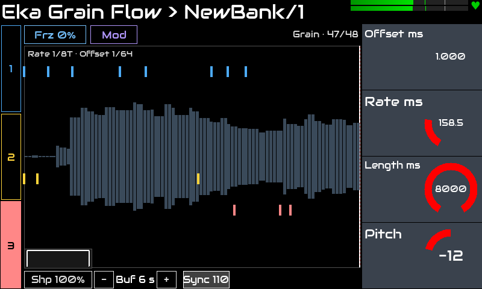
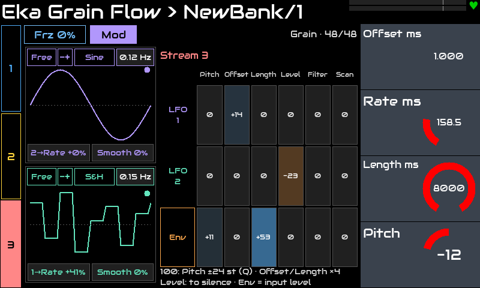

# Eka Grain Flow for Zynthian

**English** · [Русский](README.ru.md)

A **granular effect for live playing** on [Zynthian](https://zynthian.org): an **LV2 effect** and a **widget** for
the touchscreen. The input is written into a buffer all the time; three streams of grains read from it and build a
new sound, from light thickening and doubling to a cloud, a shimmering tail or a frozen pad.

Made for four encoders and a footswitch: four knob pages, three of them set the **selected** stream.

> Tested on: Zynthian **Vangelis** (stable 2610), Raspberry Pi 5, V5 kit, 800x480 touchscreen.
> Other versions and hardware were not tested.

## Features

- **Three streams of grains**, each with its own Offset, Rate, Length, Pitch, Reverse, Filter, Spray, Level, and
  **Fine** (detune in cents), Spread (stereo width) and an **interval set**. Each stream is turned on and off on its own.
- **Spray:** random start time and place of the grains, turning a plain grain delay into a cloud.
- **Intervals:** each grain takes a note of a set at random (octaves, fifth, major, minor, pentatonic…): a scattered
  arpeggio over what you play, with intervals relative to the source pitch.
- **Feedback:** grains are written back into the buffer. With Pitch +12 the copies climb higher and higher: shimmer
  tails and endless clouds; the feedback path includes soft limiting.
- **Tempo sync:** Rate and Offset snap to the nearest note value (1/64 to 4 bars, straight, triplet, dotted) at
  Zynthian's tempo, and grains start right on the grid.
- **Live input:** a stereo buffer of up to 8 seconds; the dry signal goes out **with no delay**.
- **Freeze:** continuous 0–100% retention plus a separate full-capture button;
  map it to a footswitch. Grains and modulation keep running.
  A transition of about 20 ms lets grains near the write head fade out smoothly.
- **Smooth control:** envelope and placement are captured at grain birth; Q modes also hold pitch. Continuous Pitch modulation follows sounding grains in the other modes.
- **Pitch up without glitches:** a grain that reads faster than the input comes in starts far enough behind the
  write head never to catch it; the shortest Offset is shown in the widget.
- **Modulation:** two LFOs (sine, triangle, Drift = smooth random, S&H) and **Env**, the input level. Each moves
  Pitch, Offset, Length, Level, Filter and Scan of any stream by its own depth: wow, a breathing cloud, a cloud that rises when
  you stop playing, grains that fly up on a hard attack.
- **Scan:** independent source cursors move forward or backward, including under Freeze,
  while Pitch still controls each grain’s pitch.
- **Light:** a shared pool of 48 grains; user-reported Pi 5 load is 5–6% CPU in a working setup; this is not a worst-case benchmark.
- **Shape:** a continuous grain envelope with its own thumbnail; **Spread** widens mono input too.
- **LFO:** Free/Sync, bipolar/positive output, Smooth and cross-rate modulation. **Env:** Attack, Release, Sensitivity.
- **25 factory presets** by role: thicken, double, octaves, shimmer, radio, reverb, cloud, reverse echo, wow,
  stutter, rhythmic pulse, arpeggio, chords, afterglow, sparks, a pad for Freeze.
- **Widget:** the input level of the last seconds, live grains in three colours, vertical stream buttons on the left, a Freeze button.

## Screenshots

| | |
|---|---|
|  |  |
| **Buffer:** input level history, grains, stream selection, Freeze and Shape | **Mod:** two LFOs, the 3 × 6 matrix and access to Env controls |

## Installation

On Zynthian (SSH as root):

```bash
git clone https://github.com/dmtry3/zynthian-eka.git
cd zynthian-eka/plugins/grainflow
sudo make install
systemctl restart zynthian
```

Update in one line:

```bash
cd /root/zynthian-eka && git pull && sudo make install-grainflow && systemctl restart zynthian
```

| Link or folder | What |
|---|---|
| `/usr/local/lib/lv2/eka-grainflow.lv2` | the plugin (`build/eka-grainflow.lv2`) |
| `zyngui/widgets_user/zynthian_widget_eka_grain_flow.py` | the widget (`ui/`) |
| `zynthian-my-data/presets/lv2/Eka_Grain_Flow.presets.lv2` | a folder for your presets |

It also refreshes Zynthian's preset list. Zynthian's own files are not changed. Remove: `sudo make uninstall`.

Add **Eka Grain Flow** to a chain as an audio effect, after a synth or an audio input. If it is not in the list,
enable it in webconf: Software → LV2 Plugins.

## Controls

Four pages of 4 knobs: Main → Grain → Flow → Out.
Init uses Pitch **+12, 0, −12**, with only stream 2 enabled. New plugin defaults retain stream 1 enabled.

| Page | Knob 1 | Knob 2 | Knob 3 | Knob 4 |
|---|---|---|---|---|
| **Main** | Stream (1 / 2 / 3) | Mix % | Feedback % | Freeze |
| **Grain** (selected stream) | Offset ms | Rate ms | Length ms | Pitch |
| **Flow** (selected stream) | Scan % | Fine cents | Intervals | Spread % |
| **Out** (selected stream) | Reverse % | Filter | Spray % | Level dB |

Each LFO has a `−+` / `+` mode button for bipolar (−1…+1) or positive (0…+1) output. Drag its Rate control up or down to change speed.

- **Stream** — which stream the Grain, Flow and Out pages set. Choose another stream and the knobs move to its values;
  the other streams keep sounding as they are.
- **Offset** — how far behind the recording a grain starts (0–8000 ms): further into the past.
- **Rate** — time between grain starts (5–2000 ms): less is denser.
- **Length** — grain length (10–8000 ms, never longer than Buffer). Long grains make a smooth pad under Freeze.
- **Pitch** — grain pitch, ±24 semitones.
- **Scan** — source cursor speed, −200…+200%; 0 turns it off.
- **Fine** — selected stream detune, −50…+50 cents.
- **Intervals** — random sets (Off, Oct, Oct ±, Fifth, Major, Minor, Sus, Penta, Wide),
  or quantized Pitch: Q Oct, Q Fifth, Q Major, Q Minor, Q Penta.
- **Spread** — stereo width, 0–100%: grain panning plus channel read offsets up to 18 ms. At 100% grains reach the stereo edges, even with Spray off. At 0% no extra widening is applied. Dry signal in the Mix reduces the perceived width.
- **Reverse** — share of grains played backwards.
- **Filter** — off in the middle; to the left it cuts the top (down to 200 Hz), to the right the bottom (up to 5 kHz).
- **Spray** — random scatter of the grains: start time (± Rate) and place (± Length). Takes away the machine feel.
- **Level** — level of the stream.
- **Mix** — dry / processed balance; **Feedback** — how much of the processed sound is written back into the buffer
  (up to 95 %). Disabled during full Freeze; at intermediate Amount it affects the newly recorded signal.

### Widget

| Where | What it does |
|---|---|
| Left-side buttons **1 / 2 / 3** | A tap selects the stream and keeps Grain, Flow or Out open; from Main it opens Grain. A **long press** (over half a second) turns the stream on or off; a stream that is off says "off" |
| **Freeze** | Tap for full capture / return to Amount; slide left / right for Amount |
| Level strip | Level profile, newest at the right. Full Freeze stops it and turns it blue; intermediate Amount shows the recorded level |
| Coloured marks | Sounding grains: across, where they read; up and down, the stream's Pitch |
| Dashed line | Offset of the selected stream; the shaded part nearer the head is the shortest Offset at this Pitch |
| **Shape** | Drag left / right: 0–100%, from soft Hann to a flat middle with short smooth edges. Double tap resets to 0%. The thumbnail shows the envelope |
| **Buffer − / +** | Buffer length, 1–8 s: how much of the past is shown and how far Offset reaches |
| **Sync** | Tempo sync; when on it shows the tempo, and the note values of Rate and Offset show over the buffer |
| **Mod** | The modulation page instead of the buffer (again to go back) |

### Scanning the source

The first knob on **Flow**, **Scan**, controls the selected stream, from −200…+200%.
At 0, the original Offset-following behavior
is restored, preserving older presets. +25% moves the source cursor forward through
0.25 seconds of audio per second; +100% is normal speed, negative values move backward.
Pitch still controls each grain’s read speed, Rate their birth interval, and Reverse
the direction inside each grain. Scan changes their starting positions.

The cursor wraps within the readable Buffer window. Long or high grains are shortened
if necessary to fit. Offset shifts the cursor; Offset modulation and Spray add deviations
around it. Disabling a stream resets its cursor; selecting another tab does not stop it.
Snapshots save speed, and restart the cursor at Offset when loaded.

At +100% on live input the cursor keeps roughly the same distance from the moving
write head. Under full Freeze it traverses the captured phrase. The Offset line remains
the reference setting; existing grain marks show the current reads, with no new animation.
Try **Slow Motion**, play a phrase, then Freeze: stream 1 scans at +25%, stream 2 at −15%.

### Quantized Pitch

The original Intervals modes add a random interval per grain. New **Q** modes
round Pitch plus modulation to a grid relative to the source pitch: **Q Oct**
(octaves), **Q Fifth** (0, 7), **Q Major** (0, 4, 7), **Q Minor** (0, 3, 7),
**Q Penta** (0, 2, 4, 7, 9), repeated in each octave.

In Q modes, full Pitch modulation depth spans ±24 semitones per source, with the
result limited to ±36. Each grain holds its note for its lifetime; Fine is added
after rounding. Original modes keep their ±2-semitone continuous modulation.
Try **Stepped Sky**, or select Q Oct on Flow and assign LFO 1 → Pitch 100 with Drift.

### Freeze amount and button

**Amount 0–100%** and the **Freeze button** are independent:

- 0% records live input; intermediate values retain more of the previous Buffer
  turn as Amount rises, while gradually accepting new input across the whole buffer.
- 100% stops recording entirely. Grains, filters and modulation keep running.
- The button overrides Amount with full Freeze. Releasing it returns to the saved
  Amount: 40% → button on: 100% → button off: 40%.

Slide left / right directly on the button to adjust Amount; tap to toggle full
capture. A slide never toggles capture, even when released outside the button.
There is no separate menu. **Frz NN%** shows the saved Amount; highlighting means
full Freeze. The Main-page button and pedal mapping remain binary and do not
overwrite Amount. You can adjust Amount while the button is on, ready for release.

Intermediate retention uses the previous Buffer turn with a smoothed seam and
fades in silence. At 100%, no new samples are recorded after the short transition
that protects sounding grains. Amount is saved in State; the button is saved in
its existing Freeze port. Captured audio is not saved in snapshots.

### Modulation (Mod button)

Two LFOs for the whole effect. On the left, each one's shape (a tap changes it: Sine, Tri, Drift, S&H), its rate,
0.02–20 Hz (finger up / down; up is faster; double tap = default) and a dot showing its value now.

Below each graph, **LFO 2 → Rate** (LFO 1) or **LFO 1 → Rate** (LFO 2) lets the
other LFO change this one's speed. Drag right / left for −100…+100 depth; double
tap resets to 0. At +100 the rate ranges from 1/8 to ×8 of its base frequency,
bounded to 0.02–20 Hz in Free and up to 128 Hz in Sync; negative depth reverses the movement. Phase stays continuous.
Two Drift shapes at different rates create evolving movement, with the slower
one changing the faster one's speed. Links are saved in snapshots and default to
off in older presets.

On the right, the depth grid of the **selected** stream: rows LFO 1, LFO 2 and **Env**, columns Pitch, Offset, Length,
Level, Filter and Scan. A cell is −100…+100: finger up / down (up increases), double tap = 0. At 100: Pitch ±2 semitones (sounding grains follow
too), Offset and Length 4 times longer or shorter (taken when a grain starts), Level down to silence at the LFO's
bottom (at −100, at its top). Choose another stream with its tab and the grid shows its depths.

**Env** is the input level (0 at −48 dB and below, 1 at −6 dB). It goes one way: with a positive depth Pitch, Offset
and Length rise the louder you play. On Level, +100 opens the stream only while you play; −100 ducks it while you
play, so the cloud rises in the pauses.

At the top right, in a small font: the knob page name and how many of the 48 grains sound.

**Env controls:** tap the Env row label on the Mod page to open Attack (0–1000 ms), Release (10–5000 ms), and Sensitivity (−24…+24 dB). Drag vertically; double tap resets to 0 ms / 300 ms / 0 dB. The LFO button returns to the oscillator panels. These global settings are saved in State. Sensitivity affects modulation only. Attack and Release are smoothing time constants (about 63% response after one time constant).

Each LFO has Smooth (0–100%) below its graph. Drag horizontally; double tap resets to 0%. Maximum smoothing uses a time constant of half the current LFO period. It softens S&H and Drift and also filters Sine/Tri, preserving phase and polarity. Saved in State; factory presets default to zero.

LFO tempo sync: tap Free/Sync in each LFO header. Sync replaces Hz with a note length (1/64 through 4 bars, including triplets and dotted notes); drag up for shorter/faster, down for longer/slower. Double tap resets to 1/4. Free Hz and note lengths are stored separately. Tempo changes preserve phase; this follows tempo without resetting at transport/bar boundaries. Grain Sync is independent. Cross-rate modulation remains active (Sync frequency limit: 128 Hz).

Modulation now includes Filter and Scan columns. Filter adds up to the full selected filter range, with 10 ms smoothing; the knob selects low-pass (≤0) or high-pass (>0), and modulation retains that type. Scan depth 100% adds ±200 percentage points to velocity, capped at −200…+200%. A Scan route enables scanning even with the base knob at zero; zero velocity holds position rather than resetting the cursor.

### Footswitch

Map Freeze with Zynthian's MIDI learn: select Freeze on the Main page, start learn, press the footswitch.
A latching switch works as Latch; a momentary button as Momentary (frozen while held).

## Presets

| Preset | What it does |
|---|---|
| Init | Stream 2 on at Pitch 0; streams 1 and 3 off at Pitch +12 and −12 |
| Tidal Memory | Opposing source scans and slow filter drift; try freezing a phrase |
| Breathing Light | Input dynamics open the filters, making louder playing brighter |
| Velvet Drift | Wide cloud with smoothed S&H, slow Drift and gentle Env ducking |
| Clockwork Glass | Pentatonic and octave steps with tempo-synced LFOs (1/8 and one bar) and grain Sync |
| Stepped Sky | Pitch modulation becomes octave and fifth steps |
| Slow Motion | Two source cursors move in opposite directions; Freeze to explore a captured phrase |
| Living Cloud | Three wide layers; a slow Drift changes the other LFO's speed for evolving movement |
| Thicken | Short, slightly detuned grains: denser, wider drums and plucks |
| Doubler | Two detuned copies left and right, close to a chorus |
| Octave Up | An octave up |
| Sub Octave | An octave down, dark |
| Shimmer | An octave up with Feedback: each copy climbs higher, a shimmering tail |
| Radio | Tiny broken grains through a low cut |
| Wash | Long dark grains, some backwards: close to a reverb |
| Cloud | A cloud from the far past, slowly breathing (LFOs on Offset and Length) |
| Reverse Echo | Every 400 ms plays backwards |
| Wow | The pitch wanders like old tape (LFOs on Pitch), processed sound only |
| Stutter | Rhythmic stutters on the beat (Sync) |
| Arp Rain | Grains take notes of a pentatonic scale and a fifth: a scattered arpeggio |
| Chord Cloud | One note becomes a cloud of a major chord |
| Pulse | Rhythmic grains on the beat (Sync: 1/16 and 1/8 at Zynthian's tempo) |
| Afterglow | The cloud rises when you stop playing (Env ducks it while you play) |
| Sparks | The harder the attack, the higher and shorter the sparks (Env on Pitch and Length) |
| Freeze Pad | Play a chord and press Freeze |

Your own presets and Zynthian snapshots keep all three streams, Fine, Spread, intervals, which streams are on, Sync and the modulation included.

## Building without Zynthian

On Linux or WSL: `sudo apt install lv2-dev`, then `make` and `make test`. The tests check grain pitch (within
5 cents), Offset, Freeze, the LFOs, random parameters and modulation at their edges, stream selection in the plugin and the widget logic,
and render every preset to `build_test/presets/*.wav` to listen to.

## License

GPL-3.0-or-later, see [LICENSE](LICENSE). Ideas after Autochroma (imagiro); code, interface and presets are our own. Changes: [CHANGELOG.md](CHANGELOG.md).
