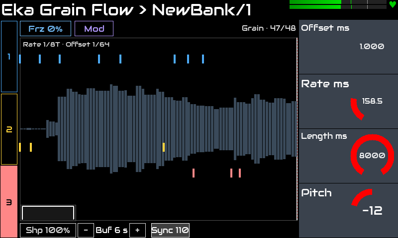
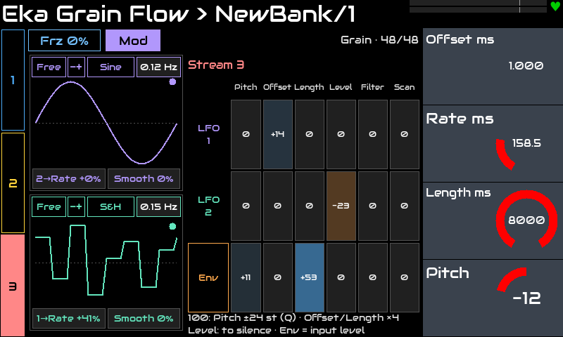

# Eka Grain Flow для Zynthian

[English](README.md) · **Русский**

**Гранулярный эффект для живой игры** на [Zynthian](https://zynthian.org): **LV2-эффект** и **виджет** для
тачскрина. Вход непрерывно пишется в буфер, три потока зёрен читают из него и собирают новый звук: от лёгкого
утолщения и удвоения до облака, мерцающего хвоста и замороженного пэда.

Управление сделано под четыре энкодера и педаль: четыре страницы ручек, три из них настраивают **выбранный** поток.

> Проверено на: Zynthian **Vangelis** (stable 2610), Raspberry Pi 5, набор V5, тачскрин 800x480.
> Другие версии и железо не проверялись.

## Возможности

- **Три потока зёрен**, у каждого свои Offset, Rate, Length, Pitch, Reverse, Filter, Spray, Level, а также
  **Fine** (расстройка в центах), Spread (стереоширина) и **набор интервалов**. Потоки включаются и выключаются
  независимо.
- **Spray:** случайный разброс момента и места старта зёрен — из ровной «зернистой задержки» получается облако.
- **Интервалы:** каждое зерно случайно берёт ноту из набора (октавы, квинта, мажор, минор, пентатоника…) —
  рассыпанное арпеджио поверх того, что вы играете, с интервалами относительно исходного звука.
- **Feedback:** зёрна записываются обратно в буфер. С Pitch +12 копии уходят всё выше: shimmer-хвосты и
  бесконечные облака; в петле есть мягкий ограничитель.
- **Синхронизация с темпом:** Rate и Offset встают на ближайшую длительность (от 1/64 до 4 тактов, ровные,
  триоли, с точкой) при темпе Zynthian, зёрна рождаются ровно на долях.
- **Живой вход:** стерео-буфер до 8 секунд, сухой сигнал идёт на выход **без задержки**.
- **Freeze:** степень удержания 0–100 % и отдельная кнопка полного захвата;
  назначается на педаль. Зёрна и модуляция продолжают работать.
  Переход занимает около 20 мс, чтобы зёрна у головки записи успели плавно затихнуть.
- **Scan:** свой курсор источника у каждого потока. Проходит фразу вперёд или назад,
  в том числе под Freeze; высоту зёрен по-прежнему задаёт Pitch.
- **Плавное управление:** огибающая и расположение фиксируются при рождении зерна; в Q-режимах фиксируется и высота. В обычных режимах Pitch-модуляция действует на звучащие зёрна.
- **Питч вверх без артефактов:** зерно, которое читает быстрее, чем пишется вход, начинается достаточно далеко
  позади записи, чтобы не догнать её; минимальный Offset виден на виджете.
- **Модуляция:** два LFO (синус, треугольник, Drift — плавный случайный, S&H) и **Env** — громкость входа.
  Каждый двигает Pitch, Offset, Length, Level, Filter и Scan любого потока на свою глубину: wow, дыхание облака, облако, которое
  поднимается, когда вы перестаёте играть, или зёрна, которые взлетают от сильной атаки.
- **Лёгкий:** общий пул на 48 зёрен; по пользовательскому замеру на Pi 5 — 5–6 % CPU в рабочем сетапе; это не замер худшего случая.
- **Shape:** плавная форма огибающей с отдельной миниатюрой; **Spread** расширяет даже моносигнал.
- **LFO:** Free/Sync, полярность −+ / +, Smooth и взаимная модуляция скорости. **Env:** Attack, Release, Sensitivity.
- **25 заводских пресетов** по ролям: утолщение, удвоение, октавы, shimmer, радио, реверб, облако, реверс-эхо,
  wow, заикание, ритмичный пульс, арпеджио, аккорды, «послесвечение», искры, пэд для Freeze.
- **Виджет:** уровень входа за последние секунды, живые зёрна трёх цветов, вертикальные кнопки потоков слева, кнопка Freeze.

## Скриншоты

| | |
|---|---|
|  |  |
| **Буфер:** входной сигнал, зёрна, выбор потока, Freeze и Shape | **Mod:** два LFO, матрица 3 × 6 и доступ к настройкам Env |

## Установка

На Zynthian (SSH под root):

```bash
git clone https://github.com/dmtry3/zynthian-eka.git
cd zynthian-eka/plugins/grainflow
sudo make install
systemctl restart zynthian
```

Обновление одной строкой:

```bash
cd /root/zynthian-eka && git pull && sudo make install-grainflow && systemctl restart zynthian
```

| Ссылка или папка | Что |
|---|---|
| `/usr/local/lib/lv2/eka-grainflow.lv2` | плагин (`build/eka-grainflow.lv2`) |
| `zyngui/widgets_user/zynthian_widget_eka_grain_flow.py` | виджет (`ui/`) |
| `zynthian-my-data/presets/lv2/Eka_Grain_Flow.presets.lv2` | папка для своих пресетов |

Ещё он обновляет список пресетов Zynthian. Файлы самого Zynthian не меняются. Удаление: `sudo make uninstall`.

Добавьте **Eka Grain Flow** в цепочку как аудио-эффект: после синта или после аудио-входа. Если его нет в списке,
включите его в webconf: Software → LV2 Plugins.

## Управление

Четыре страницы по 4 ручки: Main → Grain → Flow → Out.
В Init Pitch потоков: **+12, 0, −12**; включён только поток 2.

| Страница | Ручка 1 | Ручка 2 | Ручка 3 | Ручка 4 |
|---|---|---|---|---|
| **Main** | Stream (1 / 2 / 3) | Mix % | Feedback % | Freeze |
| **Grain** (выбранный поток) | Offset ms | Rate ms | Length ms | Pitch |
| **Flow** (выбранный поток) | Scan % | Fine cents | Intervals | Spread % |
| **Out** (выбранный поток) | Reverse % | Filter | Spray % | Level dB |

- **Stream** — какой поток настраивают страницы Grain, Flow и Out. Сменили поток, и ручки встают на его значения;
  остальные потоки звучат дальше со своими настройками.
- **Offset** — насколько позади записи начинается зерно (0–8000 мс). Чем больше, тем дальше в прошлое.
- **Rate** — интервал между запусками зёрен (5–2000 мс). Меньше — плотнее.
- **Length** — длина зерна (10–8000 мс, но не длиннее Buffer). Длинные зёрна дают ровный пэд при Freeze.
- **Pitch** — высота зёрен, ±24 полутона.
- **Scan** — скорость курсора источника, −200…+200 %, 0 — выключен.
- **Fine** — расстройка выбранного потока, −50…+50 центов.
- **Intervals** — случайные интервалы (Off, Oct, Oct ±, Fifth, Major, Minor, Sus, Penta, Wide)
  или привязка высоты: Q Oct, Q Fifth, Q Major, Q Minor, Q Penta.
- **Spread** — ширина потока, 0–100 %: разброс зёрен по панораме и небольшое различие позиций чтения каналов (до 18 мс). На 100 % зёрна уходят к краям стереополя, ширина слышна и без Spray. На 0 % дополнительного расширения нет. Mix с сухим сигналом уменьшает воспринимаемую ширину.
- **Reverse** — доля зёрен, которые играют задом наперёд.
- **Filter** — в центре выключен; влево срезает верх (до 200 Гц), вправо срезает низ (до 5 кГц).
- **Spray** — случайный разброс зёрен: момент старта (± Rate) и место (± Length). Убирает «механичность».
- **Level** — громкость потока.
- **Mix** — баланс сухого и обработанного звука; **Feedback** — сколько обработанного звука записывается обратно
  в буфер (до 95 %). При полном Freeze не работает: буфер не пишется.
  При промежуточном Amount действует на вновь записываемую часть сигнала.

### Виджет

| Где | Что делает |
|---|---|
| Кнопки **1 / 2 / 3** слева | Касание выбирает поток; открытая Grain, Flow или Out сохраняется, с Main открывается Grain. **Долгое нажатие** (больше полсекунды) включает или выключает поток; выключенный подписан «off» |
| **Freeze** | Касание — полный захват / возврат к Amount; слайд влево / вправо — Amount |
| Полоса уровня | Профиль уровня, новое справа. При полном Freeze останавливается и синеет; при промежуточном Amount показывает уровень записи |
| Цветные метки | Звучащие зёрна: по горизонтали — откуда читают, по вертикали — Pitch потока |
| Пунктир | Offset выбранного потока; затенённая часть ближе к записи — минимальный Offset при текущем Pitch |
| **Shape** | Слайд влево / вправо: 0–100 %, от мягкого Hann до плоской середины с короткими плавными краями. Двойное касание — 0 %. Миниатюра показывает огибающую |
| **Buffer − / +** | Длина буфера, 1–8 с: сколько прошлого видно и докуда достаёт Offset |
| **Sync** | Синхронизация с темпом; включённая показывает темп. Над буфером тогда видны длительности Rate и Offset |
| **Mod** | Страница модуляции вместо буфера (ещё раз — обратно) |

### Scan: движение по источнику

Первая ручка страницы **Flow**, **Scan**, управляет выбранным потоком.
Диапазон −200…+200 %; значение 0 выключает Scan.

- **Off (0)** — прежнее поведение: новые зёрна берутся на заданном Offset позади
  головки записи. Старые пресеты по умолчанию работают именно так.
- **+25 %** — место старта зёрен проходит вперёд четверть секунды исходного звука
  за секунду игры. **+100 %** — обычная скорость, **−25 %** — медленно назад.
- **Pitch** задаёт высоту каждого зерна, **Rate** — интервал появления зёрен.
  Скорость Scan не меняет эти параметры. Reverse по-прежнему разворачивает
  отдельные зёрна; отрицательный Scan меняет порядок их мест старта.

При достижении края курсор возвращается к другому краю доступной области Buffer.
Длинные и высокие зёрна при необходимости сокращаются, чтобы поместиться в неё.
Offset передвигает курсор, а модуляция Offset и Spray добавляют отклонения вокруг
него. При выключении потока курсор сбрасывается; выбор другой вкладки его не
останавливает. В снапшот сохраняется скорость, а не текущая фаза движения.

На живом входе головка продолжает писать, поэтому +100 % сохраняет примерно
постоянное расстояние до неё. На полном Freeze головка стоит, и Scan проходит
захваченную фразу. Пунктир Offset остаётся опорной настройкой; текущее положение
чтения видно по существующим меткам зёрен, новой анимации нет.

Для пробы: загрузите **Slow Motion**, поиграйте несколько секунд, нажмите Freeze.
У первого потока Scan +25 %, у второго −15 %: они проходят захват навстречу друг
другу, сохраняя свои значения Pitch. Меняйте ручку Scan на странице Flow и сравните с 0 (Off).

### Intervals: случайные интервалы и привязка Pitch

На Flow прежние режимы **Oct, Fifth, Major…** добавляют случайный интервал каждому
зерну. Новые режимы с префиксом **Q** округляют **Pitch вместе с модуляцией**:

| Режим | Разрешённые ступени в каждой октаве |
|---|---|
| Q Oct | Только октавы |
| Q Fifth | 0, 7 — основная нота и квинта |
| Q Major | 0, 4, 7 — мажорное трезвучие |
| Q Minor | 0, 3, 7 — минорное трезвучие |
| Q Penta | 0, 2, 4, 7, 9 — мажорная пентатоника |

Сетка относится к исходной высоте звука. В Q-режиме глубина Pitch 100 в матрице
даёт ±24 полутона на источник, а итог ограничен ±36 полутонами. Высота выбирается
при рождении зерна и не меняется до его конца: плавный LFO даёт последовательность
устойчивых нот. Fine добавляется после округления, сохраняя тонкую расстройку.
В прежних режимах модуляция остаётся ±2 полутона и продолжает действовать на
звучащие зёрна, как раньше.

Для пробы загрузите **Stepped Sky**. Или выберите Q Oct на Flow, затем на Mod
задайте LFO 1 → Pitch 100 и форму Drift: высота начнёт переходить по октавам.

### Freeze: регулятор и кнопка

У Freeze есть **Amount 0–100 %** и отдельная **кнопка полного захвата**.

- **Amount 0 %** — обычная запись нового входа, без удержания.
- **Между 0 и 100 %** — часть старого звука остаётся, часть постепенно заменяется
  новым. Чем выше Amount, тем дольше сохраняется захваченный звук. Обновление
  относится ко всему Buffer; выбора участка Start / End больше нет.
- **Amount 100 %** — запись полностью останавливается; зёрна, фильтры и модуляция
  продолжают работать с захваченным звуком.
- **Кнопка Freeze** включает полный захват независимо от Amount. Выключение кнопки
  возвращает Amount. Например: Amount 40 → кнопка включена: 100 → выключена: 40.

Слайд влево / вправо прямо по кнопке меняет Amount. Короткое касание переключает
полный захват. После слайда захват не переключается, даже если палец отпущен за
пределами кнопки. Отдельного меню нет. Надпись **Frz NN%** показывает сохранённый
Amount; подсветка означает полный Freeze. Кнопка на Main и MIDI-learn сохранены:
педаль управляет полным захватом, не меняя Amount. Пока кнопка включена, слайдом
можно подготовить Amount для последующего отпускания.

Промежуточное удержание использует прошлый оборот Buffer со сглаженным стыком;
в тишине оно постепенно затухает. При 100 % новых данных больше не записывается
после короткого перехода против щелчков. Для пробы: Amount 70, поиграйте,
нажмите Freeze для полного захвата, затем отпустите — звук снова начнёт обновляться.
Amount сохраняется в State, состояние кнопки — как прежде в порту Freeze.
Аудиоданные буфера в снапшот не входят.

### Настройка Env

На странице Mod коснитесь надписи **Env** слева от третьей строки матрицы. Слева откроется панель:

- **Attack**: 0–1000 мс, скорость нарастания реакции (0 — сразу).
- **Release**: 10–5000 мс, длительность затухания реакции.
- **Sensitivity**: −24…+24 dB, чувствительность к уровню входа; положительное значение помогает тихому источнику.

Регулировка — движением вверх / вниз; двойное касание возвращает 0 мс, 300 мс и 0 dB соответственно.
Кнопка **LFO** возвращает панели генераторов. Матрица справа остаётся доступна. Sensitivity влияет только на
модуляцию и не меняет громкость аудио. Все три настройки общие для потоков и сохраняются в State.
Attack и Release — постоянные времени сглаживания: за указанное время реакция проходит около 63 % изменения.

### Модуляция (кнопка Mod)

Два LFO на весь эффект. Кнопка **−+ / +** задаёт диапазон источника: биполярный −1…+1 или положительный 0…+1. Слева у каждого форма (касание меняет: Sine, Tri, Drift, S&H), частота 0,02–20 Гц
(палец вверх / вниз, вверх — быстрее; двойное касание — по умолчанию) и точка, которая показывает его значение сейчас.

Под графиком — **Smooth 0–100 %**: вправо — плавнее, влево — резче; двойное касание — 0 %. На максимуме постоянная времени сглаживания равна половине текущего периода LFO. Особенно слышно на S&H и Drift; на Sine/Tri также сглаживает сигнал. Полярность и фаза сохраняются.

Кнопка **Free / Sync** в заголовке каждого LFO переключает свободную частоту и длительность цикла от темпа хоста. В Sync поле частоты показывает ноту (от 1/64 до 4 тактов, включая триоли и пунктир); движение вверх выбирает более короткий цикл, вниз — длинный, двойное касание возвращает 1/4. Свободная частота сохраняется отдельно. Смена темпа и режима не сбрасывает фазу; это синхронизация скорости, без принудительного запуска от границы такта. Общий Sync для зёрен независим от Sync LFO.

Рядом — **LFO 2 → Rate** у первого LFO и **LFO 1 → Rate** у второго:
другой LFO меняет скорость этого. Палец вправо / влево меняет глубину −100…+100,
двойное касание сбрасывает связь в 0. При +100 скорость меняется от 1/8 до ×8
от заданной частоты (в пределах 0,02–20 Гц в Free и до 128 Гц в Sync); отрицательная глубина переворачивает
движение. Фаза не сбрасывается. Два Drift с разными частотами дают непериодическое
развитие: медленный меняет скорость более быстрого. Связи сохраняются в снапшоте;
в старых пресетах они выключены.

Справа — сетка глубин для **выбранного** потока: строки LFO 1, LFO 2 и **Env**, столбцы Pitch, Offset, Length, Level, Filter и Scan.
Ячейка −100…+100: палец вверх / вниз (вверх — больше), двойное касание — 0. При 100: Pitch ±2 полутона (высота меняется и у уже
звучащих зёрен), Offset и Length в 4 раза больше или меньше (берутся при рождении зерна), Level до тишины
в нижней точке LFO (при −100 — в верхней). Смените поток вкладкой, и сетка покажет его глубины.

**Env** — громкость входа (0 при −48 дБ и тише, 1 при −6 дБ). Работает в одну сторону: при положительной глубине
Pitch, Offset и Length растут, чем громче вы играете. На Level +100 открывает поток только когда вы играете,
−100, наоборот, приглушает его, пока вы играете, и облако поднимается в паузах.

Справа вверху мелким шрифтом — имя страницы ручек и сколько зёрен звучит из 48.

Модуляция **Filter** прибавляется к ручке фильтра (100 % = весь диапазон его стороны). При Filter ≤ 0 работает ФНЧ, при Filter > 0 — ФВЧ; модуляция не переключает тип. Переходы сглажены на 10 мс. **Scan** при глубине 100 % меняет скорость на ±200 процентных пунктов, итог ограничен −200…+200 %. Назначение модуляции включает курсор даже при Scan 0; нулевая скорость удерживает текущую позицию, отрицательная разворачивает движение.

### Педаль

Freeze назначается через MIDI-learn Zynthian: на странице Main выберите Freeze, включите learn и нажмите педаль.
Переключатель с фиксацией работает как Latch, кнопка без фиксации — как Momentary (Freeze, пока нажата).

## Пресеты

| Пресет | Что делает |
|---|---|
| Init | Поток 2 включён, Pitch 0; потоки 1 и 3 выключены, Pitch +12 и −12 |
| Tidal Memory | Два слоя движутся по буферу в противоположных направлениях; медленный Drift меняет фильтры. Попробуйте после Freeze |
| Breathing Light | Env открывает фильтры от динамики входа; более сильная игра делает облако ярче |
| Velvet Drift | Широкое плавное облако: сглаженный S&H и медленный Drift, Env слегка освобождает место атаке входа |
| Clockwork Glass | Пентатонические и октавные ступени с LFO Sync: 1/8 и один такт, при Grain Sync |
| Stepped Sky | Модуляция Pitch превращается в октавные и квинтовые ступени |
| Slow Motion | Два курсора проходят источник в разные стороны; после Freeze исследуют захваченную фразу |
| Living Cloud | Три широких слоя; медленный Drift меняет скорость другого, облако развивается неравномерно |
| Thicken | Короткие слегка расстроенные зёрна: плотнее и шире барабаны и щипковые |
| Doubler | Две расстроенные копии по сторонам, похоже на хорус |
| Octave Up | Октава вверх |
| Sub Octave | Октава вниз, тёмная |
| Shimmer | Октава вверх с Feedback: каждая копия уходит ещё выше, мерцающий хвост |
| Radio | Мелкие рваные зёрна через срез низов |
| Wash | Длинные тёмные зёрна, часть задом наперёд: похоже на реверб |
| Cloud | Облако из далёкого прошлого, медленно дышит (LFO на Offset и Length) |
| Reverse Echo | Каждые 400 мс звучат задом наперёд |
| Wow | Высота плавает, как на старой плёнке (LFO на Pitch), только обработанный звук |
| Stutter | Ритмичные заикания в доли (Sync) |
| Arp Rain | Зёрна берут ноты пентатоники и квинты: рассыпанное арпеджио |
| Chord Cloud | Из одной ноты — облако мажорного аккорда |
| Pulse | Ритмичные зёрна в доли (Sync: 1/16 и 1/8 при темпе Zynthian) |
| Afterglow | Облако поднимается, когда вы перестаёте играть (Env приглушает его во время игры) |
| Sparks | Чем сильнее атака, тем выше и короче искры (Env на Pitch и Length) |
| Freeze Pad | Сыграйте аккорд и нажмите Freeze |

Свои пресеты и снапшоты Zynthian хранят все три потока, включая Fine, Spread, интервалы, включённые потоки, Sync и модуляцию.

## Сборка без Zynthian

На Linux или WSL: `sudo apt install lv2-dev`, затем `make` и `make test`. Тесты проверяют высоту зёрен (до 5 центов),
Offset, Freeze, LFO, случайные параметры и модуляцию на границах, выбор потока в плагине и логику виджета, а каждый пресет
рендерят в `build_test/presets/*.wav`, чтобы послушать.

## Лицензия

GPL-3.0-or-later, см. [LICENSE](LICENSE). Идеи — по мотивам Autochroma (imagiro); код, интерфейс и пресеты свои. Изменения: [CHANGELOG.md](CHANGELOG.md).
