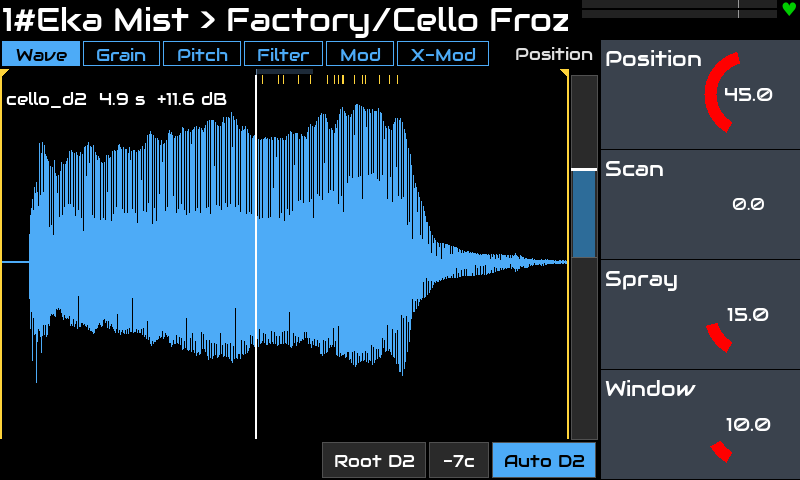
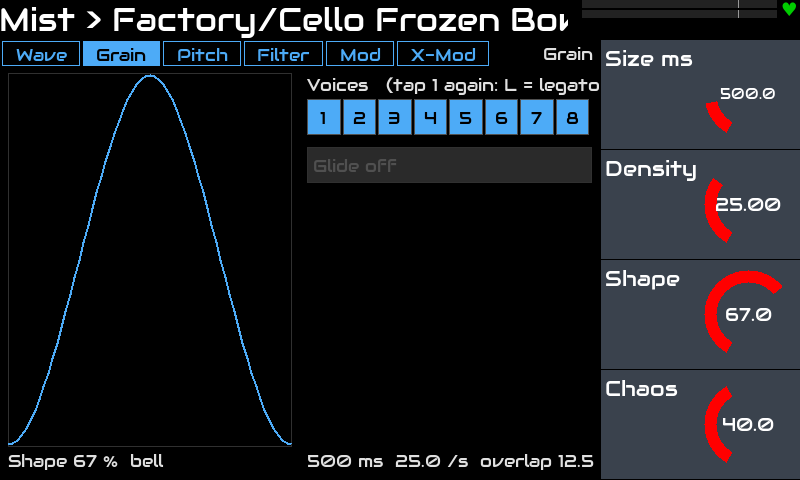
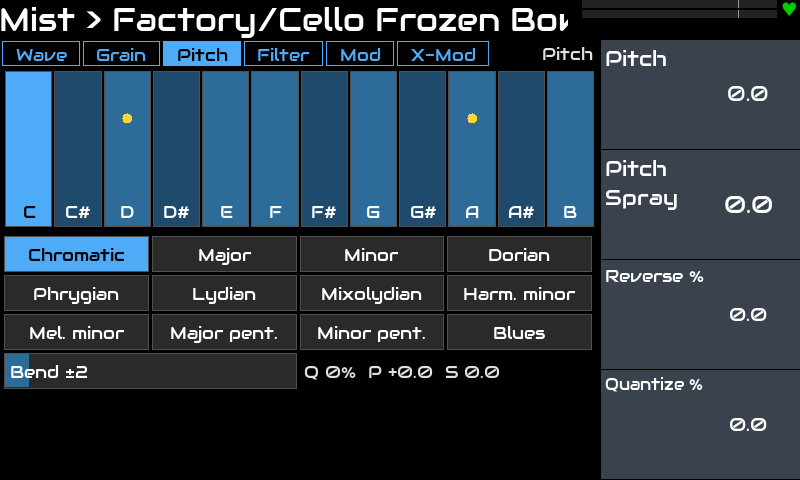
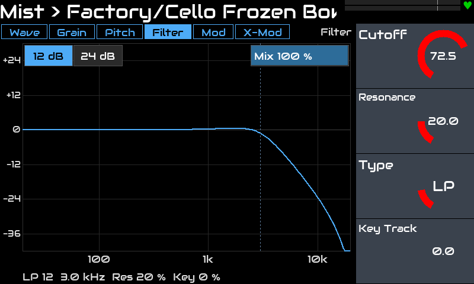
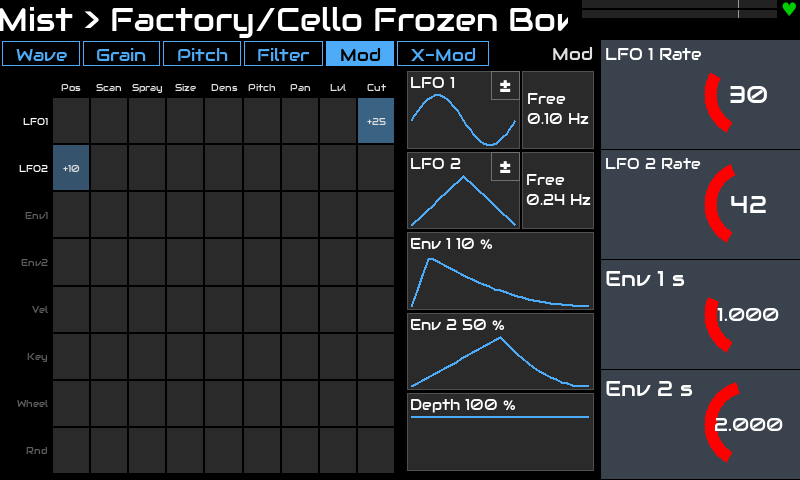
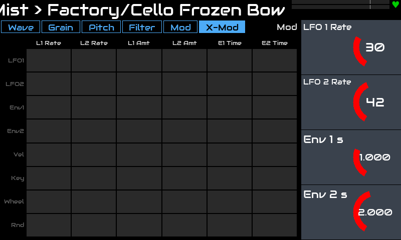

# Eka Mist for Zynthian

**English** · [Русский](README.ru.md)

A polyphonic **granular sampler** for [Zynthian](https://zynthian.org), as an **LV2 instrument plugin**, with an
**on-screen widget** for the Zynthian touch UI: the waveform with the live grains, the grain window, the scale,
the filter curve and two modulation grids.

Every note starts its own cloud of grains with its own read position. The grains come from one shared pool, so the
CPU load stays bounded however you play.

> Tested on: Zynthian **Vangelis** (stable 2610), Raspberry Pi 5, V5 kit, 800x480 touch screen.
> Other versions/hardware are untested.

## Features

- **Grain engine:** 8 voices (Poly or Mono with Glide), a shared pool of 128 grains. Position, length, pitch, pan,
  direction and level are fixed when a grain is born, so turning a knob never clicks.
- **Position:** Position, **Scan** (speed through the sample, backwards too; 0 = freeze), Spray, Window; start and
  end markers on the waveform.
- **Grain:** Size, **Density**, Shape (window), **Chaos** (from even to random timing).
- **Pitch:** Pitch, Pitch Spray, Reverse (chance), **Quantize** to a scale (12 scales, any tonic); pitch bend up to
  ±24 semitones that also bends the grains already sounding.
- **Voice:** Attack, Release, Stereo Spread, Level.
- **Filter per voice:** LP, HP, BP (12 or 24 dB/oct), Notch, Comb, Vowel (with Lows and Highs), Mix, Key Track.
- **Modulation:** LFO 1 and 2 (shapes, tempo sync, ± or + polarity), Env 1 and Env 2, Velocity, Key, Mod Wheel and
  Random into Position, Scan, Spray, Size, Density, Pitch, Pan, Level and Cutoff (an 8 x 9 grid), plus **X-Mod**:
  the same sources onto the LFO rates and amounts and the envelope times (8 x 6). LFOs and envelopes are per voice.
- **MIDI:** notes, Mod Wheel (CC 1), sustain pedal (CC 64), pitch bend.
- **8 sample files** (CC0 / CC BY, see [samples/CREDITS.md](samples/CREDITS.md)) and **18 factory presets**;
  your own samples go to a folder of their own.
- **Touch widget** with six tabs (Wave, Grain, Pitch, Filter, Mod, X-Mod); the tab follows the knob page.

## Screenshots

| | |
|---|---|
|  |  |
| **Wave:** the sample, the Window, the read point and the live grains (marks at the top) | **Grain:** window shape, density, voices |
|  |  |
| **Pitch:** the scale for Quantize and the notes sounding now | **Filter:** the response with Mix |
|  |  |
| **Mod:** the 8 x 9 grid, LFO and envelope shapes | **X-Mod:** modulation of the modulators |

## Installation

On the Zynthian (SSH as root):

```bash
git clone https://github.com/dmtry3/zynthian-eka.git
cd zynthian-eka/plugins/mist
sudo make install
systemctl restart zynthian
```

Update later with one line:

```bash
cd /root/zynthian-eka && git pull && cd plugins/mist && sudo make install && systemctl restart zynthian
```

`make install` builds on the device (gcc, `lv2-dev`, `libsndfile`; all on Zynthian) and creates:

| Link or folder | What |
|---|---|
| `/usr/local/lib/lv2/eka-mist.lv2` | the plugin (`build/eka-mist.lv2`) |
| `zyngui/widgets_user/zynthian_widget_eka_mist.py` | the widget (`ui/`) |
| `zynthian-my-data/files/Samples/eka-mist` | the factory samples (`samples/`) |
| `zynthian-my-data/files/Samples/eka-mist-user` | an empty folder for your own samples |
| `zynthian-my-data/presets/lv2/Eka_Mist.presets.lv2` | the folder for your own presets |

It also refreshes Zynthian's preset list. Nothing in Zynthian's own files is changed. To remove:
`sudo make uninstall`.

Add **Eka Mist** to a chain as a synth (Instrument). Choose the sample on the Wave tab (tap its name).

## Controls

Six pages of 4 knobs: what you change while playing. Everything else lives on the widget.

| Page | Knob 1 | Knob 2 | Knob 3 | Knob 4 |
|---|---|---|---|---|
| **Position** | Position | Scan | Spray | Window |
| **Grain** | Size | Density | Shape | Chaos |
| **Pitch** | Pitch | Pitch Spray | Reverse | Quantize |
| **Voice** | Attack | Release | Stereo Spread | Level |
| **Filter** | Cutoff | Resonance | Type | Key Track |
| **Mod** | LFO 1 Rate | LFO 2 Rate | Env 1 Time | Env 2 Time |

| Tab | Set only here |
|---|---|
| **Wave** | the sample file, start and end markers, the root note (or Auto), the sample gain (double tap: normalize to −1 dBFS) |
| **Grain** | Poly / Mono, the number of voices, Glide |
| **Pitch** | scale and tonic for Quantize, pitch bend range |
| **Filter** | Mix, 12 or 24 dB/oct, Lows and Highs for Vowel |
| **Mod** | grid cells (a finger up / down, double tap = 0), LFO shape, sync and polarity, envelope shapes, Mod Depth |
| **X-Mod** | the cross-modulation grid |

## Building and testing (any Linux)

```bash
make            # build/eka-mist.lv2
make test       # the engine offline and the widget with stub Zynthian modules
```

The presets are generated: edit `scripts/gen_presets.py`, then run it. `scripts/bench.sh` measures the CPU load
(only numbers from a Pi 5 count).

## How it works

- `src/grain_core.c`: the engine in plain C without LV2 (tested as a normal program); windows from tables, linear
  interpolation, modulation and filter coefficients every 32 samples, nothing allocated in the audio thread.
- The sample is loaded in the background (LV2 Worker, `libsndfile`); its path is saved in the snapshot.
- The widget's settings and the grids are LV2 parameters (`patch:writable`), saved in presets and snapshots;
  the grain positions come from output ports.

## License

GPL-3.0-or-later, see [LICENSE](LICENSE). The sample files have their own licenses:
[samples/CREDITS.md](samples/CREDITS.md).
