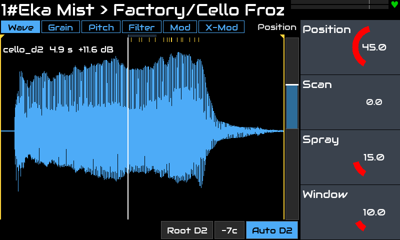
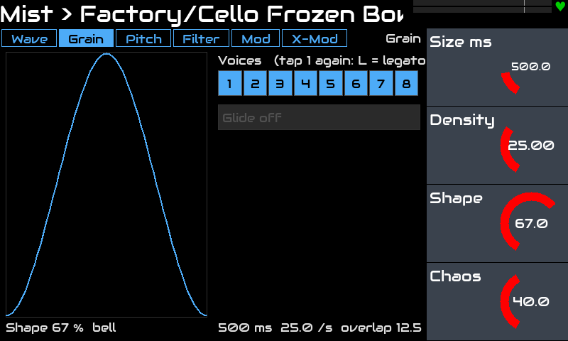
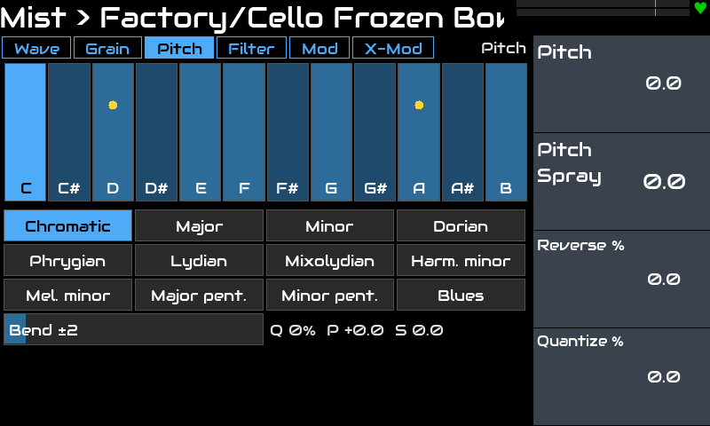
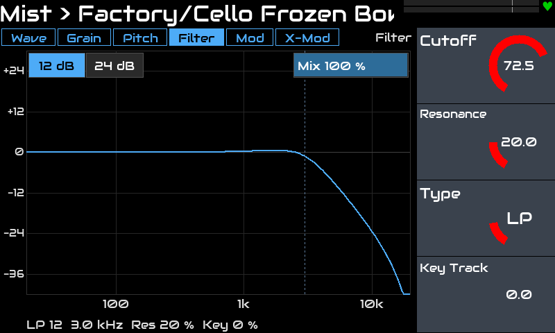
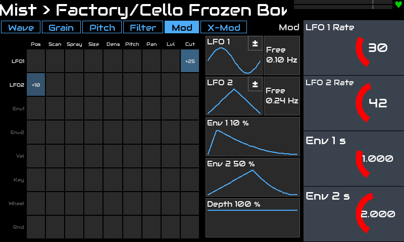
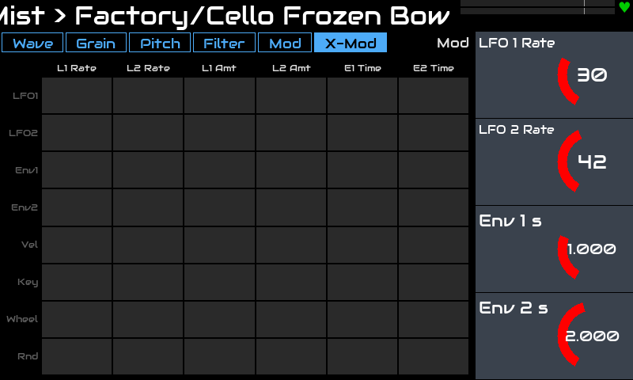

# Eka Mist для Zynthian

[English](README.md) · **Русский**

Полифонический **гранулярный сэмплер** для [Zynthian](https://zynthian.org): **LV2-инструмент** и **виджет** для
тачскрина Zynthian — форма волны с живыми зёрнами, окно зерна, лад, кривая фильтра и две сетки модуляции.

Каждая нота запускает своё облако зёрен со своей позицией чтения. Зёрна берутся из общего пула, поэтому нагрузка
на процессор ограничена, как бы вы ни играли.

> Проверено на: Zynthian **Vangelis** (stable 2610), Raspberry Pi 5, набор V5, тачскрин 800x480.
> Другие версии и железо не проверялись.

## Возможности

- **Движок зёрен:** 8 голосов (Poly или Mono с Glide), общий пул на 128 зёрен. Позиция, длина, высота, панорама,
  направление и громкость фиксируются при рождении зерна, поэтому поворот ручки не даёт щелчков.
- **Позиция:** Position, **Scan** (скорость по сэмплу, можно назад; 0 — заморозка), Spray, Window; маркеры начала
  и конца на форме волны.
- **Зерно:** Size, **Density**, Shape (окно), **Chaos** (от ровного ритма к случайному).
- **Высота:** Pitch, Pitch Spray, Reverse (вероятность), **Quantize** к ладу (12 ладов, любая тоника); Pitch Bend
  до ±24 полутонов, он сдвигает и уже звучащие зёрна.
- **Голос:** Attack, Release, Stereo Spread, Level.
- **Фильтр в каждом голосе:** LP, HP, BP (12 или 24 дБ/окт), Notch, Comb, Vowel (с Lows и Highs), Mix, Key Track.
- **Модуляция:** LFO 1 и 2 (формы, синхронизация с темпом, полярность ± или +), Env 1 и Env 2, Velocity, Key,
  Mod Wheel и Random на Position, Scan, Spray, Size, Density, Pitch, Pan, Level и Cutoff (сетка 8 × 9), и
  **X-Mod**: те же источники на скорости и глубины LFO и времена огибающих (8 × 6). LFO и огибающие у каждого
  голоса свои.
- **MIDI:** ноты, Mod Wheel (CC 1), педаль сустейна (CC 64), Pitch Bend.
- **8 сэмплов** (CC0 / CC BY, см. [samples/CREDITS.md](samples/CREDITS.md)) и **18 заводских пресетов**; свои
  сэмплы — в отдельную папку.
- **Виджет** с шестью вкладками (Wave, Grain, Pitch, Filter, Mod, X-Mod); вкладка следует за страницей энкодеров.

## Скриншоты

| | |
|---|---|
|  |  |
| **Wave:** сэмпл, Window, точка чтения и живые зёрна (метки сверху) | **Grain:** форма окна, плотность, голоса |
|  |  |
| **Pitch:** лад для Quantize и звучащие ноты | **Filter:** кривая с учётом Mix |
|  |  |
| **Mod:** сетка 8 × 9, формы LFO и огибающих | **X-Mod:** модуляция модуляторов |

## Установка

На Zynthian (SSH под root):

```bash
git clone https://github.com/dmtry3/zynthian-eka.git
cd zynthian-eka/plugins/mist
sudo make install
systemctl restart zynthian
```

Обновление одной строкой:

```bash
cd /root/zynthian-eka && git pull && cd plugins/mist && sudo make install && systemctl restart zynthian
```

`make install` собирает плагин на устройстве (gcc, `lv2-dev`, `libsndfile` — всё есть на Zynthian) и создаёт:

| Ссылка или папка | Что |
|---|---|
| `/usr/local/lib/lv2/eka-mist.lv2` | плагин (`build/eka-mist.lv2`) |
| `zyngui/widgets_user/zynthian_widget_eka_mist.py` | виджет (`ui/`) |
| `zynthian-my-data/files/Samples/eka-mist` | заводские сэмплы (`samples/`) |
| `zynthian-my-data/files/Samples/eka-mist-user` | пустая папка для своих сэмплов |
| `zynthian-my-data/presets/lv2/Eka_Mist.presets.lv2` | папка для своих пресетов |

Ещё он обновляет список пресетов Zynthian. Файлы самого Zynthian не меняются. Удаление: `sudo make uninstall`.

Добавьте **Eka Mist** в цепочку как синт (Instrument). Сэмпл выбирается на вкладке Wave (тап по его имени).

## Управление

Шесть страниц по 4 ручки: то, что меняют во время игры. Остальное — на виджете.

| Страница | Ручка 1 | Ручка 2 | Ручка 3 | Ручка 4 |
|---|---|---|---|---|
| **Position** | Position | Scan | Spray | Window |
| **Grain** | Size | Density | Shape | Chaos |
| **Pitch** | Pitch | Pitch Spray | Reverse | Quantize |
| **Voice** | Attack | Release | Stereo Spread | Level |
| **Filter** | Cutoff | Resonance | Type | Key Track |
| **Mod** | LFO 1 Rate | LFO 2 Rate | Env 1 Time | Env 2 Time |

| Вкладка | Только здесь |
|---|---|
| **Wave** | файл сэмпла, маркеры начала и конца, корневая нота (или Auto), гейн сэмпла (двойной тап — нормализация пика на −1 дБFS) |
| **Grain** | Poly / Mono, число голосов, Glide |
| **Pitch** | лад и тоника для Quantize, диапазон Pitch Bend |
| **Filter** | Mix, 12 или 24 дБ/окт, Lows и Highs у Vowel |
| **Mod** | ячейки сетки (палец вверх / вниз, двойной тап — 0), форма, синхронизация и полярность LFO, формы огибающих, Mod Depth |
| **X-Mod** | сетка кросс-модуляции |

## Сборка и тесты (любой Linux)

```bash
make            # build/eka-mist.lv2
make test       # движок офлайн и виджет с заглушками модулей Zynthian
```

Пресеты генерируются: правьте `scripts/gen_presets.py` и запустите его. `scripts/bench.sh` меряет нагрузку
(в счёт идут только замеры на Pi 5).

## Как устроено

- `src/grain_core.c`: движок на C без LV2 (тестируется обычной программой); окна из таблиц, линейная
  интерполяция, модуляция и коэффициенты фильтра раз в 32 сэмпла, в аудиопотоке ничего не выделяется.
- Сэмпл загружается в фоне (LV2 Worker, `libsndfile`), путь к нему сохраняется в снапшоте.
- Настройки виджета и сетки — LV2-параметры (`patch:writable`), они сохраняются в пресетах и снапшотах;
  позиции зёрен приходят через выходные порты.

## Лицензия

GPL-3.0-or-later, см. [LICENSE](LICENSE). У сэмплов свои лицензии: [samples/CREDITS.md](samples/CREDITS.md).
