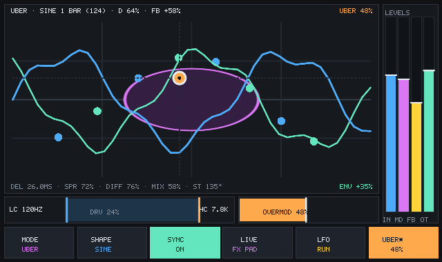
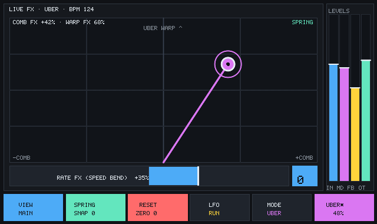

# Eka Modls for Zynthian

**English** · [Русский](README.ru.md)

**Six-engine musical-to-extreme "Über-Mod" modulation effect** for [Zynthian](https://zynthian.org): stereo **LV2** audio effect with host BPM sync (`time:Position`) and an **interactive touch widget** featuring a mode-adaptive live visualizer (floating taps, 3-phase constellation, through-zero `0 ms` flanger axis, spectral phaser/barberpole peaks, 8-tap diffused cloud, dual L/R LFO oscilloscope), a `Low Cut / High Cut / OverMod` control strip, `IN / MOD / FB / OUT` meters, and a dedicated **Live FX** X-Y performance screen.

Built for Zynthian's four encoders across six logical pages — from classic lush analog chorus, through-zero tape flanging, and optical phasing all the way to chaotic audio-rate FM and diffused cosmic Über-Mod clouds.

> Tested on: Zynthian **Vangelis** (stable 2610), Raspberry Pi 5, V5 kit, 800×480 touch screen.
> Other versions/hardware are untested.

## Features

- **Six distinct DSP modulation engines (`Mode`):**
  1. `Chorus` — dual-tap stereo BBD-style chorus with cubic Hermite fractional interpolation, quadrature modulation, and warm saturation.
  2. `Tri-Mod` — 3-phase (`0° / 120° / 240°`) ensemble / dimension swirl with dual-speed shimmer layer.
  3. `Flanger` — true **Through-Zero Tape Flanger (TZF)**: dry signal sits on a matched reference delay line so the modulated tap sweeps smoothly *past zero* (`-Δ .. +Δ`), producing authentic phase-null swooshes and metallic bipolar comb resonance.
  4. `Phaser` — bilinear 4..12-stage stereo all-pass cascade (`Spread` smoothly morphs 4 → 6 → 8 → 12 stages with zero clicks) and bipolar feedback.
  5. `Barber` — infinite **Shepard / Barberpole** 4-voice quadrature all-pass phaser with constant-power spectral windowing: notches glide endlessly upward (`Feedback ≥ 0`) or downward (`Feedback < 0`) without ever turning around.
  6. `Uber` — 8-tap diffused delay matrix inspired by Valhalla ÜberMod: golden-spaced taps (`Spread`), 4-stage stereo all-pass diffuser (`Diffuse`), cross-channel feedback, and warm loop `Drive`.
- **Musical → Extreme modulation core:**
  - 6 LFO shapes (`Shape`): `Sine`, `Tri`, `Exp` (optical skew), `S&H` (slewed random), `Chaos` (coupled nonlinear organic drift), and `Env` (input envelope follower).
  - Free `Rate` (`0.02..20 Hz`) or Zynthian tempo `Sync` (`4 bars .. 1/64`, including dotted and triplet divisions).
  - **`OverMod` (`0..100%`):** at `0%` strictly calibrated musical ranges; `1..50%` adds fast harmonic secondary modulation; `50..100%` expands modulation depth up to ×4 with audio-rate FM sidebands and chaotic jitter.
  - Bipolar `Env Mod` (`-100..+100%`): louder hits either push modulation open (`+`) or duck modulation on attacks (`-`) for tight transients and blooming tails.
  - `Low Cut` (`20..600 Hz`, keeps sub-bass anchored and clean), `High Cut` (`1..20 kHz`), analog `Drive`, `Diffuse`, stereo `Width` (`0..200%`), `LFO Freeze`, and click-free `Bypass`.
- **Dedicated Live `FX` screen:**
  - X-Y performance pad (`X = Comb FX` manual sweep, `Y = Warp FX` instant Über-Mod blast), bipolar `Rate FX` speed-bend slider with `0` button, `HOLD / SNAP 0` spring return, and MIDI-mappable `FX Zero`.
- **14 factory presets** (bank *Factory*): 7 musical classics (`Init Warm Chorus`, `Juno Velvet Ensemble`, `Through-Zero Tape Jet`, `Vintage Optical Phaser`, `Synced Dub Barberpole`, `Dimension Bass-Safe Wide`, `Dynamic Touch Flanger`) + 7 extreme/Über designs (`Uber Diffused Halo`, `Warped Vinyl Chaos`, `Metallic Comb Resonator`, `Laser 12-Stage Vortex`, `Infinite Shepard Dive`, `Audio-Rate FM Alien`, `Cosmic Self-Osc Wash`).
- **Real-time safe:** zero heap allocations in `run()`, denormal/NaN protection, DC blocker and soft safety limiter inside feedback loops.

## Screenshots

| | |
|---|---|
|  |  |
| **Main:** live mode-adaptive modulation scope (`Rate × Depth` drag), `Low Cut / High Cut / OverMod` strip, `IN / MOD / FB / OUT` meters, and 6 buttons | **FX:** live X-Y pad (`Comb FX × Warp FX`), bipolar `Rate FX` speed-bend slider with `0` reset, `HOLD / SNAP 0`, and `ZERO 0` |

## Installation

On Zynthian (SSH as root):

```bash
git clone https://github.com/dmtry3/zynthian-eka.git
cd zynthian-eka/plugins/modls
sudo make install
systemctl restart zynthian
```

One-line update:

```bash
cd /root/zynthian-eka && git pull && sudo make install-modls && systemctl restart zynthian
```

| Link or folder | Contents |
|---|---|
| `/usr/local/lib/lv2/eka-modls.lv2` | LV2 bundle (`eka_modls.so`, `manifest.ttl`, `eka_modls.ttl`, `presets.ttl`) |
| `zyngui/widgets_user/zynthian_widget_eka_modls.py` | Touch widget (`ui/`) |
| `zynthian-my-data/presets/lv2/Eka_Modls.presets.lv2` | User presets folder |

`install.sh` refreshes the preset cache and sets the category to **Modulation**. Uninstall: `sudo make uninstall`.

On first install, enable **Eka Modls** in Zynthian webconf (*Software → LV2 Plugins*), then add it as an *Audio Effect*.

## Controls

Six pages of 4 encoders:

| Page | Knob 1 | Knob 2 | Knob 3 | Knob 4 |
|---|---|---|---|---|
| **1. Engine** | `Mode` (`Chorus / Tri-Mod / Flanger / Phaser / Barber / Uber`) | `Depth` (`0..100%`) | `Feedback` (`-100..+100%`) | `Mix` (`0..100%`) |
| **2. LFO** | `Shape` (`Sine / Tri / Exp / S&H / Chaos / Env`) | `Rate` (`0.02..20 Hz` / Sync) | `Sync` (`Free / Sync`) | `Stereo` (`0..180°`) |
| **3. Uber** | `Delay` (`0.3..120 ms`) | `Spread` (`0..100%`) | `Diffuse` (`0..100%`) | `OverMod` (`0..100%`) |
| **4. Tone** | `Low Cut` (`20..600 Hz`) | `High Cut` (`1..20 kHz`) | `Drive` (`0..100%`) | `Env Mod` (`-100..+100%`) |
| **5. Live FX** | `Rate FX` (`-100..+100%`) | `Warp FX` (`0..100%`) | `Comb FX` (`-100..+100%`) | `FX Zero` (`Off / Zero`) |
| **6. Master** | `Width` (`0..200%`) | `LFO Freeze` (`Run / Freeze`) | `Output` (`-18..+12 dB`) | `Bypass` (`Off / On`) |

## Widget & Gestures

- **Main Modulation Scope (top):** drag horizontally for `Rate` and vertically for `Depth` (selects `LFO` page); **double-tap** resets `OverMod`, `Warp FX`, and `Comb FX` to `0%`.
- **Tone & OverMod strip (middle):** drag left/right edges on the left half for `Low Cut` / `High Cut` (`Tone`); drag the right bar for `OverMod` (`Uber`).
- **Live `FX` screen:** tap `FX PAD` to open the playable X-Y pad (`X = Comb FX`, `Y = Warp FX`) and bottom `Rate FX` slider with `0` reset, `HOLD / SNAP 0` spring return, and `ZERO 0`.
- **6 bottom buttons:** `MODE`, `SHAPE`, `SYNC`, `FX PAD`, `FREEZE`, `UBER*` (short tap cycles quick `OverMod` `0% → 45% → 85% → 0%`; **long press** toggles click-free `Bypass`, turning the widget grayscale).

## Build & Tests on Linux / WSL

```bash
make -C plugins/modls                 # build LV2 bundle
make -C plugins/modls test            # DSP, LV2 host, and widget tests
SAN=1 make -C plugins/modls test      # with AddressSanitizer + UBSan
```

## License

GPL-3.0-or-later. See [LICENSE](LICENSE) and [CHANGELOG.md](CHANGELOG.md).
