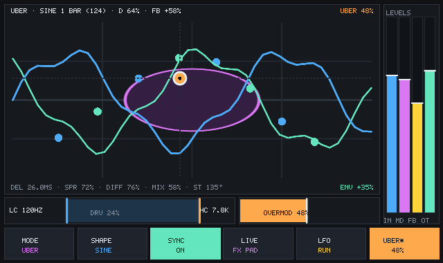
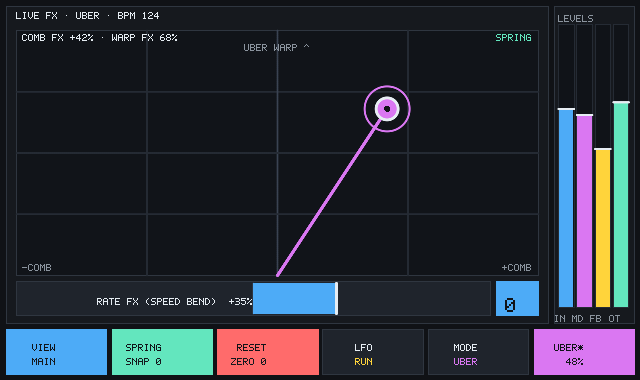

# Eka Modls для Zynthian

[English](README.md) · **Русский**

**Шестирежимный модуляционный плагин класса «Über-Mod»** (Chorus, Tri-Mod Ensemble, Through-Zero Flanger, 4..12-stage Phaser, Barberpole Shepard Phaser и 8-отводный диффузный Uber-движок) для [Zynthian](https://zynthian.org): стерео аудио-эффект в формате **LV2** с синхронизацией темпа Zynthian (`time:Position`) и **интерактивным тач-виджетом** (живой визуализатор под каждый алгоритм + двухлучевой LFO-осциллограф, полоса `Low Cut / High Cut / OverMod`, метры `IN / MOD / FB / OUT` и отдельный игровой экран **Live FX** с X-Y пэдом).

Сделан под четыре энкодера: шесть логичных страниц управления — от деликатного студийного хоруса, плёночного Through-Zero фленджера и винтажного оптического фазера до экстремальной аудио-частотной FM-модуляции, хаоса и космических диффузных облаков.

> Проверено на: Zynthian **Vangelis** (stable 2610), Raspberry Pi 5, набор V5, тачскрин 800×480.
> Другие версии и железо не проверялись.

## Возможности

- **6 самостоятельных алгоритмов модуляции (`Mode`):**
  1. `Chorus` — двухголосный стерео BBD-хорус на 4-точечной кубической интерполяции Эрмита с квадратурной модуляцией и тёплым насыщением.
  2. `Tri-Mod` — 3-фазный ансамбль (`0° / 120° / 240°`) в духе студийных Dimension / Tri-Stereo с двойной скоростью модуляции.
  3. `Flanger` — честный **Through-Zero Tape Flanger (TZF)**: сухой сигнал идёт через опорную линию задержки, а модулируемый отвод проходит *сквозь ноль* (`-Δ .. +Δ`), давая настоящий плёночный фазовый ноль и биполярный гребенчатый резонанс.
  4. `Phaser` — билинейный 4..12-каскадный стерео all-pass фазер (`Spread` плавно морфирует `4 → 6 → 8 → 12` каскадов без щелчков) с биполярной обратной связью.
  5. `Barber` — бесконечный **фазер Шепарда (Barberpole)** на 4 квадратурных полосах с окном постоянной мощности: провалы бесконечно едут вверх (`Feedback ≥ 0`) или вниз (`Feedback < 0`), никогда не разворачиваясь.
  6. `Uber` — 8-отводная диффузная матрица в духе Valhalla ÜberMod: разброс отводов `Spread` (`3..215 мс`), 4-каскадный стерео all-pass диффузор (`Diffuse`), перекрёстная обратная связь и тёплый `Drive` в петле.
- **От музыкальности до экстремального «Über-Mod»:**
  - 6 форм LFO (`Shape`): `Sine`, `Tri`, `Exp` (оптический перекос), `S&H` (сглаженный случайный), `Chaos` (нелинейный органический дрейф) и `Env` (огибающая входного сигнала).
  - Свободная частота `Rate` (`0.02..20 Гц`) или привязка к темпу Zynthian `Sync` (`4 bars .. 1/64`, включая точки и триоли).
  - **`OverMod` (`0..100%`):** на `0%` строго музыкальные диапазоны; `1..50%` добавляет быструю гармоническую вторичную модуляцию (флаттер/мерцание); `50..100%` разгоняет глубину до ×4, добавляя FM-призвуки на аудио-частотах и хаотический джиттер.
  - Биполярный `Env Mod` (`-100..+100%`): громкие удары либо раскрывают модуляцию (`+`), либо прижимают её в момент атаки (`-`), сохраняя чёткий транзиент и пышный хвост.
  - `Low Cut` (`20..600 Гц`, сохраняет чистый собранный бас), `High Cut` (`1..20 кГц`), аналоговый `Drive`, `Diffuse`, стереоширина `Width` (`0..200%`), заморозка фазы `LFO Freeze` и бесщёлчковый `Bypass`.
- **Отдельный игровой экран `Live FX`:**
  - Большой X-Y пэд (`X = Comb FX` ручной прогон задержки/нотчей, `Y = Warp FX` мгновенный Über-разгон), биполярный слайдер `Rate FX` с кнопкой сброса `0`, пружинный возврат `HOLD / SNAP 0` и MIDI-сброс `FX Zero`.
- **14 заводских пресетов** (банк *Factory*): 7 музыкальных (`Init Warm Chorus`, `Juno Velvet Ensemble`, `Through-Zero Tape Jet`, `Vintage Optical Phaser`, `Synced Dub Barberpole`, `Dimension Bass-Safe Wide`, `Dynamic Touch Flanger`) и 7 экстремальных (`Uber Diffused Halo`, `Warped Vinyl Chaos`, `Metallic Comb Resonator`, `Laser 12-Stage Vortex`, `Infinite Shepard Dive`, `Audio-Rate FM Alien`, `Cosmic Self-Osc Wash`).
- **Безопасен для реального времени:** без выделений памяти в `run()`, защита от NaN/денормалов, DC-блокер и мягкий ограничитель в петле обратной связи.

## Скриншоты

| | |
|---|---|
|  |  |
| **Main:** живой визуализатор выбранного алгоритма и кривых L/R LFO (`Rate × Depth`), полоса `Low Cut / High Cut / OverMod`, метры `IN / MOD / FB / OUT` и 6 кнопок | **FX:** игровой X-Y пэд `Comb FX × Warp FX`, биполярный слайдер `Rate FX` с кнопкой `0`, пружинный возврат `HOLD / SNAP 0` и `ZERO 0` |

## Установка

На Zynthian (SSH под root):

```bash
git clone https://github.com/dmtry3/zynthian-eka.git
cd zynthian-eka/plugins/modls
sudo make install
systemctl restart zynthian
```

Обновление одной строкой:

```bash
cd /root/zynthian-eka && git pull && sudo make install-modls && systemctl restart zynthian
```

| Ссылка или папка | Что внутри |
|---|---|
| `/usr/local/lib/lv2/eka-modls.lv2` | LV2-бандл (`eka_modls.so`, `manifest.ttl`, `eka_modls.ttl`, `presets.ttl`) |
| `zyngui/widgets_user/zynthian_widget_eka_modls.py` | Тач-виджет (`ui/`) |
| `zynthian-my-data/presets/lv2/Eka_Modls.presets.lv2` | Папка пользовательских пресетов |

`install.sh` обновляет кэш пресетов и прописывает категорию **Modulation**. Удаление: `sudo make uninstall`.

При первом добавлении включите **Eka Modls** в webconf Zynthian (*Software → LV2 Plugins*), затем добавьте его в цепочку как *Audio Effect*.

## Управление

Шесть страниц по 4 энкодера:

| Страница | Ручка 1 | Ручка 2 | Ручка 3 | Ручка 4 |
|---|---|---|---|---|
| **1. Engine** | `Mode` (`Chorus / Tri-Mod / Flanger / Phaser / Barber / Uber`) | `Depth` (`0..100%`) | `Feedback` (`-100..+100%`) | `Mix` (`0..100%`) |
| **2. LFO** | `Shape` (`Sine / Tri / Exp / S&H / Chaos / Env`) | `Rate` (`0.02..20 Гц` / Sync) | `Sync` (`Free / Sync`) | `Stereo` (`0..180°`) |
| **3. Uber** | `Delay` (`0.3..120 мс`) | `Spread` (`0..100%`) | `Diffuse` (`0..100%`) | `OverMod` (`0..100%`) |
| **4. Tone** | `Low Cut` (`20..600 Гц`) | `High Cut` (`1..20 кГц`) | `Drive` (`0..100%`) | `Env Mod` (`-100..+100%`) |
| **5. Live FX** | `Rate FX` (`-100..+100%`) | `Warp FX` (`0..100%`) | `Comb FX` (`-100..+100%`) | `FX Zero` (`Off / Zero`) |
| **6. Master** | `Width` (`0..200%`) | `LFO Freeze` (`Run / Freeze`) | `Output` (`-18..+12 дБ`) | `Bypass` (`Off / On`) |

## Виджет и жесты

- **Главный визуализатор (сверху):** тяните по горизонтали для `Rate` и по вертикали для `Depth` (переключает энкодеры на `LFO`); **двойной тап** сбрасывает `OverMod`, `Warp FX` и `Comb FX` в `0%`.
- **Полоса Tone & OverMod (в центре):** тяните границы слева для `Low Cut` / `High Cut` (`Tone`), а правую шкалу — для `OverMod` (`Uber`).
- **Отдельный экран `FX`:** тап по `FX PAD` открывает игровой X-Y пэд (`X = Comb FX`, `Y = Warp FX`) и нижний слайдер `Rate FX` с кнопкой сброса `0`, режимом пружины `HOLD / SNAP 0` и общим сбросом `ZERO 0`.
- **6 нижних кнопок:** `MODE`, `SHAPE`, `SYNC`, `FX PAD`, `FREEZE`, `UBER*` (короткий тап быстро переключает `OverMod`: `0% → 45% → 85% → 0%`; **долгий тап** включает общий `Bypass` — весь виджет становится серым).

## Сборка и тесты на Linux / WSL

```bash
make -C plugins/modls                 # собрать LV2-бандл
make -C plugins/modls test            # тесты DSP, LV2-хоста и виджета
SAN=1 make -C plugins/modls test      # с AddressSanitizer + UBSan
```

## Лицензия

GPL-3.0-or-later. См. [LICENSE](LICENSE). Изменения: [CHANGELOG.md](CHANGELOG.md).
