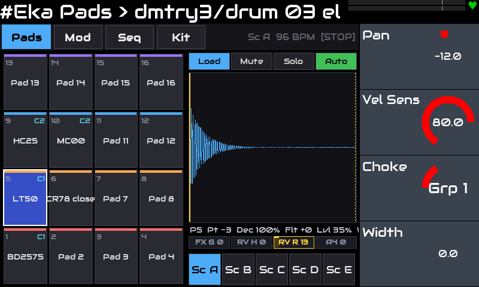
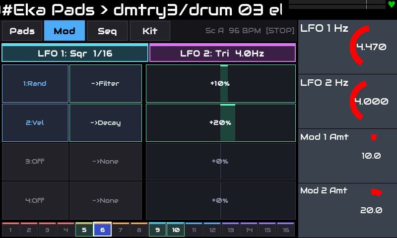
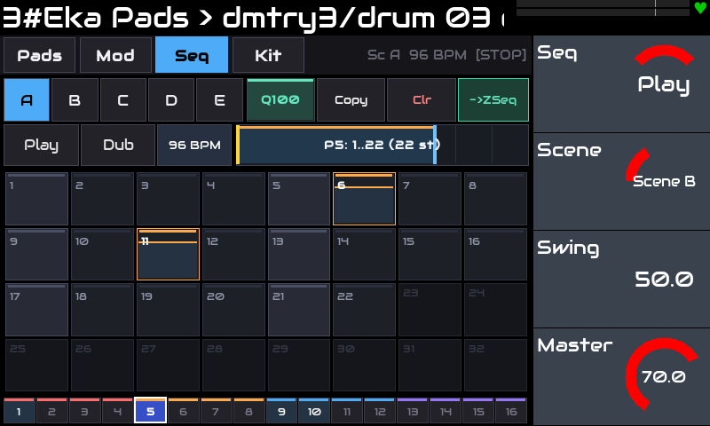
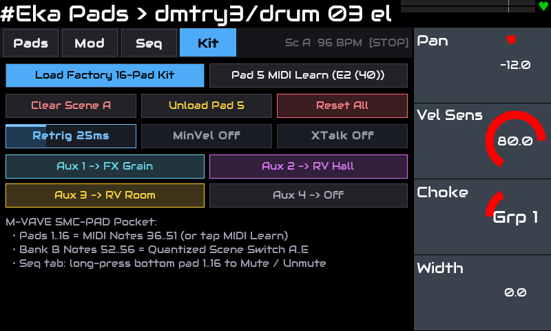

# Eka Pads for Zynthian

**English** · [Русский](README.ru.md)

A **16-pad drum sampler, modulation engine, and polyrhythmic scene sequencer** for [Zynthian](https://zynthian.org), implemented as an **LV2 instrument plugin** (MIDI in, main stereo out + 4 stereo Aux sends, LV2 `time:Position` transport sync) plus a **4-tab touch widget** (`Pads`, `Mod`, `Seq`, `Kit`) designed for live finger-drumming with pad controllers like **M-VAVE SMC-PAD Pocket** over Bluetooth MIDI.

Made for four encoders: **Auto-Select** follows the last hit pad and keeps Zynthian's 4 physical encoders synced to that pad across seven clean knob pages without value jumps.

> Tested on: Zynthian **Vangelis** (stable 2610), Raspberry Pi 5, V5 kit, 800×480 touchscreen.
> Other versions/hardware are untested.

## Features

- **16 independent pads (4×4 grid)** with async background sample loading (`libsndfile`: `WAV`, `FLAC`, `AIFF`, `OGG`, `MP3`) via LV2 Worker, quick `< / >` sample stepping, `Load Folder Kit`, and a built-in 16-sample factory drum kit (`samples/`).
- **Per-pad DSP engine:**
  - Anti-aliased windowed sinc `Pitch` (`±24 st`), exponential `Attack` (`0..500 ms`), `Decay` (`0..100%`), bipolar DJ `Filter` (`LP` / Open / `HP`) with resonance `Reso` (`0..100%`), `Level`.
  - `Start` / `End` waveform trim, 5 playback modes (`One-Shot`, `Gate`, `Rev Shot`, `Rev Gate`, `Loop`), transient `Punch` (`-100..+100%`), `Drive` (soft saturation + bitcrush).
  - `Pan`, `Vel Sens`, 4 click-free `Choke` groups (2 ms fade), bipolar `Width` (`-100..+100%`, all-pass + dual-Haas stereo enhancer), `Mute`, `Solo`, pad `Link` (`Layer` / `Round-Robin`), **Auto-Slice** (4/8/16 grid or transient detection), and **Copy / Swap Pad**.
  - **Master `Bus Glue` compressor (`0..100%`)** ahead of the soft limiter.
- **Performance Modes (`16L` & `Rpt` in top bar):**
  - **16 Levels / Chromatic (`16L`):** play the selected pad across all 16 pads (or an external MIDI keyboard) by chromatic pitch (`Chrm`), 16 velocities (`16Vl`), or 16 filter steps (`16Fl`) with live p-lock Overdub recording.
  - **Note Repeat (`Rpt`):** MPC-style tempo-synced retrigger (`1/8`, `1/16`, `1/16T`, `1/32`) while holding touch or MIDI pads.
- **4 Stereo Aux Sends (`Aux 1..4`):** per-pad send levels routed directly to Zynthian Mixbuses from the `Kit` tab.
- **Per-pad Modulation Matrix (`Mod` tab):**
  - 4 modulation slots per pad: sources (`Off`, `Vel`, `Rand`, `LFO1`, `LFO2`, `Env`) → destinations (`Pitch`, `Decay`, `Filter`, `Level`, `Start`, `Drive`, `Pan`, `Width`, `Aux1`, `Aux2`) with bipolar amount (`-100..+100%`).
  - 2 independent LFOs per pad (`Sine`, `Tri`, `Saw`, `Sqr`, `S&H`, `Free` `0.05..20 Hz` or tempo `Sync` `4/1..1/16T`) with a waveform preview popup, plus an Envelope Follower.
- **Polyrhythmic Scene Sequencer (`Seq` tab):**
  - Up to **32 steps** per pad with independent `Beg..End` loop range (`1..32`), `Swing` (`50..75%`), smooth `Quantize` (`0..100%` with real microtiming), `Velocity` (`0..127`), `Chance` (`10..100%`), ratchet `Roll` (`1x..4x`), and per-step **Parameter Locks** (`Pitch`, `Filter`, `Microtiming`).
  - **Euclidean Rhythm Generator (`Euclid Hits/Rot`)**, `< Shift / Shift >` pattern rotate, **Metronome** (`Off / Rec / On`), 1-bar **Count-in**, and **Undo Dub**.
  - **5 large scenes (`A..E`)** on screen (8 scenes internally, `A..H`), quantized switching at bar boundaries via touchscreen or MIDI notes `52..56`, **Scene Chain** (up to 8 bars), and **1-bar Fill** via long-press on `A..E`.
  - **Live Overdub (`Dub/Rec`)** from MIDI pads, tightly phase-locked (`<0.25 ms`) to Zynthian / `Eka Roll` Host Transport (`time:Position`) or internal BPM (`40..240`).
  - **One-tap export to ZynSeq (`->ZSeq`)** with automatic bar-count calculation from the LCM of polyrhythmic pad lengths.
- **Controller-ready (`M-VAVE SMC-PAD Pocket`):** Auto-Select, one-tap MIDI Learn, and a hardware trigger filter (`Retrig`, `MinVel`, `XTalk`) to eliminate double/phantom hits.
- **Full Snapshot Persistence:** all 16 sample paths, pad parameters, modulation, sequencer patterns, and Aux routes are saved in Zynthian snapshots (`LV2 State`).

## Screenshots

| | |
|---|---|
|  |  |
| **Pads:** 4×4 pad grid with choke groups, waveform inspector, `Aux 1..4` send sliders and `Sc A..E` scene bar | **Mod:** `LFO 1` & `LFO 2` buttons, 4-slot modulation matrix with bipolar depth sliders and 16-pad strip |
|  |  |
| **Seq:** scenes `A..E`, `Q` quantize, `->ZSeq` export, polyrhythmic `Beg..End` steps slider and 4×8 step grid | **Kit:** factory kit loader, `MIDI Learn`, `Reset All`, `Retrig`/`MinVel`/`XTalk` filters and `Aux 1..4 -> Mixbus` routing |

## Installation

On Zynthian (SSH as root):

```bash
git clone https://github.com/dmtry3/zynthian-eka.git
cd zynthian-eka/plugins/pads
sudo make install
systemctl restart zynthian
```

Update in one line:

```bash
cd /root/zynthian-eka && git pull && sudo make install-pads && systemctl restart zynthian
```

| Link or folder | Contents |
|---|---|
| `/usr/local/lib/lv2/eka-pads.lv2` | LV2 bundle (`eka_pads.so`, `manifest.ttl`, `eka_pads.ttl`) |
| `zyngui/widgets_user/zynthian_widget_eka_pads.py` | Touch widget (`ui/`) |
| `zynthian-my-data/files/Samples/eka-pads` | 16-sample factory drum kit (`samples/`) |
| `zynthian-my-data/files/Samples/eka-pads-user` | User samples folder |
| `zynthian-my-data/presets/lv2/Eka_Pads.presets.lv2` | User presets folder |

`install.sh` refreshes Zynthian's preset cache; nothing in Zynthian's own files is modified. To remove: `sudo make uninstall`.

If adding for the first time, enable **Eka Pads** in Zynthian webconf (*Software → LV2 Plugins*), then add it to a chain as a *Synthesizer / Instrument*.

### Optional Patch: M-VAVE SMC-PAD over USB

**M-VAVE SMC-PAD** / **SMC-PAD Pocket** uses a SINCO USB chip and exposes the port `SINCO IN 2` — the same identifier as the **SINCO SMK25** keyboard. On connection, Zynthian autoloads `zyngine/ctrldev/zynthian_ctrldev_sinco_smk25.py`, which writes an SMK25 SysEx preset to the controller and overwrites the SMC-PAD pad layout.

An optional patch script disables autoloading of that driver (`autoload_flag = False`; it can still be enabled manually in Zynthian UI if needed):

```bash
cd /root/zynthian-eka/plugins/pads && sudo make patch-smcpad && systemctl restart zynthian
```

To check status or revert the patch:

```bash
./scripts/patch-smcpad.sh --status
sudo ./scripts/patch-smcpad.sh --revert && systemctl restart zynthian
```

> Note: Zynthian software updates overwrite `/zynthian/zynthian-ui/`, so re-run `sudo make patch-smcpad && systemctl restart zynthian` after updating Zynthian.

## Controls

Eight pages of 4 encoders (pages 1–5 follow the currently selected pad; page 8 follows the active row in the `Pad MIDI Notes` window):

| Page | Knob 1 | Knob 2 | Knob 3 | Knob 4 |
|---|---|---|---|---|
| **1. Pad Sound** | `Pitch` (`-24..+24 st`) | `Decay` (`0..100%`) | `Filter` (`-100..+100%`) | `Level` (`0..100%`) |
| **2. Pad Shape** | `Start` (`0..99%`) | `Mode` (`One-Shot/Gate/Rev Shot/Rev Gate/Loop`) | `Punch` (`-100..+100%`) | `Drive` (`0..100%`) |
| **3. Pad Mix** | `Pan` (`-100..+100%`) | `Vel Sens` (`0..100%`) | `Choke` (`Off / Grp 1..4`) | `Width` (`-100..+100%`) |
| **4. Pad Sends** | `Aux 1` (`0..100%`) | `Aux 2` (`0..100%`) | `Aux 3` (`0..100%`) | `Aux 4` (`0..100%`) |
| **5. Pad Mod** | `LFO 1 Hz` (`0.05..20 Hz`) | `LFO 2 Hz` (`0.05..20 Hz`) | `Mod 1 Amt` (`-100..+100%`) | `Mod 2 Amt` (`-100..+100%`) |
| **6. Seq & Master** | `Seq` (`Stop / Play / Rec`) | `Scene` (`Scene A..E`) | `Swing` (`50..75%`) | `Master` (`0..100%`) |
| **7. Steps & Stereo** | `Stereo` (`0..200%`) | `Steps` (`1..32`) | `Beg Step` (`1..32`) | `Bus Glue` (`0..100%`) |
| **8. Pad Notes** | `Note 1` (`0..127`) | `Note 2` (`0..127`) | `Note 3` (`0..127`) | `Note 4` (`0..127`) |

## Widget & Gestures

Four tabs along the top bar (`Pads | Mod | Seq | Kit`):

- **`Pads` tab:**
  - **Left 4×4 pad grid:** tap a pad to trigger and select it; **long press** toggles `Mute`.
  - **Right inspector:** `Load`, `Mute`, `Solo`, `Auto/Lock` (Auto-Select); interactive waveform box (drag left/right edges to trim `Start`/`End`, **long press** opens the Sample Settings popup with `Pitch / Level / Decay / Filter / Start / End / Punch / Drive / Pan / Width / Mode / Choke`, or tap empty slot to load WAV/FLAC); compact `Aux 1..4` horizontal send sliders; large `Sc A..E` scene launch bar at the bottom.
- **`Mod` tab:**
  - **Top `LFO 1` & `LFO 2` buttons:** tap to open the LFO popup with live waveform preview, `Free / Sync` toggle, wave selector (`Sine..S&H`), and `Rate` slider.
  - **4 Matrix rows:** tap source/destination buttons to cycle, drag the bipolar slider (`-100..+100%`) for modulation depth.
  - **Bottom 16-pad strip:** tap to switch pad, long press to `Mute`.
- **`Seq` tab:**
  - **Top bar:** large scene buttons `A..E`, horizontal `Q` quantize slider (`Off / 1..100%`), `Copy` scene, `Clr` pad lane, and `->ZSeq` export.
  - **Second bar:** `Play/Stop`, `Dub/Rec`, draggable `BPM`, and horizontal `Beg..End` steps range slider (`1..32`) for polyrhythms.
  - **4×8 LED step grid:** short tap toggles a step; drag up/down adjusts `Velocity`; **long press** opens the step popup with `Velocity` (`0..127`), `Chance` (`10..100%`), and `Roll` (`1x..4x`) sliders.
  - **Bottom 16-pad strip:** tap to select lane, long press to `Mute / Unmute`.
- **`Kit` tab:**
  - `Load Factory 16-Pad Kit`, `Pad MIDI Notes` (dedicated 16-pad note-mapping window: pick a row `R1..R4` to map the 4 pads with encoders `Note 1..4`, drag vertically on a pad, arm `Learn` for the selected pad, or reset to `36..51` via `Def`), `Clear Scene`, `Unload Pad`, `Reset All` (two-tap confirmation to reset all settings, scenes, and samples to default).
  - Hardware pad filter sliders: `Retrig` (`0..80 ms`), `MinVel` (`0..40`), `XTalk` (`0..60%`).
  - `Aux 1..4 -> Mixbus` routing buttons (tap to cycle available Zynthian Mixbuses).

## Building & Testing on Linux / WSL

```bash
make -C plugins/pads                 # build build/eka-pads.lv2
make -C plugins/pads test            # DSP core, LV2 host and widget tests
```

## License

GPL-3.0-or-later. See [LICENSE](LICENSE). Changes: [CHANGELOG.md](CHANGELOG.md).
