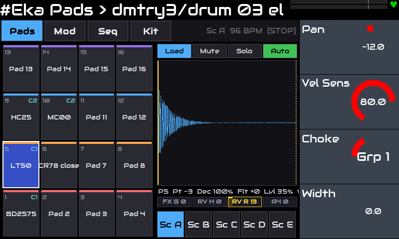
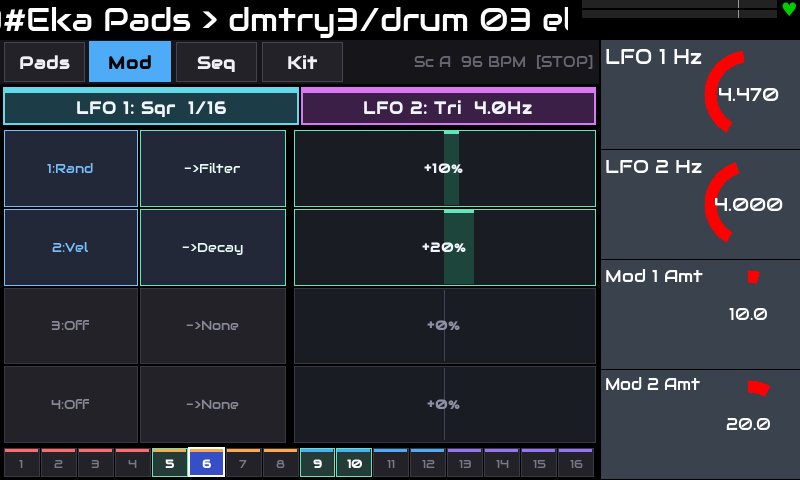
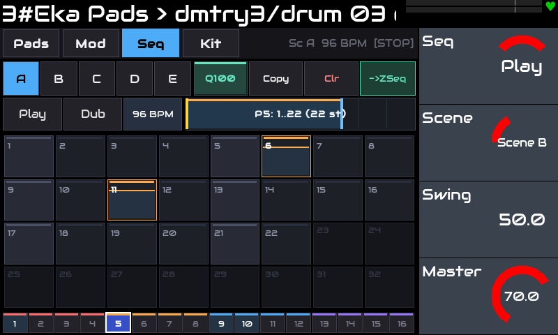
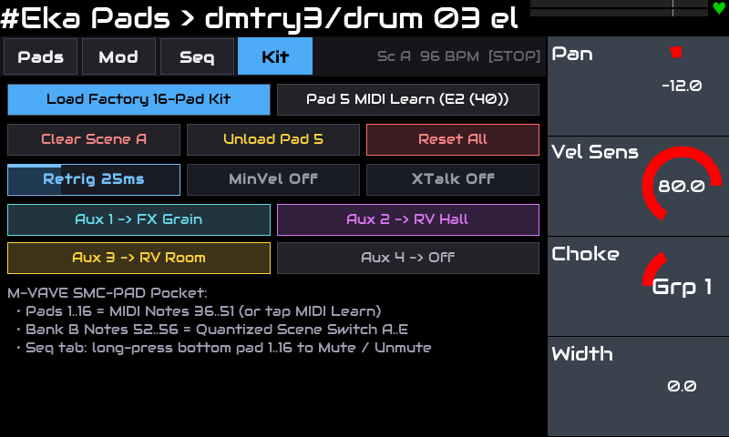

# Eka Pads для Zynthian

[English](README.md) · **Русский**

**16-пэдовый драм-сэмплер, движок модуляции и полиритмический секвенсор со сценами** для [Zynthian](https://zynthian.org): инструмент в формате **LV2** (MIDI вход, основной стерео-выход + 4 стерео-сенда Aux, синхронизация с транспортом через `time:Position`) и **5-вкладочный тач-виджет** (`Play`, `Pads`, `Mod`, `Seq`, `Kit`), заточенный под живую игру с пэдовых контроллеров вроде **M-VAVE SMC-PAD Pocket** по Bluetooth MIDI.

Сделан под четыре энкодера: **Auto-Select** следит за последним ударенным пэдом и мгновенно синхронизирует 4 физических энкодера Zynthian с его параметрами на семи страницах без скачков значений.

> Проверено на: Zynthian **Vangelis** (stable 2610), Raspberry Pi 5, набор V5, тачскрин 800×480.
> Другие версии и железо не проверялись.

## Возможности

- **16 независимых пэдов (сетка 4×4):** фоновая загрузка сэмплов (`libsndfile`: `WAV`, `FLAC`, `AIFF`, `OGG`, `MP3`) через LV2 Worker, быстрый перебор соседних файлов (`< / >`), загрузка целой папки как кита (`Load Folder Kit`) и встроенный стартовый набор из 16 ударных (`samples/`).
- **Звуковой движок на каждый пэд:**
  - Оконный sinc-ресемплер с анти-алиасингом для `Pitch` (`±24 пт`), `Attack` (`0..500 мс`), `Decay` (`0..100%`), биполярный DJ-фильтр `Filter` (`LP` / открыт / `HP`) с резонансом `Reso` (`0..100%`), `Level`.
  - Обрезка волны `Start` / `End`, 5 режимов воспроизведения (`One-Shot`, `Gate`, `Rev Shot`, `Rev Gate`, `Loop`), транзиентный `Punch` (`-100..+100%`), `Drive` (мягкая сатурация + биткрашер).
  - `Pan`, `Vel Sens`, 4 группы глушения `Choke` (плавный 2 мс фейд без щелчков), биполярная стереоширина `Width` (`-100..+100%`, all-pass + dual-Haas), `Mute`, `Solo`, связь пэдов `Link` (`Layer` / `Round-Robin`), **Auto-Slice** (нарезка лупа по сетке 4/8/16 или по транзиентам) и **Copy / Swap Pad**.
  - **Мастер-компрессор `Bus Glue` (`0..100%`)** перед мягким лимитером.
- **Отдельная вкладка живой игры `Play` (первая вкладка):**
  - **Mute / Solo групп Choke (`G1..G4` + `All On`):** плавное безщелчковое глушение 4 групп Choke (тап = Mute, долгий тап = Solo) независимо от мьютов отдельных пэдов, с индикаторами активности.
  - **Прямые кнопки `Note Repeat` (`Off | 1/8 | 1/16 | 16T | 1/32`) и `16 Levels` (`Norm | Chrm | 16Vl | 16Fl`):** переключение в одно касание без перебора по кругу (компактные кнопки также доступны на остальных вкладках).
  - **Мастер DJ-фильтр XY-пэд:** `LP ← Open → HP` + `Reso` с режимами `Mom` (автовозврат при отпускании) и `Hold` (двойной тап — сброс).
  - **Моментальные Punch-in FX (при удержании):** темповые `Stut 1/4`, `Stut 1/8`, `Stut 1/16`, торможение `Tape Stop`, `Break` (тишина на мастере с сохранением хвостов Aux) и `Aux1 Throw` (посыл 100% в `Aux 1`).
  - **Крупная панель сцен `A..E` во всю ширину + индикатор прогресса такта (4 доли):** тап — квантованный переход, долгий тап — 1-тактовый Fill.
- **4 стерео-сенда (`Aux 1..4`):** независимые посылы с каждого пэда с роутингом в Mixbus Zynthian прямо на вкладке `Kit`.
- **Матрица модуляции на каждый пэд (вкладка `Mod`):**
  - 4 слота модуляции: источники (`Off`, `Vel`, `Rand`, `LFO1`, `LFO2`, `Env`) → цели (`Pitch`, `Decay`, `Filter`, `Level`, `Start`, `Drive`, `Pan`, `Width`, `Aux1`, `Aux2`) с биполярной глубиной (`-100..+100%`).
  - 2 независимых LFO на пэд (`Sine`, `Tri`, `Saw`, `Sqr`, `S&H`, режим `Free` `0.05..20 Гц` или темповый `Sync` `4/1..1/16T`) со всплывающим окном и графиком волны, плюс Envelope Follower.
- **Полиритмический секвенсор со сценами (вкладка `Seq`):**
  - До **32 шагов** на каждый пэд с независимым диапазоном `Beg..End` (`1..32`), `Swing` (`50..75%`), плавной квантизацией `Quantize` (`0..100%` с реальным микротаймингом), `Velocity` (`0..127`), `Chance` (`10..100%`), трещотками `Roll` (`1x..4x`) и **Parameter Locks** на шаг (`Pitch`, `Filter`, `Microtiming`).
  - **Евклидов генератор (`Euclid Hits/Rot`)**, сдвиг паттерна `< Shift / Shift >`, **Метроном** (`Off / Rec / On`), **Count-in** (1 такт перед `Rec`), **Undo Dub** последнего овердаба.
  - **5 крупных сцен (`A..E`)** на экране (внутри 8 сцен `A..H`), квантованное переключение по границе такта с экрана или по MIDI-нотам `52..56`, **цепочка сцен (`Scene Chain`, до 8 тактов)** и **1-тактовый Fill** по долгому тапу на сцену `A..E`.
  - **Live Overdub (`Dub/Rec`)** прямо с пэдов, жёсткая синхронизация фазы (`<0.25 мс`) с транспортом Zynthian / `Eka Roll` (`time:Position`) или внутренним темпом (`40..240 BPM`).
  - **Экспорт активной сцены в ZynSeq (`->ZSeq`)** в одно касание с авторасчётом числа тактов по НОК полиритмии.
- **Заточен под `M-VAVE SMC-PAD Pocket`:** Auto-Select, MIDI Learn в одно касание и фильтр фантомных ударов (`Retrig`, `MinVel`, `XTalk`).
- **Полное сохранение в снапшотах Zynthian (`LV2 State`):** все 16 путей к сэмплам, настройки пэдов, модуляция, паттерны секвенсора и роутинг Aux.

## Скриншоты

| | |
|---|---|
|  |  |
| **Pads:** сетка 4×4 с группами Choke, инспектор волны, посылы `Aux 1..4` и панель сцен `Sc A..E` | **Mod:** кнопки `LFO 1` и `LFO 2`, матрица модуляции на 4 слота с биполярными слайдерами и полоса 16 пэдов |
|  |  |
| **Seq:** сцены `A..E`, квантизация `Q`, экспорт `->ZSeq`, полиритмический диапазон `Beg..End` и сетка шагов 4×8 | **Kit:** загрузка заводского кита, `MIDI Learn`, `Reset All`, фильтры `Retrig`/`MinVel`/`XTalk` и роутинг `Aux 1..4 -> Mixbus` |

## Установка

На Zynthian (SSH под root):

```bash
git clone https://github.com/dmtry3/zynthian-eka.git
cd zynthian-eka/plugins/pads
sudo make install
systemctl restart zynthian
```

Обновление одной строкой:

```bash
cd /root/zynthian-eka && git pull && sudo make install-pads && systemctl restart zynthian
```

| Ссылка или папка | Что внутри |
|---|---|
| `/usr/local/lib/lv2/eka-pads.lv2` | LV2-бандл (`eka_pads.so`, `manifest.ttl`, `eka_pads.ttl`) |
| `zyngui/widgets_user/zynthian_widget_eka_pads.py` | Тач-виджет (`ui/`) |
| `zynthian-my-data/files/Samples/eka-pads` | Заводской набор из 16 ударных (`samples/`) |
| `zynthian-my-data/files/Samples/eka-pads-user` | Папка пользовательских сэмплов |
| `zynthian-my-data/presets/lv2/Eka_Pads.presets.lv2` | Папка пользовательских пресетов |

`install.sh` обновляет кэш пресетов; файлы самого Zynthian не меняются. Удаление: `sudo make uninstall`.

При первом добавлении включите **Eka Pads** в webconf Zynthian (*Software → LV2 Plugins*), затем добавьте его в цепочку как *Synthesizer / Instrument*.

### Дополнительный патч: M-VAVE SMC-PAD по USB

**M-VAVE SMC-PAD** / **SMC-PAD Pocket** собран на чипе SINCO и по USB отдаёт порт `SINCO IN 2` — точно такой же, как клавиатура **SINCO SMK25**. При подключении Zynthian автоматически загружает драйвер `zyngine/ctrldev/zynthian_ctrldev_sinco_smk25.py`, который отправляет SysEx-пресет SMK25 и сбивает раскладку пэдов SMC-PAD.

Дополнительный скрипт-патч отключает автозагрузку этого драйвера (`autoload_flag = False`; при необходимости его всё равно можно включить вручную в меню Zynthian):

```bash
cd /root/zynthian-eka/plugins/pads && sudo make patch-smcpad && systemctl restart zynthian
```

Проверка статуса и откат патча:

```bash
./scripts/patch-smcpad.sh --status
sudo ./scripts/patch-smcpad.sh --revert && systemctl restart zynthian
```

> Примечание: при обновлении Zynthian перезаписывает `/zynthian/zynthian-ui/`, поэтому после обновления просто повторите `sudo make patch-smcpad && systemctl restart zynthian`.

## Управление

Одиннадцать страниц по 4 энкодера (страницы 1–3 — живые MIDI-маппируемые контроллеры вкладки `Play`, переключаются прямо из верхней полосы `FX | Mute | Perf`; страницы 4–8 автоматически привязаны к выбранному пэду, страница 11 — к выбранному ряду в окне `Pad MIDI Notes`):

| Страница | Ручка 1 | Ручка 2 | Ручка 3 | Ручка 4 |
|---|---|---|---|---|
| **1. Play FX** | `Mst Filter` (`-100..+100%`) | `Mst Reso` (`0..100%`) | `Stutter` (`Off / 1/4 / 1/8 / 1/16`) | `Aux1 Throw` (`Off / On`) |
| **2. Play Mutes** | `Mute G1` (`Off / On`) | `Mute G2` (`Off / On`) | `Mute G3` (`Off / On`) | `Mute G4` (`Off / On`) |
| **3. Play Perf** | `Tape Stop` (`Off / On`) | `Break` (`Off / On`) | `Note Rpt` (`Off..1/32`) | `16 Levels` (`Normal / Chrom / 16 Vel / 16 Flt`) |
| **4. Pad Sound** | `Pitch` (`-24..+24 пт`) | `Decay` (`0..100%`) | `Filter` (`-100..+100%`) | `Level` (`0..100%`) |
| **5. Pad Shape** | `Start` (`0..99%`) | `Mode` (`One-Shot/Gate/Rev Shot/Rev Gate/Loop`) | `Punch` (`-100..+100%`) | `Drive` (`0..100%`) |
| **6. Pad Mix** | `Pan` (`-100..+100%`) | `Vel Sens` (`0..100%`) | `Choke` (`Off / Grp 1..4`) | `Width` (`-100..+100%`) |
| **7. Pad Sends** | `Aux 1` (`0..100%`) | `Aux 2` (`0..100%`) | `Aux 3` (`0..100%`) | `Aux 4` (`0..100%`) |
| **8. Pad Mod** | `LFO 1 Hz` (`0.05..20 Гц`) | `LFO 2 Hz` (`0.05..20 Гц`) | `Mod 1 Amt` (`-100..+100%`) | `Mod 2 Amt` (`-100..+100%`) |
| **9. Seq & Master** | `Seq` (`Stop / Play / Rec`) | `Scene` (`Scene A..E`) | `Swing` (`50..75%`) | `Master` (`0..100%`) |
| **10. Steps & Stereo** | `Stereo` (`0..200%`) | `Steps` (`1..32`) | `Beg Step` (`1..32`) | `Bus Glue` (`0..100%`) |
| **11. Pad Notes** | `Note 1` (`0..127`) | `Note 2` (`0..127`) | `Note 3` (`0..127`) | `Note 4` (`0..127`) |

## Виджет и жесты

Пять вкладок в верхней строке (`Play | Pads | Mod | Seq | Kit`):

- **Вкладка `Play`:**
  - **Слева:** 4 крупные кнопки `Choke Mute` (`G1..G4`, короткий тап = Mute, долгий = Solo, кнопка `All On`), 5 прямых кнопок `Note Repeat` (`Off..1/32`) и 4 прямые кнопки `16 Levels` (`Norm..16Fl`).
  - **Справа:** XY-пэд `Master Filter` (`LP/HP` + `Reso`, переключатель `Mom`/`Hold`) и 6 моментальных кнопок `Punch-in FX` (`Stut 1/4`, `Stut 1/8`, `Stut 1/16`, `Tape Stop`, `Break`, `Aux1 Throw`).
  - **Снизу:** полоса прогресса такта (4 доли) и 5 крупных сцен `A..E` (долгий тап — 1-тактовый Fill).

- **Вкладка `Pads`:**
  - **Слева — сетка 4×4:** тап запускает и выбирает пэд; **долгий тап** включает/выключает `Mute`.
  - **Справа — инспектор:** кнопки `Load`, `Mute`, `Solo`, `Auto/Lock` (Auto-Select); окно волны (перетаскивание краёв задаёт `Start`/`End`, **долгий тап** открывает всплывающее окно настройки сэмпла `Pitch / Level / Decay / Filter / Start / End / Punch / Drive / Pan / Width / Mode / Choke`, тап по пустому слоту открывает загрузку WAV/FLAC); компактные слайдеры посылов `Aux 1..4`; снизу крупные кнопки запуска сцен `Sc A..E`.
- **Вкладка `Mod`:**
  - **Сверху кнопки `LFO 1` и `LFO 2`:** тап открывает окно настроек LFO с графиком волны, переключателем `Free / Sync`, выбором формы (`Sine..S&H`) и слайдером скорости.
  - **4 строки матрицы:** тап по источнику/цели перебирает значения, перетаскивание биполярного слайдера (`-100..+100%`) задаёт глубину.
  - **Снизу полоса 16 пэдов:** тап выбирает пэд, долгий тап — `Mute`.
- **Вкладка `Seq`:**
  - **Верхний ряд:** крупные кнопки сцен `A..E`, слайдер квантизации `Q` (`Off / 1..100%`), `Copy` сцены, `Clr` дорожки пэда и экспорт `->ZSeq`.
  - **Второй ряд:** `Play/Stop`, `Dub/Rec`, перетаскиваемый `BPM` и горизонтальный слайдер диапазона шагов `Beg..End` (`1..32`) для полиритмии.
  - **Сетка 4×8 LED-шагов:** короткий тап включает/выключает шаг; перетаскивание вверх/вниз меняет `Velocity`; **долгий тап** открывает всплывающее окно шага со слайдерами `Velocity` (`0..127`), `Chance` (`10..100%`) и `Roll` (`1x..4x`).
  - **Снизу полоса 16 пэдов:** тап выбирает дорожку, долгий тап — `Mute / Unmute`.
- **Вкладка `Kit`:**
  - `Load Factory 16-Pad Kit`, `Pad MIDI Notes` (отдельное окно настройки MIDI-нот всех 16 пэдов: выбор ряда `R1..R4` для настройки 4 энкодерами `Note 1..4`, перетаскивание вверх/вниз по пэду, `Learn` для выбранного пэда и сброс `Def` в `36..51`), `Clear Scene`, `Unload Pad`, `Reset All` (двойное нажатие — полный сброс всех настроек, сцен и сэмплов в дефолт).
  - Слайдеры фильтра фантомных ударов: `Retrig` (`0..80 мс`), `MinVel` (`0..40`), `XTalk` (`0..60%`).
  - Кнопки роутинга `Aux 1..4 -> Mixbus` (тап перебирает доступные Mixbus Zynthian).

## Сборка и тесты на Linux / WSL

```bash
make -C plugins/pads                 # собрать build/eka-pads.lv2
make -C plugins/pads test            # тесты DSP, LV2-хоста и виджета
```

## Лицензия

GPL-3.0-or-later. См. [LICENSE](LICENSE). Изменения: [CHANGELOG.md](CHANGELOG.md).
