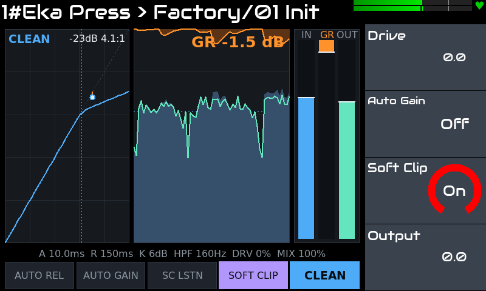

# Eka Press for Zynthian

**English** · [Русский](README.ru.md)

A **single-band live compressor** for [Zynthian](https://zynthian.org), implemented as an **LV2 audio effect plugin** (stereo in, stereo out) plus a **touch widget** (interactive transfer curve, scrolling level & gain-reduction timeline, IN/GR/OUT peak meters, and one-tap mode/toggle buttons) for the Zynthian touchscreen.

Made for four encoders: four clean knob pages covering dynamics, envelope, sidechain and color.

> Tested on: Zynthian **Vangelis** (stable 2610), Raspberry Pi 5, V5 kit, 800×480 touchscreen.
> Other versions/hardware are untested.

## Features

- **Four compressor characters (`Mode`):**
  1. `Clean` — transparent VCA (hybrid RMS+Peak detector, predictable gain reduction).
  2. `Opto` — optical style (smooth attack, two-stage program-dependent release, soft knee).
  3. `Punch` — fast FET peak detector with snappy bite and subtle harmonic density proportional to gain reduction.
  4. `Glue` — cohesive bus VCA for gluing loops after *Eka Tape* or a full mix.
- **Core dynamics:** `Threshold` (`-60..0 dB`), `Ratio` (`1:1..20:1`, `20:1` acts as `∞:1` limiter), `Attack` (`0.1..100 ms`), `Release` (`10..1500 ms`) with `Auto Release`, and quadratic soft `Knee` (`0..18 dB`).
- **Internal sidechain:** 2nd-order Butterworth `SC HPF` (`20..500 Hz`, bypassed at `20 Hz`), `Stereo Link` (`0..100%`, from Dual Mono to full stereo linking), and `SC Listen` audition.
- **Color & output:** analog `Drive` (`0..100%`, asymmetric saturation with DC blocker and gain compensation), `Makeup` (`-12..+24 dB`) + `Auto Makeup`, parallel `Mix` (`0..100%`), smooth `-0.3 dBFS` `Soft Clip` ceiling, and `Output` trim (`-24..+12 dB`).
- **10 Factory Presets** (*Factory* bank): `Init`, `Guitar & Mic Leveler`, `Acoustic Sparkle`, `Opto Vocal & Flute`, `Synth Punch`, `Bass Lock`, `Tape Bus Glue`, `NY Parallel Crush`, `Warm Analog Squeeze`, and `Brickwall Limiter`.
- **Real-time safe:** zero allocations in `run()`, denormal/NaN-safe, click-free parameter smoothing.

## Screenshot



*Left: interactive Transfer Curve (`Threshold` / `Ratio`) with live operating point and mode header. Center: scrolling Input/Output/Gain-Reduction timeline. Right: IN / GR / OUT vertical meters with peak hold. Bottom: compact parameter strip and 5-button touch bar.*

## Installation

On Zynthian (SSH as root):

```bash
git clone https://github.com/dmtry3/zynthian-eka.git
cd zynthian-eka/plugins/press
sudo make install
systemctl restart zynthian
```

Update in one line:

```bash
cd /root/zynthian-eka && git pull && sudo make install-press && systemctl restart zynthian
```

| Link or folder | Contents |
|---|---|
| `/usr/local/lib/lv2/eka-press.lv2` | LV2 bundle (`eka_press.so`, `manifest.ttl`, `eka_press.ttl`, `presets.ttl`) |
| `zyngui/widgets_user/zynthian_widget_eka_press.py` | Touch widget (`ui/`) |
| `zynthian-my-data/presets/lv2/Eka_Press.presets.lv2` | User presets folder |

`install.sh` also refreshes Zynthian's preset cache. Nothing in Zynthian's own files is modified. To remove: `sudo make uninstall`.

If adding for the first time, enable **Eka Press** in Zynthian webconf (*Software → LV2 Plugins*), then add it to a chain as an *Audio Effect*.

## Controls

Four pages of 4 encoders:

| Page | Knob 1 | Knob 2 | Knob 3 | Knob 4 |
|---|---|---|---|---|
| **1. Main** | `Thresh` (`-60..0 dB`) | `Ratio` (`1:1..20:1`) | `Makeup` (`-12..+24 dB`) | `Mix` (`0..100%`) |
| **2. Envelope** | `Attack` (`0.1..100 ms`) | `Release` (`10..1500 ms`) | `Knee` (`0..18 dB`) | `Mode` (`Clean/Opto/Punch/Glue`) |
| **3. Sidechain** | `SC HPF` (`20..500 Hz`) | `Link` (`0..100%`) | `Auto Rel` (`Off / On`) | `SC Lstn` (`Off / On`) |
| **4. Color** | `Drive` (`0..100%`) | `AutoGain` (`Off / On`) | `SoftClip` (`Off / On`) | `Output` (`-24..+12 dB`) |

## Widget & Gestures

- **Transfer Curve (left):** drag horizontally to set `Threshold`, vertically to set `Ratio`.
- **Bottom 5 buttons:** tap `AUTO REL`, `AUTO GAIN`, `SC LSTN`, `SOFT CLIP` to toggle; tap the 5th colored mode button to cycle `CLEAN → OPTO → PUNCH → GLUE`, or **long-press** it (0.5 s) to toggle clickless **Bypass** (the whole widget turns grey).

## Building & Testing on Linux / WSL

```bash
make -C plugins/press                 # build LV2 bundle
make -C plugins/press test            # DSP core, LV2 host and widget tests
SAN=1 make -C plugins/press test      # with AddressSanitizer + UBSan
```

## License

GPL-3.0-or-later. See [LICENSE](LICENSE).
