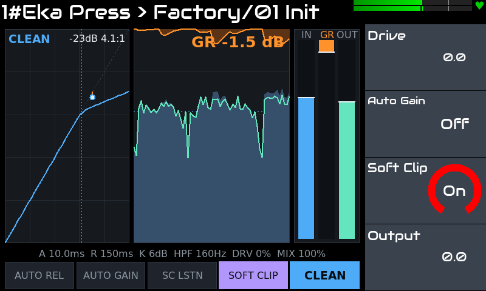

# Eka Press для Zynthian

[English](README.md) · **Русский**

**Однополосный живой компрессор** для [Zynthian](https://zynthian.org): **LV2-плагин** (стерео вход / стерео выход) и **сенсорный виджет** (интерактивная кривая сжатия, бегущая лента уровня и Gain Reduction, вертикальные пикметры `IN / GR / OUT` и быстрые кнопки режимов и тумблеров) для тачскрина Zynthian.

Сделан под 4 энкодера: четыре логичные страницы ручек для динамики, огибающей, сайдчейна и окраса.

> Проверено на: Zynthian **Vangelis** (stable 2610), Raspberry Pi 5, комплект V5, тачскрин 800×480.
> Другие версии и железо не проверялись.

## Возможности

- **Четыре характера сжатия (`Mode`):**
  1. `Clean` — прозрачный VCA (комбинированный RMS+Peak детектор, точное и предсказуемое сжатие).
  2. `Opto` — оптический характер (плавная атака, двухфазный программа-зависимый релиз, мягкое колено).
  3. `Punch` — быстрый FET-детектор с подчёркнутой атакой и лёгкой гармонической плотностью при глубоком сжатии.
  4. `Glue` — шинный VCA для склейки лупов после *Eka Tape* и общей шины.
- **Динамика:** `Threshold` (`-60..0 дБ`), `Ratio` (`1:1..20:1`, на `20:1` — режим лимитера `∞:1`), `Attack` (`0.1..100 мс`), `Release` (`10..1500 мс`) + `Auto Release`, квадратичное мягкое колено `Knee` (`0..18 дБ`).
- **Внутренний сайдчейн:** фильтр `SC HPF` 2-го порядка Баттерворта (`20..500 Гц`, на `20 Гц` обходится), `Stereo Link` (`0..100%`, от независимого Dual Mono до полного Stereo Link) и прослушивание детектора `SC Listen`.
- **Окрас и выход:** аналоговый `Drive` (`0..100%`, асимметричное насыщение с DC-блокером и компенсацией уровня), `Makeup` (`-12..+24 дБ`) + `Auto Makeup`, параллельная компрессия `Mix` (`0..100%`), мягкий потолок `Soft Clip` (`-0.3 дБ`) и `Output` (`-24..+12 дБ`).
- **10 заводских пресетов** (банк *Factory*): `Init`, `Guitar & Mic Leveler`, `Acoustic Sparkle`, `Opto Vocal & Flute`, `Synth Punch`, `Bass Lock`, `Tape Bus Glue`, `NY Parallel Crush`, `Warm Analog Squeeze`, `Brickwall Limiter`.
- **Безопасность в реальном времени:** 0 аллокаций в `run()`, защита от денормалов и NaN, плавное сглаживание параметров без щелчков.

## Скриншот



*Слева: интерактивная кривая сжатия (`Threshold` / `Ratio`) с живой точкой сигнала и текущим режимом в левом верхнем углу. По центру: бегущая лента входа, выхода и Gain Reduction. Справа: вертикальные пикметры `IN / GR / OUT` с удержанием пиков. Снизу: компактная строка параметров и 5 тач-кнопок.*

## Установка

На Zynthian (SSH под root):

```bash
git clone https://github.com/dmtry3/zynthian-eka.git
cd zynthian-eka/plugins/press
sudo make install
systemctl restart zynthian
```

Обновление одной строкой:

```bash
cd /root/zynthian-eka && git pull && sudo make install-press && systemctl restart zynthian
```

| Ссылка или папка | Содержимое |
|---|---|
| `/usr/local/lib/lv2/eka-press.lv2` | бандл LV2 (`eka_press.so`, `manifest.ttl`, `eka_press.ttl`, `presets.ttl`) |
| `zyngui/widgets_user/zynthian_widget_eka_press.py` | сенсорный виджет (`ui/`) |
| `zynthian-my-data/presets/lv2/Eka_Press.presets.lv2` | папка пользовательских пресетов |

`install.sh` автоматически обновляет кэш пресетов Zynthian. Файлы самого Zynthian не меняются. Удаление: `sudo make uninstall`.

При первом запуске включи **Eka Press** в webconf (*Software → LV2 Plugins*) и добавь его в цепочку как *Audio Effect*.

## Управление

Четыре страницы по 4 энкодера:

| Страница | Ручка 1 | Ручка 2 | Ручка 3 | Ручка 4 |
|---|---|---|---|---|
| **1. Main** | `Thresh` (`-60..0 дБ`) | `Ratio` (`1:1..20:1`) | `Makeup` (`-12..+24 дБ`) | `Mix` (`0..100%`) |
| **2. Envelope** | `Attack` (`0.1..100 мс`) | `Release` (`10..1500 мс`) | `Knee` (`0..18 дБ`) | `Mode` (`Clean/Opto/Punch/Glue`) |
| **3. Sidechain** | `SC HPF` (`20..500 Гц`) | `Link` (`0..100%`) | `Auto Rel` (`Off / On`) | `SC Lstn` (`Off / On`) |
| **4. Color** | `Drive` (`0..100%`) | `AutoGain` (`Off / On`) | `SoftClip` (`Off / On`) | `Output` (`-24..+12 дБ`) |

## Виджет и жесты

- **Кривая сжатия (слева):** свайп по горизонтали меняет `Threshold`, по вертикали — `Ratio`.
- **Нижний ряд из 5 кнопок:** тап по `AUTO REL`, `AUTO GAIN`, `SC LSTN`, `SOFT CLIP` переключает соответствующий тумблер; тап по 5-й цветной кнопке листает режимы по кругу (`CLEAN → OPTO → PUNCH → GLUE`).

## Сборка и тесты в Linux / WSL

```bash
make -C plugins/press                 # сборка LV2-бандла
make -C plugins/press test            # тесты DSP, LV2-хоста и виджета
SAN=1 make -C plugins/press test      # с AddressSanitizer и UBSan
```

## Лицензия

GPL-3.0-or-later. См. [LICENSE](LICENSE).
