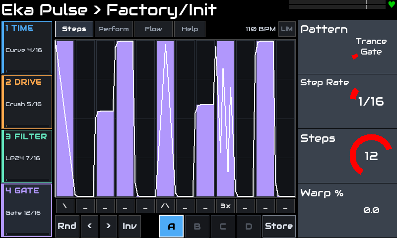
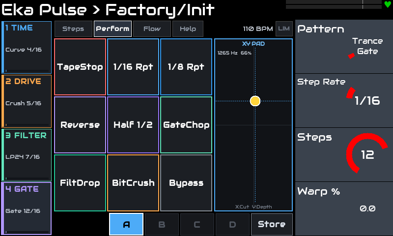
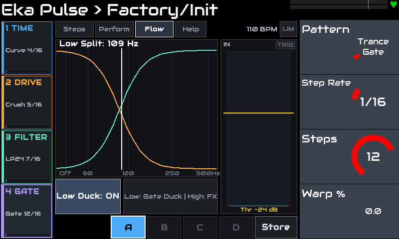

# Eka Pulse for Zynthian

**English** · [Русский](README.ru.md)

A **rhythmic multi-effect shaper** for [Zynthian](https://zynthian.org), implemented as an **LV2 audio effect plugin** (stereo in, stereo out) plus a **touch widget** (polyrhythmic step editor, live performance pads, XY pad, Low Split crossover and Scenes A–D) for the Zynthian touchscreen.

Made for four encoders and a footswitch: five knob pages, three of them edit the **selected** slot.

> Tested on: Zynthian **Vangelis**, Raspberry Pi 5, V5 kit, 800×480 touchscreen.
> Other versions/hardware are untested.

## Features

- **Four polyrhythmic shaper slots in series**, each with its own `1..16` step loop length, per-step shape (`_` Hold, `\` Decay, `/` Ramp, `/\` Pulse, `2x`, `3x`), `Warp`, `Smooth / Punch`, independent click-free `ON/OFF`, and 24 built-in musical patterns:
  1. **1: TIME** — stereo ring buffer (~4+ s) with 4-point Hermite interpolation and de-click crossfade:
     - `Curve` (TimeShaper delay curve over `1/8..1 bar`),
     - `Chop` (Step-Chopper: `THRU`, `1/8`, `1/16`, `1/2x`, `REV`, `STOP` by step height),
     - `Stutter` (beat-synced stutter subdivisions),
     - `TapeStop` (motor deceleration/acceleration, brake time via `Range`).
  2. **2: DRIVE & CRUSH** — `Tube` (asymmetric saturation + DC blocker), `Fold` (1st-order ADAA wavefolder), `Hard` (clipper/fuzz), `Crush` (sample-rate + bit crush), `Combo` (Tube + Crush).
  3. **3: FILTER** — TPT SVF (`LP 24`, `LP 12`, `BP`, `HP`, `Morph` LP→BP→HP, `Notch`) and 4-stage stereo allpass `Phaser`.
  4. **4: GATE & SPACE** — `Gate` (with `Floor` and front-edge `Punch` when `Smooth < 0`), `Pan` (auto-pan), `Width` (M/S stereo width), `Gate+Pan` (ping-pong chopper).
- **Low Split Crossover (Linkwitz-Riley 24 dB/oct, `Off / 60..500 Hz`).** Keeps sub-bass clean while shaping highs, or enable **Low Duck** to apply the `Gate` envelope to the low band. Zero added delay when `Off`.
- **Triggers & Envelope Modulation:**
  - `Sync` — locked to Zynthian transport (halts cleanly when stopped, starts synchronously on beat 1).
  - `Free` — internal clock (works without transport).
  - `Audio` — restarts a full cycle from step 1 on input transients above `Thresh` (works without transport).
  - `MIDI` — restarts a full cycle from step 1 on MIDI Note On (works without transport).
  - `EnvMod` (`-100..+100%`) — input envelope modulates slot depth dynamically.
- **Live Performance (`Perform` tab):** 3×3 momentary pads (`TapeStop`, `1/16 Rpt`, `1/8 Rpt`, `Reverse`, `Half 1/2`, `GateChop`, `FiltDrop`, `BitCrush`, `Bypass`), interactive **XY Pad** (`X: Cutoff`, `Y: Depth`), and **4 Scenes (`A–D`)** with `Store`, long-press to clear `B–D`, footswitch `PrevScn` / `NextScn`, and full LV2 State persistence.
- **24 Factory Presets** (*Factory* bank) covering sidechain, trance gates, polyrhythms, acid filters, phaser, wavefolding, lo-fi crush, glitch chopping, tape stop, clean-bass splits, and Audio/MIDI triggered FX.
- **Zero-latency stereo-linked brickwall limiter** (0 dBFS ceiling, `LIM` badge), 0 RT allocations, flush-to-zero enabled.

## Screenshots

| | |
|---|---|
|  |  |
| **Steps:** four slot cards on the left, polyrhythmic step bars, smooth curve overlay, playhead, step shapes, live `Param 1 · Param 2 · Depth` pill and Scenes `A–D` | **Perform:** 3×3 momentary live pads, interactive XY pad (`Cutoff` / `Depth`), Scenes `A–D` + `Store` |
|  | |
| **Flow:** Linkwitz-Riley `Low Split` crossover curve, `Low Duck` toggle and input level meter with draggable `Thr` line and `TRIG` LED | |

## Installation

On Zynthian (SSH as root):

```bash
git clone https://github.com/dmtry3/zynthian-eka.git
cd zynthian-eka/plugins/pulse
sudo make install
systemctl restart zynthian
```

Update in one line:

```bash
cd /root/zynthian-eka && git pull && sudo make install-pulse && systemctl restart zynthian
```

| Link or folder | Contents |
|---|---|
| `/usr/local/lib/lv2/eka-pulse.lv2` | LV2 bundle (`eka_pulse.so`, `manifest.ttl`, `eka_pulse.ttl`, `presets.ttl`) |
| `zyngui/widgets_user/zynthian_widget_eka_pulse.py` | Touch widget (`ui/`) |
| `zynthian-my-data/presets/lv2/Eka_Pulse.presets.lv2` | User presets folder |

`install.sh` also refreshes Zynthian's preset cache. Nothing in Zynthian's own files is modified. To remove: `sudo make uninstall`.

If adding for the first time, enable **Eka Pulse** in Zynthian webconf (*Software → LV2 Plugins*), then add it to a chain as an *Audio Effect*.

## Controls

Five pages of 4 encoders. Pages `FX`, `Curve` and `Trigger` control the **selected** slot; `Mode`, `Param 1` and `Param 2` automatically rename to match the selected slot.

| Page | Knob 1 | Knob 2 | Knob 3 | Knob 4 |
|---|---|---|---|---|
| **1. Main** | `Slot` (`1:Time..4:Gate`) | `Mix` (`0..100%`) | `LowSplit` (`Off, 60..500 Hz`) | `LowDuck` (`Off / On`) |
| **2. FX** *(slot)* | `Mode` *(slot algorithm)* | `Range / Drive / Cutoff / Floor` | `Window / Tone / Res / Width` | `Depth` (`-100..+100%`) |
| **3. Curve** *(slot)* | `Pattern` (`Custom` + 24) | `Rate` (`1/32..1 bar`, `Free`) | `Steps` (`1..16`) | `Warp` (`-100..+100%`) |
| **4. Trigger** *(slot)* | `Trig` (`Sync/Free/Audio/MIDI`) | `Thresh` (`-60..0 dB`) | `EnvMod` (`-100..+100%`) | `Smooth` (`-100..+100`, `<0` = Punch) |
| **5. Perform** | `LivePad` (`Off` + 8 FX) | `PrevScn` *(pedal)* | `NextScn` *(pedal)* | `Scene` (`A–D`) |

## Widget & Gestures

- **Left slot column (`1 TIME`, `2 DRIVE`, `3 FILTER`, `4 GATE`):** tap to select a slot; tap the selected slot again or hold (`0.6 s`) to toggle `ON / OFF`.
- **`Steps` tab:** swipe across bars to draw step levels; tap the row below to cycle step shapes (`_ \ / /\ 2x 3x`) or `TIME: Chop` actions (`THRU 1/8 1/16 1/2x REV STOP`); `Rnd`, `<`, `>`, `Inv` transform the pattern; live `Param 1 · Param 2 · Depth` pill in the top-right corner.
- **`Perform` tab:** hold any of the 9 pads or drag the XY pad for momentary live FX (releases right back onto the grid).
- **`Flow` tab:** drag the crossover curve to set `Low Split`, tap `Low Duck`, and drag the yellow `Thr` line on the input meter.
- **`Help` tab:** quick per-slot parameter and gesture reference.
- **Scenes `A–D` + `Store`:** tap `Store` then `A–D` to save; tap a saved (blue) scene to recall; long-press (`0.6 s`) a saved scene `B–D` to clear it back to empty (gray). Empty scenes cannot be selected by touch, knob or pedal.

## Building & Testing on Linux / WSL

```bash
make -C plugins/pulse                 # build LV2 bundle
make -C plugins/pulse test            # DSP core, LV2 host + all 24 presets, widget checks
SAN=1 make -C plugins/pulse test      # AddressSanitizer + UBSan
```

## License

GPL-3.0-or-later. See [LICENSE](LICENSE).
