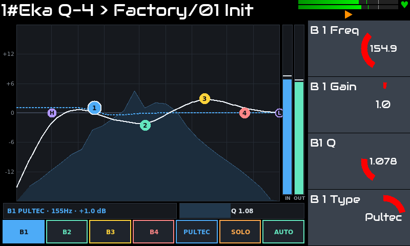

# Eka Q-4 for Zynthian

**English** · [Русский](README.ru.md)

A **4-band live parametric equalizer** for [Zynthian](https://zynthian.org), implemented as an **LV2 audio effect plugin** (stereo in, stereo out) plus an **interactive touch widget** (draggable EQ nodes, HPF/LPF handles, 24-band live spectrum analyzer, touch Q slider, Solo audition, and IN/OUT peak meters) for the Zynthian touchscreen.

Made for four encoders: six clean knob pages covering the four parametric bands, cuts/tilt, and master controls.

> Tested on: Zynthian **Vangelis** (stable 2610), Raspberry Pi 5, V5 kit, 800×480 touchscreen.
> Other versions/hardware are untested.

## Features

- **4 Parametric Bands (64-bit TDF-II biquads):**
  - **Band 1 (Low, `20..1000 Hz`):** `Shelf`, `Bell`, `Pultec` (low shelf + gentle compensating upper-bass dip), `Off`.
  - **Band 2 (Low-Mid, `60..4000 Hz`):** `Bell`, `Notch` (feedback/resonance surgical cut), `Off`.
  - **Band 3 (High-Mid, `250..12000 Hz`):** `Bell`, `Notch`, `Off`.
  - **Band 4 (High, `800..20000 Hz`):** `Shelf`, `Bell`, `Air` (wide smooth silk high shelf), `Off`.
- **Edges & Tilt:** Butterworth `HPF` (`20..600 Hz`, bypassed at `20 Hz`), `LPF` (`2..20 kHz`, bypassed at `20 kHz`) with selectable `12 / 24 dB/oct` slope, and a symmetric `Tilt` control (`-6..+6 dB` around `1 kHz`).
- **Live tools:** global `Scale` (`0..200%`), click-free bandpass `Solo` per band (`Off / Band 1..4`), perceptual `AutoGain` loudness compensation, and `Output` trim (`-18..+18 dB`).
- **24-band real-time spectrum analyzer:** zero-latency log-spaced filterbank drawn behind the EQ curve.
- **10 Factory Presets** (*Factory* bank): `Init`, `Vocal Clarity & Air`, `Acoustic Guitar Polish`, `Bass Pultec Weight`, `Warm Keys & Rhodes`, `Tape Loop Mud Clean`, `Granular Cloud Sculpt`, `West Coast Fold Tame`, `Stage Anti-Feedback`, and `Master Smile & Air`.
- **Real-time safe:** zero allocations in `run()`, denormal/NaN-safe, smooth click-free coefficient interpolation.

## Screenshot



*Interactive EQ frequency-response graph with 4 color-coded draggable nodes, HPF/LPF edge handles, 24-band live spectrum silhouette, IN/OUT peak meters with hold, touch Q slider, and 7-button touch bar (long press `AUTO` for grayscale Bypass).*

## Installation

On Zynthian (SSH as root):

```bash
git clone https://github.com/dmtry3/zynthian-eka.git
cd zynthian-eka/plugins/q4
sudo make install
systemctl restart zynthian
```

Update in one line:

```bash
cd /root/zynthian-eka && git pull && sudo make install-q4 && systemctl restart zynthian
```

| Link or folder | Contents |
|---|---|
| `/usr/local/lib/lv2/eka-q4.lv2` | LV2 bundle (`eka_q4.so`, `manifest.ttl`, `eka_q4.ttl`, `presets.ttl`) |
| `zyngui/widgets_user/zynthian_widget_eka_q-4.py` | Touch widget (`ui/zynthian_widget_eka_q4.py`) |
| `zynthian-my-data/presets/lv2/Eka_Q-4.presets.lv2` | User presets folder |

`install.sh` also refreshes Zynthian's preset cache. Nothing in Zynthian's own files is modified. To remove: `sudo make uninstall`.

If adding for the first time, enable **Eka Q-4** in Zynthian webconf (*Software → LV2 Plugins*), then add it to a chain as an *Audio Effect*.

## Controls

Six pages of 4 encoders:

| Page | Knob 1 | Knob 2 | Knob 3 | Knob 4 |
|---|---|---|---|---|
| **1. Band 1** | `B1 Freq` (`20..1000 Hz`) | `B1 Gain` (`-18..+18 dB`) | `B1 Q` (`0.2..12`) | `B1 Type` (`Shelf/Bell/Pultec/Off`) |
| **2. Band 2** | `B2 Freq` (`60..4000 Hz`) | `B2 Gain` (`-18..+18 dB`) | `B2 Q` (`0.2..16`) | `B2 Type` (`Bell/Notch/Off`) |
| **3. Band 3** | `B3 Freq` (`250..12000 Hz`) | `B3 Gain` (`-18..+18 dB`) | `B3 Q` (`0.2..16`) | `B3 Type` (`Bell/Notch/Off`) |
| **4. Band 4** | `B4 Freq` (`800..20000 Hz`) | `B4 Gain` (`-18..+18 dB`) | `B4 Q` (`0.2..12`) | `B4 Type` (`Shelf/Bell/Air/Off`) |
| **5. Cuts & Tilt** | `HPF` (`20..600 Hz`) | `LPF` (`2..20 kHz`) | `Tilt` (`-6..+6 dB`) | `Slope` (`12 / 24 dB`) |
| **6. Master** | `Scale` (`0..200%`) | `Solo` (`Off / B1..B4`) | `AutoGain` (`Off / On`) | `Output` (`-18..+18 dB`) |

## Widget & Gestures

- **EQ graph:** drag nodes `1..4` horizontally (`Freq`) and vertically (`Gain`); drag `H` / `L` along the `0 dB` line for `HPF` / `LPF`.
- **Double tap** on a node resets its `Gain` to `0 dB` (or bypasses `HPF`/`LPF`).
- **Q bar:** drag left/right to adjust `Q` of the selected band.
- **Bottom buttons:** tap `B1..B4` to select a band (**long press** toggles the band On/Off); tap the type button to cycle filter type; tap `SOLO` to audition the selected band; tap `AUTO` to toggle `AutoGain` (**long press** toggles full EQ `Bypass` and grays out the UI).

## Building & Testing on Linux / WSL

```bash
make -C plugins/q4                 # build LV2 bundle
make -C plugins/q4 test            # DSP core, LV2 host and widget tests
SAN=1 make -C plugins/q4 test      # with AddressSanitizer + UBSan
```

## License

GPL-3.0-or-later. See [LICENSE](LICENSE).
