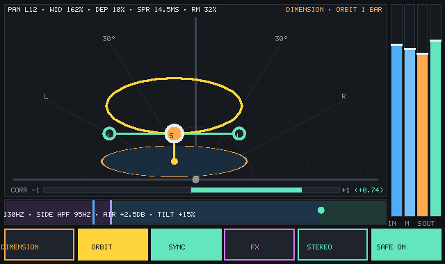
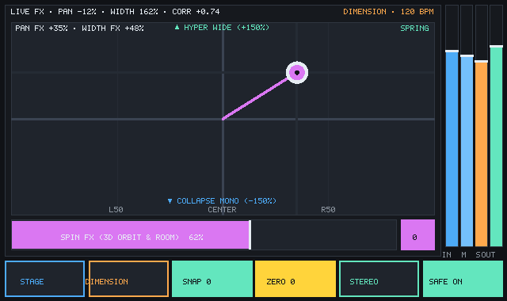

# Eka Space for Zynthian

**English** · [Русский](README.ru.md)

A **3D stereo soundstage, multi-mode stereo widener, binaural panner & spatial modulator** for [Zynthian](https://zynthian.org), implemented as an **LV2 audio effect plugin** (stereo in, stereo out, LV2 `time:Position` BPM sync) plus an **interactive touch widget** (draggable 2D soundstage radar with `Pan`, `Depth` and `Width` wing handles, motion orbit trail, phase correlation bar, `Bass Mono / Side HPF / Side Air` bar, `IN/M/S/OUT` meters, and a dedicated live **FX** X-Y screen) for the Zynthian touchscreen.

Made for four encoders: six clean knob pages covering stage positioning, 5 stereo expansion engines, tempo-synced spatial modulation, low-end anchor / side air / dynamic envelope width, live X-Y performance FX, and master audition / phase protection.

> Tested on: Zynthian **Vangelis** (stable 2610), Raspberry Pi 5, V5 kit, 800×480 touchscreen.
> Other versions/hardware are untested.

## Features

- **2D Soundstage Positioning (`Stage`):**
  - `Pan` (`-100..+100%`) — true stereo constant-power balance blended with cross-panning and subtle far-ear binaural head-shadow damping.
  - `Width` (`0..300%`) — continuous Mid/Side stereo scale from pure mono (`0%`) through natural stereo (`100%`) to hyper-wide (`300%`).
  - `Depth` (`0..100%`) — front-to-back acoustic distance cue combining proximity attenuation, high-frequency air absorption, and early-reflection ratio.
  - `Tilt` (`-100..+100%`) — opposite L/R spectral high-shelves (`±6 dB` around `900 Hz`) for natural frequency-balanced asymmetry without shifting sub-bass.
- **5 Stereo Widener Engines (`Mode`):**
  1. `M/S` — clean mastering-grade Mid/Side expansion with subtle micro-spread synthesis for mono inputs.
  2. `Comb` — 100% mono-compatible complementary dual-tap comb stereoizer (`+Side` on L, `-Side` on R — cancels cleanly when summed to mono).
  3. `Haas` — psychoacoustic precedence effect (`0.5..40 ms` `Spread`) with head-shadow damping on the delayed channel.
  4. `Dimension` — analog BBD-style dual quadrature cross-phase chorus expander inspired by studio Dimension D units.
  5. `Vortex` — 4-stage decorrelated all-pass phase disperser with cross-delay for extreme, enveloping 3D clouds.
- **Early Reflections (`Room`, `0..100%`):** 4-tap decorrelated stereo early-reflection stage scaled by `Spread` (`0.5..40 ms`) and `Depth` to place dry synths, loops, or mono instruments in a physical space without a long reverb tail.
- **Tempo-Synced Spatial Modulation (`Motion`):**
  - 5 spatial trajectories (`Mod Shape`): `Pan` (L↔R), `Breathe` (Width pulse), `Orbit` (2D circular Pan + Depth rotation), `Figure-8` (Lissajous Pan `f` × Width/Depth `2f`), and `Drift` (organic dual-sine movement).
  - `Mod Rate` (`0.05..12 Hz`) with LV2 `time:Position` BPM `Sync` (`4 bars .. 1/64`, including triplets and dotted divisions) and `Mod Depth` (`0..100%`).
- **Bass Mono Anchor, Side Air & Dynamic Width (`Bass & Air`):**
  - `Bass Mono` (`20..500 Hz`) folds low frequencies out of the Side channel so kick and sub-bass stay rock-solid in the center even at `300%` width.
  - `Side HPF` (`20..1000 Hz`) and `Side Air` (`-12..+12 dB` at `6.5 kHz`) sculpt the stereo wings.
  - Bipolar `Env Width` (`-100..+100%`): input envelope follower expands stereo width on loud hits (`+`) or ducks the sides on transients (`-`) so attacks punch dead-center and bloom wide on release.
- **Dedicated Live `FX` Screen & Master Phase Guard:**
  - Live `Pan FX` (`-100..+100%`), `Width FX` (`-100..+100%`), and `Spin FX` (`0..100%` 3D rotation + room bloom) with `HOLD / SNAP 0` spring return and MIDI-mappable `FX Zero`.
  - `Audition` monitor (`Stereo`, `Mono`, `Mid`, `Side`) and automatic `SafePhase` protection against negative-correlation mono cancellation.
- **10 Factory Presets** (*Factory* bank): `Init Natural Stage`, `Mono-to-Stereo Comb Velvet`, `Analog Dimension Chorus`, `Psychoacoustic Haas Wall`, `Binaural 3D Orbit`, `Figure-8 Synced Swirl`, `Dynamic Transient Bloom`, `Tight Center & Distant Wings`, `Extreme Vortex Hyper-Wide`, and `Master Bus Velvet & Bass Lock`.
- **Real-time safe:** zero allocations in `run()`, denormal/NaN-safe, click-free parameter smoothing.

## Screenshots

| | |
|---|---|
|  |  |
| **Main:** 2D Soundstage Radar (`Pan` × `Depth` + `Width` wings + motion orbit trail + correlation meter), `Bass Mono / Side HPF / Side Air` bar, `IN/M/S/OUT` meters and 6 touch buttons | **FX:** live `Pan FX` × `Width FX` X-Y pad, `Spin FX` slider with `0` reset, `HOLD / SNAP 0` spring return and `ZERO 0` |

## Installation

On Zynthian (SSH as root):

```bash
git clone https://github.com/dmtry3/zynthian-eka.git
cd zynthian-eka/plugins/space
sudo make install
systemctl restart zynthian
```

Update in one line:

```bash
cd /root/zynthian-eka && git pull && sudo make install-space && systemctl restart zynthian
```

| Link or folder | Contents |
|---|---|
| `/usr/local/lib/lv2/eka-space.lv2` | LV2 bundle (`eka_space.so`, `manifest.ttl`, `eka_space.ttl`, `presets.ttl`) |
| `zyngui/widgets_user/zynthian_widget_eka_space.py` | Touch widget (`ui/`) |
| `zynthian-my-data/presets/lv2/Eka_Space.presets.lv2` | User presets folder |

`install.sh` refreshes Zynthian's preset cache and sets the category to **Spatial**. To remove: `sudo make uninstall`.

If adding for the first time, enable **Eka Space** in Zynthian webconf (*Software → LV2 Plugins*), then add it to a chain as an *Audio Effect*.

## Controls

Six pages of 4 encoders:

| Page | Knob 1 | Knob 2 | Knob 3 | Knob 4 |
|---|---|---|---|---|
| **1. Stage** | `Pan` (`-100..+100%`) | `Width` (`0..300%`) | `Depth` (`0..100%`) | `Tilt` (`-100..+100%`) |
| **2. Widener** | `Mode` (`M/S / Comb / Haas / Dimension / Vortex`) | `Widen` (`0..100%`) | `Spread` (`0.5..40 ms`) | `Room` (`0..100%`) |
| **3. Motion** | `Mod Shape` (`Pan / Breathe / Orbit / Figure-8 / Drift`) | `Mod Rate` (`0.05..12 Hz` / Sync) | `Mod Depth` (`0..100%`) | `Sync` (`Free / Sync`) |
| **4. Bass & Air** | `Bass Mono` (`20..500 Hz`) | `Side HPF` (`20..1000 Hz`) | `Side Air` (`-12..+12 dB`) | `Env Width` (`-100..+100%`) |
| **5. Live FX** | `Pan FX` (`-100..+100%`) | `Width FX` (`-100..+100%`) | `Spin FX` (`0..100%`) | `FX Zero` (`Off / Zero`) |
| **6. Master** | `Audition` (`Stereo / Mono / Mid / Side`) | `SafePhase` (`Off / On`) | `Mix` (`0..100%`) | `Output` (`-18..+12 dB`) + `Bypass` |

## Widget & Gestures

- **Soundstage Radar (top):** drag the center `S` node left/right for `Pan` and up/down for `Depth` (switches encoders to `Stage`); drag the `W` wing handles outward/inward to set `Width` (`0..300%`); **double-tap** inside the radar to reset `Pan = 0%`, `Width = 100%`, `Depth = 0%`.
- **Bass Mono & Side Air bar (middle):** drag left markers for `Bass Mono` / `Side HPF`, or drag the right `Air` node vertically for `Side Air` (`-12..+12 dB`); switches encoders to `Bass & Air`.
- **Dedicated `FX` screen:** tap `FX` on the bottom bar to open the live **Live FX** touch screen (and switch encoders to `Live FX`) with a large **X-Y pad** (`X = PAN FX`, `Y = WIDTH FX`), bottom `SPIN FX` slider with `0` reset, `HOLD / SNAP 0` spring-return toggle, and `ZERO 0`.
- **Bottom 6 buttons:** tap `MODE`, `SHAPE`, `SYNC`, `FX`, `AUD` (`Stereo/Mono/Mid/Side`), `SAFE` (`SafePhase`); **long press `SAFE`** toggles full `Bypass` and grays out the UI.

## Building & Testing on Linux / WSL

```bash
make -C plugins/space                 # build LV2 bundle
make -C plugins/space test            # DSP core, LV2 host and widget tests
SAN=1 make -C plugins/space test      # with AddressSanitizer + UBSan
```

## License

GPL-3.0-or-later. See [LICENSE](LICENSE). Changes: [CHANGELOG.md](CHANGELOG.md).
