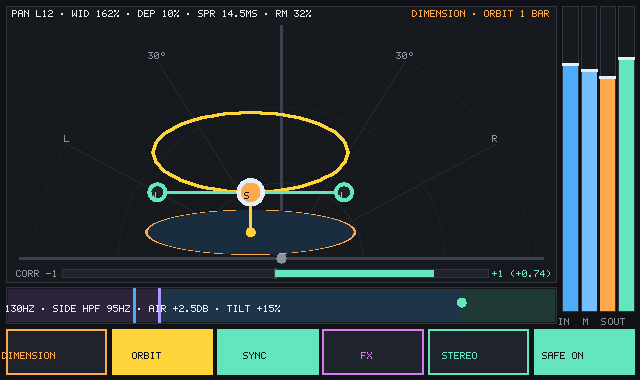
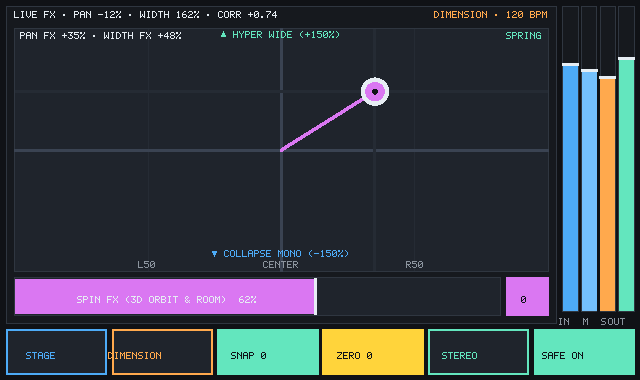

# Eka Space для Zynthian

[English](README.md) · **Русский**

**Плагин управления 3D-пространством, многорежимного стереорасширения, бинауральной панорамы и пространственной модуляции** для [Zynthian](https://zynthian.org): аудио-эффект в формате **LV2** (стерео вход, стерео выход, синхронизация с BPM Zynthian через `time:Position`) с **интерактивным тач-виджетом** (2D-радар сцены с перетаскиванием позиции `Pan × Depth` и крыльев `Width`, орбитальным следом модуляции, коррелометром фазы, полосой `Bass Mono / Side HPF / Side Air`, метрами `IN/M/S/OUT` и отдельным живым экраном **FX** с X-Y пэдом).

Сделан под четыре энкодера: шесть логичных страниц управления — позиция на сцене, 5 движков стереорасширения, синхронизированная с темпом пространственная модуляция, удержание баса в моно / воздух по краям / динамическая ширина от огибающей, живые X-Y макросы и мастер-контроль с проверкой моно-совместимости.

> Проверено на: Zynthian **Vangelis** (stable 2610), Raspberry Pi 5, набор V5, тачскрин 800×480.
> Другие версии и железо не проверялись.

## Возможности

- **Позиционирование на 2D-сцене (`Stage`):**
  - `Pan` (`-100..+100%`) — честный стерео-баланс постоянной мощности в сочетании с кросс-панорамированием и мягким бинауральным затенением дальнего уха (head shadow).
  - `Width` (`0..300%`) — плавный масштаб стереобазы от чистого моно (`0%`) и естественного стерео (`100%`) до сверхширокого (`300%`).
  - `Depth` (`0..100%`) — глубина сцены (ближе / дальше): сочетание ослабления прямого сигнала, поглощения высоких частот воздухом и доли ранних отражений.
  - `Tilt` (`-100..+100%`) — встречный спектральный наклон L/R (`±6 дБ` выше `900 Гц`) для аккуратной музыкальной асимметрии без смещения суб-баса.
- **5 режимов стереорасширения (`Mode`) — от аккуратного мастерингового до экстремального:**
  1. `M/S` — чистое Mid/Side расширение с деликатной синтетической подзвучкой для моно-источников.
  2. `Comb` — 100% моно-совместимый комплементарный гребенчатый стерео-расширитель (`+Side` в L, `-Side` в R: при сложении в моно вычитается в ноль без тембральной окраски).
  3. `Haas` — психоакустический эффект предшествования (`Spread` `0.5..40 мс`) с притемнением задержанного канала.
  4. `Dimension` — аналоговый квадратурный BBD-хорус/расширитель в духе студийных приборов Dimension D.
  5. `Vortex` — 4-каскадный фазовый дисперсер на некоррелированных all-pass фильтрах с перекрёстной задержкой для экстремального 3D-окружения.
- **Ранние отражения (`Room`, `0..100%`):** 4-отводная стерео-модель ранних отражений комнаты (связанная со `Spread` и `Depth`) помещает сухой синт, сэмпл или моно-инструмент в живой объём без длинного хвоста реверберации.
- **Синхронизированная пространственная модуляция (`Motion`):**
  - 5 траекторий (`Mod Shape`): `Pan` (авто-панорама L↔R), `Breathe` (дыхание стереоширины), `Orbit` (круговая 2D-орбита Pan + Depth), `Figure-8` (восьмёрка Лиссажу: Pan на частоте `f`, Width/Depth на `2f`) и `Drift` (органический двухсинусный дрейф).
  - `Mod Rate` (`0.05..12 Гц`) с привязкой к темпу Zynthian `Sync` (`4 bars .. 1/64`, включая триоли и точки) и `Mod Depth` (`0..100%`).
- **Моно-якорь баса, воздух в Side и динамическая ширина (`Bass & Air`):**
  - `Bass Mono` (`20..500 Гц`) собирает низкие частоты строго в центр, чтобы бочка и бас оставались плотными даже при `Width = 300%`.
  - `Side HPF` (`20..1000 Гц`) и шельф `Side Air` (`-12..+12 дБ` на `6.5 кГц`) подсвечивают края стереокартины.
  - Биполярный `Env Width` (`-100..+100%`): детектор огибающей раскрывает стереоширину на громких ударах (`+`) или, наоборот, прижимает края в момент атаки (`-`), чтобы транзиент бил чётко по центру, а хвост расплывался в стороны.
- **Отдельный живой экран `FX` и защита фазы:**
  - Живые макросы `Pan FX` (`-100..+100%`), `Width FX` (`-100..+100%`) и `Spin FX` (`0..100%` 3D-вращение + раскрытие комнаты) с пружинным возвратом `HOLD / SNAP 0` и MIDI-сбросом `FX Zero`.
  - Режим прослушивания `Audition` (`Stereo`, `Mono`, `Mid`, `Side`) и автозащита `SafePhase` от противофазного провала в моно.
- **10 заводских пресетов** (банк *Factory*): `Init Natural Stage`, `Mono-to-Stereo Comb Velvet`, `Analog Dimension Chorus`, `Psychoacoustic Haas Wall`, `Binaural 3D Orbit`, `Figure-8 Synced Swirl`, `Dynamic Transient Bloom`, `Tight Center & Distant Wings`, `Extreme Vortex Hyper-Wide`, `Master Bus Velvet & Bass Lock`.
- **Безопасен для реального времени:** без выделений памяти в `run()`, защита от денормалов и NaN, плавное сглаживание параметров без щелчков.

## Скриншоты

| | |
|---|---|
|  |  |
| **Main:** 2D-радар звуковой сцены (`Pan` × `Depth` + крылья `Width` + орбита модуляции + коррелометр), полоса `Bass Mono / Side HPF / Side Air`, метры `IN/M/S/OUT` и 6 кнопок | **FX:** живой X-Y пэд `Pan FX` × `Width FX`, слайдер `Spin FX` с кнопкой `0`, пружинный возврат `HOLD / SNAP 0` и `ZERO 0` |

## Установка

На Zynthian (SSH под root):

```bash
git clone https://github.com/dmtry3/zynthian-eka.git
cd zynthian-eka/plugins/space
sudo make install
systemctl restart zynthian
```

Обновление одной строкой:

```bash
cd /root/zynthian-eka && git pull && sudo make install-space && systemctl restart zynthian
```

| Ссылка или папка | Что внутри |
|---|---|
| `/usr/local/lib/lv2/eka-space.lv2` | LV2-бандл (`eka_space.so`, `manifest.ttl`, `eka_space.ttl`, `presets.ttl`) |
| `zyngui/widgets_user/zynthian_widget_eka_space.py` | Тач-виджет (`ui/`) |
| `zynthian-my-data/presets/lv2/Eka_Space.presets.lv2` | Папка пользовательских пресетов |

`install.sh` обновляет кэш пресетов и прописывает категорию **Spatial**. Удаление: `sudo make uninstall`.

При первом добавлении включите **Eka Space** в webconf Zynthian (*Software → LV2 Plugins*), затем добавьте его в цепочку как *Audio Effect*.

## Управление

Шесть страниц по 4 энкодера:

| Страница | Ручка 1 | Ручка 2 | Ручка 3 | Ручка 4 |
|---|---|---|---|---|
| **1. Stage** | `Pan` (`-100..+100%`) | `Width` (`0..300%`) | `Depth` (`0..100%`) | `Tilt` (`-100..+100%`) |
| **2. Widener** | `Mode` (`M/S / Comb / Haas / Dimension / Vortex`) | `Widen` (`0..100%`) | `Spread` (`0.5..40 мс`) | `Room` (`0..100%`) |
| **3. Motion** | `Mod Shape` (`Pan / Breathe / Orbit / Figure-8 / Drift`) | `Mod Rate` (`0.05..12 Гц` / Sync) | `Mod Depth` (`0..100%`) | `Sync` (`Free / Sync`) |
| **4. Bass & Air** | `Bass Mono` (`20..500 Гц`) | `Side HPF` (`20..1000 Гц`) | `Side Air` (`-12..+12 дБ`) | `Env Width` (`-100..+100%`) |
| **5. Live FX** | `Pan FX` (`-100..+100%`) | `Width FX` (`-100..+100%`) | `Spin FX` (`0..100%`) | `FX Zero` (`Off / Zero`) |
| **6. Master** | `Audition` (`Stereo / Mono / Mid / Side`) | `SafePhase` (`Off / On`) | `Mix` (`0..100%`) | `Output` (`-18..+12 дБ`) + `Bypass` |

## Виджет и жесты

- **2D-радар сцены (сверху):** тяните центральный узел `S` влево/вправо для `Pan` и вверх/вниз для `Depth` (переключает энкодеры на `Stage`); тяните боковые крылья `W` для `Width` (`0..300%`); **двойной тап** по радару сбрасывает `Pan = 0%`, `Width = 100%`, `Depth = 0%`.
- **Полоса Bass Mono & Side Air (в центре):** тяните левые границы `Bass Mono` / `Side HPF` по горизонтали или правую точку `Air` по вертикали (`-12..+12 дБ`); переключает энкодеры на `Bass & Air`.
- **Отдельный экран `FX`:** тап по кнопке `FX` открывает игровой экран **Live FX** (и переключает энкодеры на `Live FX`) с большим **X-Y пэдом** (`X = PAN FX`, `Y = WIDTH FX`), нижним слайдером `SPIN FX` с кнопкой сброса `0`, режимом пружины `HOLD / SNAP 0` и общим сбросом `ZERO 0`.
- **6 нижних кнопок:** `MODE`, `SHAPE`, `SYNC`, `FX`, `AUD` (`Stereo/Mono/Mid/Side`), `SAFE` (`SafePhase`); **долгий тап по `SAFE`** включает общий `Bypass` — весь виджет становится серым.

## Сборка и тесты на Linux / WSL

```bash
make -C plugins/space                 # собрать LV2-бандл
make -C plugins/space test            # тесты DSP, LV2-хоста и виджета
SAN=1 make -C plugins/space test      # с AddressSanitizer + UBSan
```

## Лицензия

GPL-3.0-or-later. См. [LICENSE](LICENSE). Изменения: [CHANGELOG.md](CHANGELOG.md).
