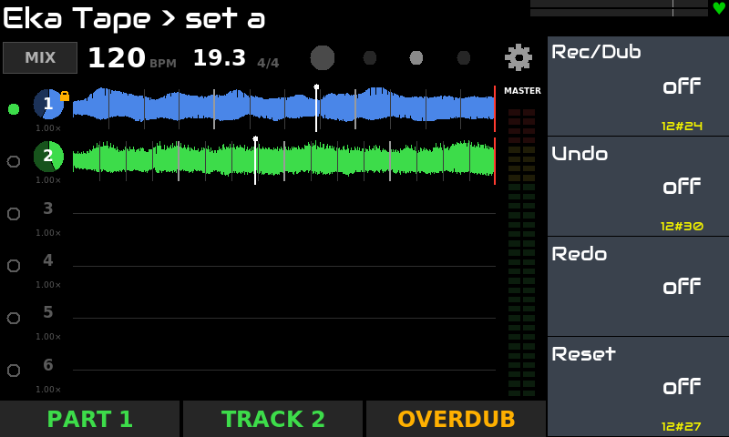
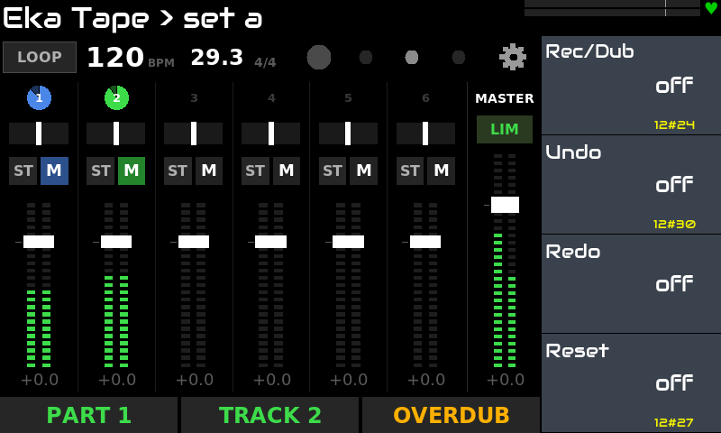

# Eka Tape for Zynthian

**English** · [Русский](README.ru.md)

A **live audio looper** for [Zynthian](https://zynthian.org), as an **LV2 audio-effect plugin**, made for the stage:
parts of stereo tracks, played with the feet from a MIDI footswitch, with **on-screen widgets** for the Zynthian
touch UI (Loop, Mixer, Speed, settings). Smooth sound and stability come before new features: every change of the
sound goes through a fade or a crossfade.

> Tested on: Zynthian **Vangelis** (stable 2610), Raspberry Pi 5 (8 GB), V5 kit, 800x480 touch screen.
> Other versions/hardware are untested.

## Features

- **Parts x tracks:** 4 parts of 4 stereo tracks (or 2 x 2, 6 x 6). One part plays, the others wait.
- **Record, overdub, undo, redo** without a limit on layers; RPO or ROP record order; Free or Quantize mode, a fixed
  length per track (1–16 bars) or free; count-in and a signal threshold to start recording.
- **Parts:** **Lock** marks the tracks that go on into the next empty part, in the same phase, without a gap;
  a recorded part starts from its beginning. Part changes and mutes are quantized (now, beat, bar, end of loop).
- **Tempo from Zynthian:** in Quantize the tracks follow tempo changes smoothly like tape and stay on the beat.
- **Speed and pitch per track:** speed 0.5x–2x like tape (free, semitones or octaves, with glide) and **pitch**
  ±12 semitones without changing the tempo (Signalsmith Stretch).
- **Mixer:** level, pan (stereo or split L/R per track), mute, master with a soft limiter, peak meters.
- **Mute, Reverse, Reset** with smooth fades; hold Reset to clear everything.
- **Sessions:** a Zynthian preset saves the whole looper with its sound (24-bit WAV), in the background,
  without stopping the loops.
- **Footswitch:** every function is a controller on a knob page, so it maps by Zynthian's MIDI learn; the plugin
  tells a tap from a hold itself.
- **Touch widgets:** Loop (the waves of the tracks, parts, tempo bar, visual metronome), Mixer, Speed, settings.

## Screenshots

| | |
|---|---|
|  |  |
| **Loop:** two recorded tracks, the tempo bar and the parts | **Mixer:** level, pan, ST / M, the master with the limiter |

## Installation

On the Zynthian (SSH as root):

```bash
git clone https://github.com/dmtry3/zynthian-eka.git
cd zynthian-eka/plugins/tape
sudo make install
systemctl restart zynthian
```

Update later with one line:

```bash
cd /root/zynthian-eka && git pull && cd plugins/tape && sudo make install && systemctl restart zynthian
```

`make install` builds on the device (g++) and creates two links: `/usr/local/lib/lv2/eka-tape.lv2` →
`build/eka-tape.lv2` and the widget in `zyngui/widgets_user/`. Nothing in Zynthian's own files is changed. To remove:
`sudo make uninstall`.

Add **Eka Tape** to an audio chain as an effect. Recording needs the Zynthian transport running.

## Controls

The settings live on the widget. The knob pages are there for the footswitch and other MIDI controllers:

| Page | 1 | 2 | 3 | 4 |
|---|---|---|---|---|
| **Record** | Rec / Dub | Undo (hold: Redo) | Redo | Reset (hold 1 s: everything) |
| **Track** | Mute | Reverse | Lock | Next track (hold: previous) |
| **Navigate** | Previous track | Next part (hold: previous) | Previous part | Play / Stop |
| **Screens** | Loop widget | Mixer widget | | |
| **Mix** | Track level | Track pan | Master | Track speed |

The action controllers react to 0 → 1, so footswitch buttons must be **momentary** (127 pressed, 0 released).
Hold is 500 ms, full Reset 1 s; both can be changed on the settings screen.

**A song with parts:**
1. Part 1: record a beat on track 1 and a bass on track 2. Lock track 1.
2. Next part: on the bar line an empty part 2 starts, the beat goes on, the bass fades. Record chords on track 2.
3. Hold Next part: back to part 1, beat and bass. Next part again: beat and chords.

## Building and testing (any Linux)

```bash
make            # build/eka-tape.lv2
make test       # the core offline: tracks, layers, parts, crossfades, speed, sessions; the LV2 wrapper
```

## How it works

- `core/`: the sound engine in C++ without LV2 (tested as normal programs); one buffer per track for playback,
  so the load does not grow with overdubs; layers are cut from a memory pool reserved at start.
- `lv2/`: the LV2 wrapper; tempo and position come from Zynthian through `time:Position`.
- `widget/`: the widgets (Python, Tkinter).

## License

GPL-3.0-or-later, see [LICENSE](LICENSE). Pitch uses Signalsmith Stretch (MIT), see
[THIRD_PARTY.md](THIRD_PARTY.md).
