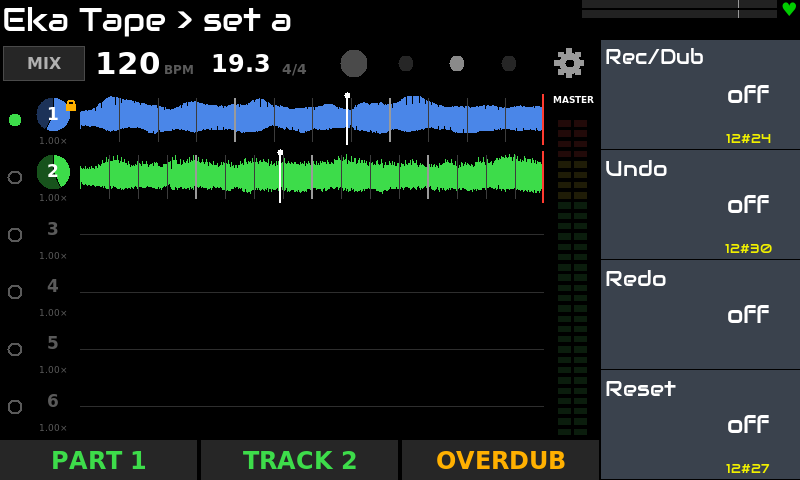
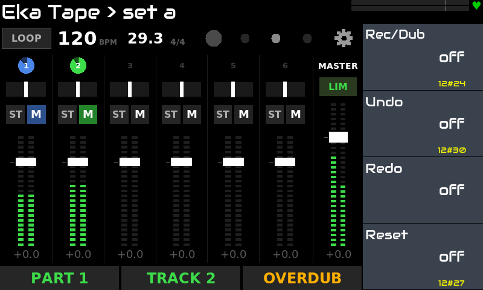

# Eka Tape для Zynthian

[English](README.md) · **Русский**

**Аудио-лупер для живой игры** на [Zynthian](https://zynthian.org): **LV2-эффект** для сцены — парты из
стерео-дорожек, управление ногами с MIDI-футсвитча и **виджеты** для тачскрина Zynthian (Loop, Mixer, Speed,
настройки). Мягкость звука и стабильность важнее новых функций: любое изменение звука идёт через плавную огибающую
или кроссфейд.

> Проверено на: Zynthian **Vangelis** (stable 2610), Raspberry Pi 5 (8 ГБ), набор V5, тачскрин 800x480.
> Другие версии и железо не проверялись.

## Возможности

- **Парты × дорожки:** 4 парта по 4 стерео-дорожки (или 2 × 2, 6 × 6). Играет один парт, остальные ждут.
- **Запись, овердаб, Undo, Redo** без предела слоёв; порядок записи RPO или ROP; режимы Free и Quantize, у каждой
  дорожки своя длина (1–16 тактов) или свободная; счёт перед записью и старт по порогу сигнала.
- **Парты:** **Lock** отмечает дорожки, которые переходят в следующий пустой парт в той же фазе, без разрыва;
  записанный парт начинает с начала. Смена парта и mute квантуются (сразу, доля, такт, конец цикла).
- **Темп из Zynthian:** в Quantize дорожки мягко, как лента, следуют смене темпа и остаются в долю.
- **Скорость и высота у каждой дорожки:** скорость 0,5×–2× как лента (свободно, по полутонам или октавам, с
  плавным ходом) и **сдвиг высоты** ±12 полутонов без смены темпа (Signalsmith Stretch).
- **Микшер:** уровень, панорама (стерео или раздельно L/R у дорожки), mute, мастер с мягким ограничителем, пики.
- **Mute, Reverse, Reset** с плавными затуханиями; удержание Reset очищает всё.
- **Сессии:** пресет Zynthian сохраняет весь лупер вместе со звуком (WAV 24 бит), в фоне, лупы не
  останавливаются.
- **Футсвитч:** каждая функция — контроллер на странице энкодеров, мапится MIDI learn Zynthian; тап и удержание
  плагин различает сам.
- **Виджеты:** Loop (волны дорожек, парты, полоса темпа, визуальный метроном), Mixer, Speed, настройки.

## Скриншоты

| | |
|---|---|
|  |  |
| **Loop:** две записанные дорожки, полоса темпа и парты | **Mixer:** уровень, панорама, ST / M, мастер с ограничителем |

## Установка

На Zynthian (SSH под root):

```bash
git clone https://github.com/dmtry3/zynthian-eka.git
cd zynthian-eka/plugins/tape
sudo make install
systemctl restart zynthian
```

Обновление одной строкой:

```bash
cd /root/zynthian-eka && git pull && cd plugins/tape && sudo make install && systemctl restart zynthian
```

`make install` собирает плагин на устройстве (g++) и создаёт две ссылки: `/usr/local/lib/lv2/eka-tape.lv2` →
`build/eka-tape.lv2` и виджет в `zyngui/widgets_user/`. Файлы самого Zynthian не меняются. Удаление:
`sudo make uninstall`.

Добавьте **Eka Tape** в аудиоцепочку как эффект. Запись идёт только при запущенном транспорте Zynthian.

## Управление

Настройки живут на виджете. Страницы энкодеров нужны для футсвитча и других MIDI-контроллеров:

| Страница | 1 | 2 | 3 | 4 |
|---|---|---|---|---|
| **Record** | Rec / Dub | Undo (удержание — Redo) | Redo | Reset (удержание 1 с — всё) |
| **Track** | Mute | Reverse | Lock | Следующая дорожка (удержание — предыдущая) |
| **Navigate** | Предыдущая дорожка | Следующий парт (удержание — предыдущий) | Предыдущий парт | Play / Stop |
| **Screens** | Виджет Loop | Виджет Mixer | | |
| **Mix** | Уровень дорожки | Панорама дорожки | Master | Скорость дорожки |

Контроллеры-действия срабатывают по переходу 0 → 1, поэтому кнопки футсвитча должны быть **momentary** (127 при
нажатии, 0 при отпускании). Удержание — 500 мс, полный Reset — 1 с; оба порога настраиваются на экране настроек.

**Песня с партами:**
1. Парт 1: записать ритм на дорожку 1 и бас на дорожку 2. Отметить дорожку 1 кнопкой Lock.
2. Следующий парт: на черте такта начинается пустой парт 2, ритм играет дальше, бас затихает. Записать аккорды на
   дорожку 2.
3. Удержание «Следующий парт» — возврат в парт 1: ритм и бас. Снова «Следующий парт» — ритм и аккорды.

## Сборка и тесты (любой Linux)

```bash
make            # build/eka-tape.lv2
make test       # ядро офлайн: дорожки, слои, парты, кроссфейды, скорость, сессии; обёртка LV2
```

## Как устроено

- `core/`: звуковое ядро на C++ без LV2 (тестируется обычными программами); на воспроизведение один буфер на
  дорожку, поэтому нагрузка не растёт с числом овердабов; слои нарезаются из пула памяти, выделенного при запуске.
- `lv2/`: обёртка LV2; темп и позиция приходят из Zynthian через `time:Position`.
- `widget/`: виджеты (Python, Tkinter).

## Лицензия

GPL-3.0-or-later, см. [LICENSE](LICENSE). Сдвиг высоты сделан на Signalsmith Stretch (MIT), см.
[THIRD_PARTY.md](THIRD_PARTY.md).
