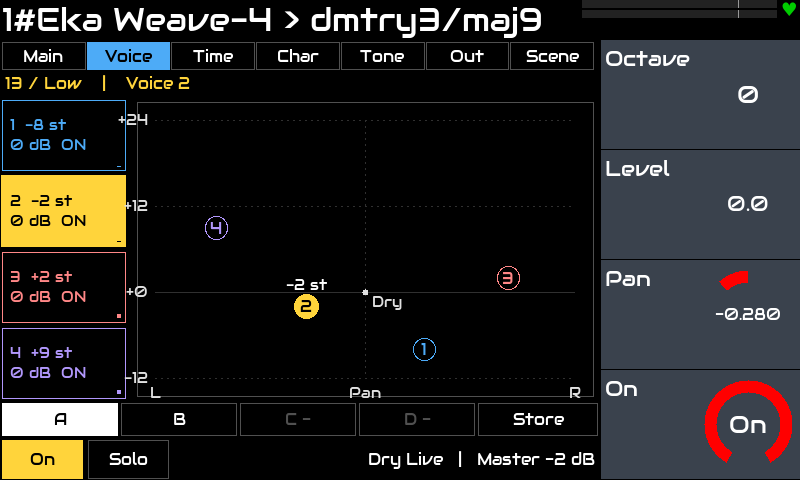
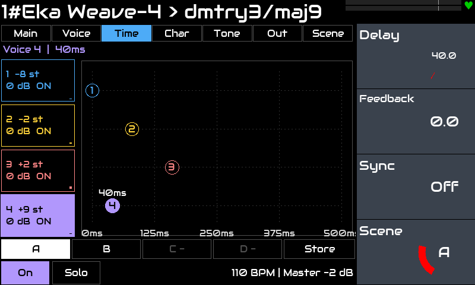
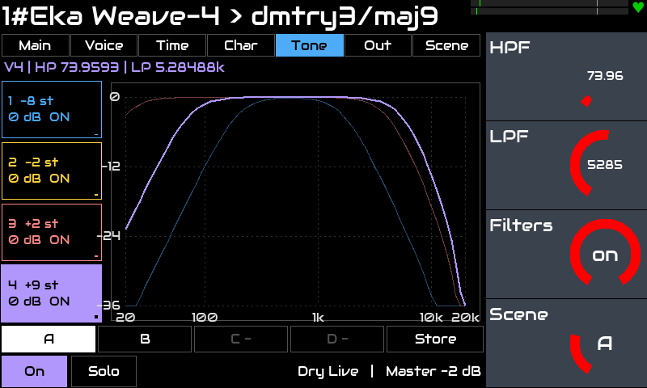

# Eka Weave-4 for Zynthian

[Русская версия](README.ru.md)

A four-voice real-time pitch harmonizer for [Zynthian](https://zynthian.org), implemented as an **LV2 audio effect plugin** (mono in, stereo out) plus a **touch widget** (stereo pitch/pan map, delay timeline, filter response curves, scenes A–D) for the Zynthian touch UI.

Powered by the **Bungee Basic** pitch-shifting engine (standard quality, granularity 0) and an embedded **aubio YIN-fast** pitch tracker for live instrument/vocal harmony without external library dependencies.

> Tested on: Zynthian **Vangelis**, Raspberry Pi 5, V5 kit, 800x480 touch screen.
> Other versions/hardware are untested.

## Features

- **Four harmony voices + dry signal.** Mono input, stereo output, per-voice level, pan, On/Off (preserving delay tails) and Solo.
- **Four harmony modes:**
  - **Interval:** independent semitone shifts (`-12..+12 st`) per voice.
  - **Chord:** 14 chord types (`Major`, `Minor`, `7`, `maj7`, `m7`, `maj9`, `m9`, `6/9`, `9`, `13`, `7#9`, `sus2`, `sus4`, `dim7`) and 5 voicings (`Close`, `Open`, `Low`, `Drop 2`, `Lead` smooth voice leading) with per-voice octave offsets and automatic activation of all chord notes.
  - **MIDI:** hold notes on a MIDI keyboard or sequencer (e.g. `Eka Roll` / `zynseq`) to set absolute target pitches while the embedded pitch tracker follows your live instrument or voice (`Auto`, `Guitar`, `Flute`, `Voice` input profiles).
  - **Scale:** diatonic harmony across 12 keys and 9 seven-note scales (`Major`, `Minor`, `Dorian`, `Phrygian`, `Lydian`, `Mixolydian`, `Locrian`, `Harm Minor`, `Mel Minor`) with signed per-voice degrees (`-8ve..+8ve`); no MIDI keyboard needed.
- **Per-voice Delay & Tempo Sync.** `0..3 s` delay, `0..90%` feedback with soft loop saturation, host tempo sync (`1/64` to `4 bars`, dotted and triplet divisions), and preserved delay tails when muting a voice.
- **Per-voice Character & Glide.** Fine detune (`±50 cents`), independent organic humanize (slow micro-pitch and micro-timing drift), and portamento **Glide** (`0..500 ms`, per scene).
- **Per-voice Tone.** Independent 12 / 24 dB/oct HPF (`20..4000 Hz`) and LPF (`200..20000 Hz`) with resonance (`0..100%`) and per-filter resonance toggles, placed inside the delay feedback loop so repeats progressively darken/thin out; live logarithmic response curves (`+12..-36 dB`); dry signal stays untouched.
- **Master Safety Limiter & Stereo Width.** Zero-latency stereo-linked brickwall master limiter (prevents clipping while preserving stereo balance, with a `LIM` indicator on the widget) and a **Width** (`0..100%`) stereo spread control on `Output`.
- **Scenes A–D.** Store and recall complete harmony, voice, delay, character, glide and tone banks inside standard Zynthian snapshots and LV2 presets. Includes a dedicated **Scenes** page with `Prev` / `Next` (MIDI Learn friendly for footpedals) and `Store`.
- **Low-latency Dry & Voice timing.** Dry defaults to **Live** (zero added dry delay inside the plugin) with optional **Aligned** mode. Voices run in **Fast** native-latency timing by default (saving up to ~43 ms on upper intervals), with optional **Aligned** mode on `Output`.
- **9 Factory Presets** (*Weave-4 Factory*) covering guitar, flute, ensemble, filtered echoes, synced rhythm and MIDI choir.
- **Touch widget.** 7 compact shared pages (`Main`, `Voice`, `Time`, `Char`, `Tone`, `Out`, `Scene`), colour-coded voice cards with live post-gain meters (tap to select, tap again to toggle `On/Off`), stereo pitch/pan map, delay timeline, filter response display with per-filter `12/24` and `Res` buttons, `In: Auto/Gtr/Flt/Voc` quick toggle, scene strip and On/Solo buttons.

## Screenshots

| | |
|---|---|
|  |  |
| **Voice / Stereo Map:** four colour-coded voice cards with intervals and meters, pitch-vs-pan stereo map, Scenes A–D strip and On/Solo buttons | **Time:** per-voice delay timeline with predicted repeats, host BPM readout, and Delay / Feedback / Sync / Scene controls |
|  | |
| **Tone:** per-voice HPF/LPF response curves on a logarithmic frequency axis (`20 Hz–20 kHz`) | |

## Requirements

- Zynthian (Raspberry Pi 5 recommended for 4 simultaneous voices).
- `gcc`, `g++` (C11 / C++20), `make`, `cmake`, `pkg-config`, `python3`, and LV2 headers (`lv2-dev`).
- No system Rubber Band or aubio packages are required; Bungee Basic is built statically on first compile and the aubio YIN-fast DSP subset is embedded.

## Installation

```bash
git clone https://github.com/dmtry3/zynthian-eka.git
cd zynthian-eka/plugins/weave4
sudo ./scripts/install.sh      # builds, installs the LV2 bundle + widget, registers factory presets
sudo systemctl restart zynthian
```

`install.sh` builds and installs:

| Path | Contents |
|---|---|
| `/usr/local/lib/lv2/eka-weave4.lv2/` | `eka_weave4.so`, `manifest.ttl`, `eka_weave4.ttl`, `factory-presets.ttl`, licenses |
| `/zynthian/zynthian-ui/zyngui/widgets_user/zynthian_widget_eka_weave-4.py` | Touch widget (plus legacy alias `zynthian_widget_eka_weave4.py`) |

It also registers the 9 factory presets in `/zynthian/config/jalv/presets_Eka_Weave-4.json` (preserving any existing user banks) and initializes the user preset bundle directory so saving into a new bank works right away.

Nothing in Zynthian's own files is modified. To remove: `sudo ./scripts/uninstall.sh`.

If adding for the first time, refresh/enable **Eka Weave-4** in Zynthian webconf (*Software → LV2 Plugins*), then add it to a chain as an *Audio Effect* (Pitch). For **MIDI** mode, route MIDI input into the chain.

## Controls

Controls are grouped into 7 shared pages (4 controllers per page, matching the 4 zynpots). Selecting a voice edits only that voice across `Voice`, `Time`, `Character` and `Tone` without overwriting other slots.

| Page | Control | Description |
|---|---|---|
| **Harmony** (`Main`) | Mode | `Interval`, `Chord`, `MIDI`, `Scale` |
| | Pitch / Chord / MIDI Ch / Key | Selected voice pitch (Interval), chord type (Chord), MIDI input channel (MIDI), or Root Key `C..B` (Scale) |
| | Level / Voicing / Profile / Scale | Selected voice level (Interval), `Close`/`Open`/`Low`/`Drop 2`/`Lead` (Chord), `Auto`/`Guitar`/`Flute`/`Voice` input profile (MIDI), or 9 seven-note scales (Scale) |
| | Dry | Dry input level (`-60..+6 dB`) |
| **Voice** | Pitch / Octave / Degree | Semitones `-12..+12` (Interval), Octave `-1..+1` (Chord/MIDI), or signed scale degree `-8ve..+8ve` (Scale) |
| | Level | Selected voice level (`-60..+6 dB`; `-60 dB` mutes) |
| | Pan | Selected voice stereo balance (`-1..+1`) |
| | On | Enable / disable selected voice without losing its level (delay tails keep ringing) |
| **Time** | Delay / Division | Delay in milliseconds (`0..3000 ms`) when Sync is Off, or musical division (`1/64..4 bars`) when Sync is On |
| | Feedback | Delay feedback (`0..90%`) |
| | Sync | Free ms vs host tempo sync |
| **Character** (`Char`) | Fine | Fine detune (`-50..+50 cents`) |
| | Humanize | Organic pitch + micro-timing drift amount (`0..100%`) |
| | Speed | Drift modulation rate |
| | Glide | Portamento glide time (`0..500 ms`, per scene) |
| **Tone** | HPF | 12 / 24 dB/oct high-pass cutoff (`20..4000 Hz`) |
| | LPF | 12 / 24 dB/oct low-pass cutoff (`200..20000 Hz`) |
| | Res | Filter resonance (`0..100%`) applied to HPF and/or LPF based on the widget toggles |
| | Filters | Bypass / enable selected voice's HPF + LPF pair (defaults Off) |
| **Output** (`Out`) | Master | Combined output gain (`-60..+6 dB`) |
| | Dry timing | `Live` (zero added dry delay) or `Aligned` (delays dry to match enabled harmony voices) |
| | Voice timing | `Fast` (native per-voice latency) or `Aligned` (aligns all voices to the slowest voice) |
| | Width | Stereo spread (`0..100%`, defaults to `50%`) |
| **Scenes** (`Scene`) | Scene | Direct canonical selector (`A–D`); supports MIDI Learn / automation |
| | Prev Scene | Steps to the previous populated scene (skips empty slots); MIDI Learn friendly for footpedals |
| | Next Scene | Steps to the next populated scene (skips empty slots); MIDI Learn friendly for footpedals |
| | Store Scene | Arms copy (`Ready` / `Arm Store`); turning `Scene`, pressing `Prev`/`Next`, or tapping `A–D` clones the active scene into the target slot |

### Widget

- **Top bar:** 7 page tabs (`Main`, `Voice`, `Time`, `Char`, `Tone`, `Out`, `Scene`), summary line (active chord/key/input note/delay/filter readout) and yellow `LIM` master limiter indicator.
- **Voice cards (left):** 4 colour-coded cards showing interval/target note, level, status (`ON`, `OFF`, `TAIL`, `SOLO`, `ARM`, `WAIT`, `RANGE`) and live post-gain peak meter. Tap any card to select that voice (keeping the current page); tap the selected card again to toggle `On / Off`.
- **Centre plot:** switches automatically between the **stereo pitch/pan map** (`Main`, `Voice`, `Char`, `Out`, `Scene`), **delay timeline** with predicted echo repeats (`Time`), and **logarithmic HPF/LPF response curves** (`+12..-36 dB`) with compact `HP 12/24`, `Res`, `LP 12/24`, `Res` buttons above the plot (`Tone`).
- **Bottom strip:** `A`, `B`, `C`, `D` scene buttons (empty slots marked with `-`), `Store` / `Cancel` button, `On` / `Solo` toggles for the selected voice, `In: Auto/Gtr/Flt/Voc` quick profile toggle (in `MIDI` and `Scale` modes), and `Dry Live/Aligned | Master` (or BPM) status.

## Factory Presets

Installed under the **Weave-4 Factory** bank:

1. `01 Guitar - C Major Thirds` — Scale mode, C Major diatonic +3rd
2. `02 Guitar - Low Octave` — `-12 st` sub-octave with gentle tone shaping
3. `03 Guitar - Wide Fifths` — stereo `+7 st` / `-5 st` fifths
4. `04 Flute - D Minor Thirds` — Scale mode, D Minor +3rd with Flute tracking profile
5. `05 Flute - Airy Octave` — stereo `+12 st` / `+7 st` with subtle detune and humanize
6. `06 Ensemble - Four Gentle Voices` — 4-voice wide unison chorus/ensemble
7. `07 Dark - Minor Echoes` — Minor Open chord with filtered stereo delays
8. `08 Rhythm - Synced Fifths` — tempo-synced `+7 st` / `+12 st` rhythmic echoes
9. `09 MIDI - Four Voice Choir` — 4-voice MIDI-controlled harmony choir

## Performance & Limitations

- **CPU (Raspberry Pi 5, 48 kHz / 256 frames, 4 active voices with Character, Tone, Delay/Feedback):** ~15% mean JACK callback deadline (~13% thread CPU), zero xruns in native benchmark runs.
- **Latency:** *Dry timing = Live* adds `0` samples to the dry path inside the plugin. Shifted voices run at native Bungee HQ latency (~55–109 ms depending on interval; *Voice timing* port `voice_timing` defaults to `Fast` with no artificial inter-voice alignment padding). JACK/audio interface latency is additional.
- **Pitch tracking (Scale & MIDI modes):** designed for monophonic input (single-note guitar, flute, voice, mono synth). Polyphonic chords fed into the input tracker are not supported.
- **Scenes:** inactive scene banks are stored in normal LV2 control ports, so Zynthian snapshots and LV2 presets retain all four scenes automatically. Delay audio buffers are not stored in presets.

## Troubleshooting

| Problem | Check |
|---|---|
| Plugin not listed | `lv2ls \| grep zynthian-eka/weave4`, refresh LV2 plugins in webconf, restart Zynthian |
| No widget | Check `/zynthian/zynthian-ui/zyngui/widgets_user/zynthian_widget_eka_weave-4.py`; `journalctl -u zynthian \| grep -i widget` |
| MIDI mode receives no notes | Route a MIDI source (keyboard / `Eka Roll` / `zynseq`) to the chain; check `MIDI Ch` on the Harmony page |
| Cannot save preset to a new bank | Run `sudo python3 scripts/register-factory-presets.py` to initialize `/zynthian/zynthian-my-data/presets/lv2/Eka_Weave-4.presets.lv2/manifest.ttl` |
| `WAIT` shown on voice cards | Normal in Scale/MIDI modes until a steady monophonic pitch is detected on the audio input |

## How it works & Stable identifiers

- `src/dsp/`: independent C/C++ DSP modules (`backend_bungee.cpp`, `pitch.c`, `delay.c`, `character.c`, `tone.c`, `tracker.c`) with zero heap allocations, locks, or I/O in the audio callback.
- `src/harmony/`: interval/chord/voice-leading (`chords.c`), MIDI target assignment (`midi.c`), diatonic scale mapping (`scale.c`), and musical delay division timing (`timing.c`).
- `src/lv2/`: LV2 plugin wrapper (`plugin.c`), scene bank definitions (`scenes.h`), and host tempo tracking (`tempo.c`).
- `ui/zynthian_widget_eka_weave4.py`: multi-instance Zynthian Tk widget reading telemetry from LV2 output ports and binding canonical controllers into 7 shared pages.

Stable identifiers:
- **Display name:** `Eka Weave-4`
- **LV2 URI:** `http://dmtry3.github.io/zynthian-eka/weave4`
- **Bundle / binary:** `eka-weave4.lv2` / `eka_weave4.so`
- **Widget:** `zynthian_widget_eka_weave-4.py` (legacy alias `zynthian_widget_eka_weave4.py`)

## Testing

```bash
make test                           # RT heap-allocation checks, full LV2 DSP suite, factory presets
DISPLAY=:0 python3 test/widget_ui.py  # Native Zynthian Tk widget test (on Pi)
```

## License & Third-Party

GPL-3.0-or-later — see `LICENSE`.
Third-party sources, versions and licenses (Bungee Basic, embedded aubio DSP subset) are documented in `THIRD_PARTY.md`.
