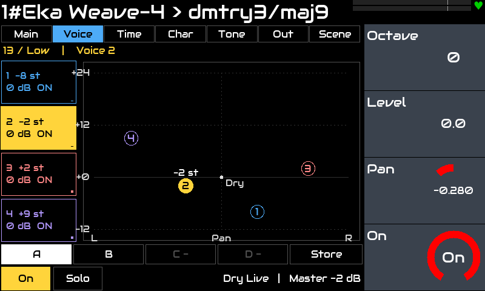
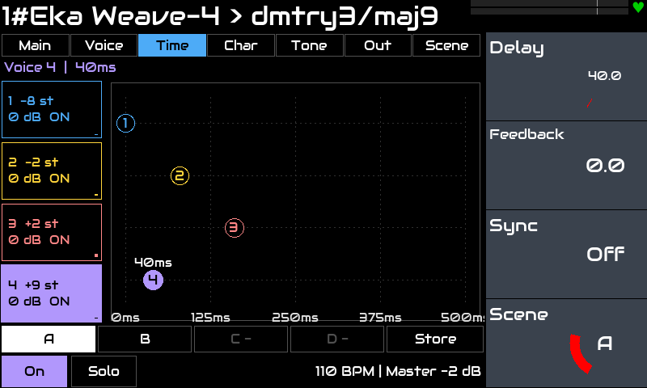
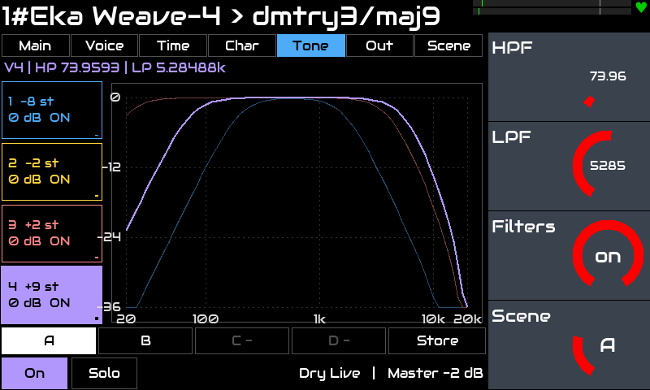

# Eka Weave-4 для Zynthian

[English version](README.md)

Четырёхголосый питч-гармонизатор реального времени для [Zynthian](https://zynthian.org): **LV2-плагин (аудиоэффект)** с моно-входом и стерео-выходом, плюс **сенсорный виджет** (стереокарта высоты/панорамы, таймлайн дилэев, кривые фильтров, сцены A–D).

Внутри — движок питч-шифтинга **Bungee Basic** (стандартное качество, `granularity 0`) и встроенный детектор высоты тона **aubio YIN-fast** для живого инструмента или вокала без внешних системных библиотек.

> Проверено на: Zynthian **Vangelis**, Raspberry Pi 5, комплект V5, экран 800x480.
> Другие версии и железо не проверялись.

## Возможности

- **Четыре голоса гармонии + сухой сигнал.** Моно-вход, стерео-выход; для каждого голоса — уровень, панорама, On/Off (с сохранением хвостов дилэя) и Solo.
- **Четыре режима гармонии:**
  - **Interval:** независимый сдвиг каждого голоса в полутонах (`-12..+12 st`).
  - **Chord:** 14 типов аккордов (`Major`, `Minor`, `7`, `maj7`, `m7`, `maj9`, `m9`, `6/9`, `9`, `13`, `7#9`, `sus2`, `sus4`, `dim7`) и 5 расположений (`Close`, `Open`, `Low`, `Drop 2`, `Lead` — плавное голосоведение) с октавным сдвигом на голос и автоматическим включением всех нот аккорда.
  - **MIDI:** зажимайте ноты на MIDI-клавиатуре или секвенсоре (например, `Eka Roll` / `zynseq`), чтобы задавать абсолютные целевые ноты, пока встроенный трекер отслеживает ваш живой инструмент или голос (профили `Auto`, `Guitar`, `Flute`, `Voice`).
  - **Scale:** диатоническая гармония в 12 тональностях и 9 семиступенных ладах (`Major`, `Minor`, `Dorian`, `Phrygian`, `Lydian`, `Mixolydian`, `Locrian`, `Harm Minor`, `Mel Minor`) со ступенями со знаком на каждый голос (`-8ve..+8ve`); MIDI-клавиатура не нужна.
- **Дилэй и синхронизация с темпом на каждый голос.** Задержка `0..3 с`, обратная связь `0..90%` с мягкой защитой петли, синхронизация с темпом хоста (`1/64` до `4 bars`, с точкой и триоли), сохранение хвостов при выключении голоса.
- **Character и Glide.** Точная расстройка (`±50 центов`), независимая живая гуманизация (плавный микродрейф высоты и времени) и портаменто **Glide** (`0..500 мс`, сохраняется в сценах).
- **Tone на каждый голос.** Независимые фильтры HPF (`20..4000 Гц`) и LPF (`200..20000 Гц`) с крутизной 12 / 24 дБ/окт, резонансом (`0..100%`) и отдельным вкл/выкл резонанса для каждого фильтра; фильтр работает внутри петли дилэя, чтобы повторы постепенно темнели; отображение АЧХ на логарифмической шкале (`+12..-36 дБ`); сухой сигнал не затрагивается.
- **Мастер-лимитер и Width.** Стерео-линкованный brickwall-лимитер на мастере с нулевой задержкой (защищает от клиппинга, сохраняя панораму; индикатор `LIM` на виджете) и ручка стерео-разброса голосов **Width** (`0..100%`) на странице `Out`.
- **Сцены A–D.** Сохранение и мгновенное переключение полных банков настроек гармонии, голосов, дилэев, характера, Glide и фильтров внутри стандартных снапшотов Zynthian и LV2-пресетов. Есть отдельная страница **Scenes** с `Prev` / `Next` (удобно для MIDI Learn на футсвичи/педали) и `Store`.
- **Минимальная задержка Dry и голосов.** По умолчанию `Dry timing = Live` (нулевая добавленная задержка сухого сигнала внутри плагина) с опцией `Aligned`. Голоса работают в режиме `Fast` (нативная задержка каждого голоса без искусственного выравнивания, что экономит до ~43 мс на верхних интервалах) с переключением в `Aligned` на странице `Out`.
- **9 фабричных пресетов** (*Weave-4 Factory*) для гитары, флейты, ансамбля, фильтрованных эхо, ритмичных дилэев и MIDI-хора.
- **Виджет.** 7 компактных общих страниц (`Main`, `Voice`, `Time`, `Char`, `Tone`, `Out`, `Scene`), цветные карточки голосов с живыми индикаторами уровня (тап выбирает голос без смены страницы, повторный тап переключает `On/Off`), стереокарта высоты/панорамы, таймлайн задержек, график фильтров с кнопками `12/24` и `Res`, кнопка быстрого выбора профиля `In: Auto/Gtr/Flt/Voc`, полоса сцен и кнопки On/Solo.

## Скриншоты

| | |
|---|---|
|  |  |
| **Voice / Стереокарта:** 4 цветные карточки голосов с интервалами и индикаторами, карта высота/панорама, полоса сцен A–D и кнопки On/Solo | **Time:** таймлайн задержек по голосам с прогнозом повторов, темп хоста и контроллеры Delay / Feedback / Sync / Scene |
|  | |
| **Tone:** кривые АЧХ фильтров HPF/LPF каждого голоса на логарифмической шкале (`20 Гц–20 кГц`) | |

## Требования

- Zynthian (для 4 одновременных голосов рекомендуется Raspberry Pi 5).
- `gcc`, `g++` (C11 / C++20), `make`, `cmake`, `pkg-config`, `python3`, заголовки LV2 (`lv2-dev`).
- Системные пакеты Rubber Band и aubio не требуются: Bungee Basic собирается статически при первой сборке, а DSP-подмножество aubio YIN-fast встроено в проект.

## Установка

```bash
git clone https://github.com/dmtry3/zynthian-eka.git
cd zynthian-eka/plugins/weave4
sudo ./scripts/install.sh      # собирает, устанавливает LV2-бандл и виджет, регистрирует фабричные пресеты
sudo systemctl restart zynthian
```

`install.sh` собирает и устанавливает:

| Путь | Содержимое |
|---|---|
| `/usr/local/lib/lv2/eka-weave4.lv2/` | `eka_weave4.so`, `manifest.ttl`, `eka_weave4.ttl`, `factory-presets.ttl`, лицензии |
| `/zynthian/zynthian-ui/zyngui/widgets_user/zynthian_widget_eka_weave-4.py` | Сенсорный виджет (и алиас совместимости `zynthian_widget_eka_weave4.py`) |

Также скрипт регистрирует 9 фабричных пресетов в `/zynthian/config/jalv/presets_Eka_Weave-4.json` (сохраняя все существующие пользовательские банки) и инициализирует бандл пользовательских пресетов, чтобы сохранение в новый банк работало сразу.

Файлы самого Zynthian не изменяются. Удалить: `sudo ./scripts/uninstall.sh`.

При первой установке обновите/включите **Eka Weave-4** в webconf Zynthian (*Software → LV2 Plugins*), затем добавьте плагин в цепочку как *Audio Effect* (Pitch). Для режима **MIDI** направьте MIDI-вход в эту цепочку.

## Управление

Контроллеры сгруппированы в 7 общих страниц по 4 ручки (по числу зинпотов). Выбор голоса переключает редактирование на страницах `Voice`, `Time`, `Character` и `Tone` только для этого голоса, не перезаписывая остальные.

| Страница | Контроллер | Что делает |
|---|---|---|
| **Harmony** (`Main`) | Mode | `Interval`, `Chord`, `MIDI`, `Scale` |
| | Pitch / Chord / MIDI Ch / Key | Интервал выбранного голоса (Interval), тип аккорда (Chord), MIDI-канал (MIDI) или тоника `C..B` (Scale) |
| | Level / Voicing / Profile / Scale | Громкость выбранного голоса (Interval), `Close`/`Open`/`Low`/`Drop 2`/`Lead` (Chord), профиль трекера `Auto`/`Guitar`/`Flute`/`Voice` (MIDI) или 9 ладов (Scale) |
| | Dry | Уровень сухого сигнала (`-60..+6 дБ`) |
| **Voice** | Pitch / Octave / Degree | Полутоны `-12..+12` (Interval), октава `-1..+1` (Chord/MIDI) или ступень лада `-8ve..+8ve` (Scale) |
| | Level | Громкость выбранного голоса (`-60..+6 дБ`; `-60 дБ` глушит) |
| | Pan | Панорама выбранного голоса (`-1..+1`) |
| | On | Вкл/выкл выбранного голоса без потери громкости (хвосты дилэя доигрывают) |
| **Time** | Delay / Division | Задержка в миллисекундах (`0..3000 мс`) при выкл. Sync или длительность (`1/64..4 bars`) при вкл. Sync |
| | Feedback | Обратная связь дилэя (`0..90%`) |
| | Sync | Свободные мс или привязка к темпу хоста |
| **Character** (`Char`) | Fine | Тонкая расстройка (`-50..+50 центов`) |
| | Humanize | Глубина живого дрейфа высоты и микротайминга (`0..100%`) |
| | Speed | Скорость модуляции дрейфа |
| | Glide | Время портаменто (`0..500 мс`, сохраняется в сценах) |
| **Tone** | HPF | Фильтр ВЧ 12 / 24 дБ/окт (`20..4000 Гц`) |
| | LPF | Фильтр НЧ 12 / 24 дБ/окт (`200..20000 Гц`) |
| | Res | Резонанс (`0..100%`) для включённых кнопками HPF и/или LPF |
| | Filters | Вкл/обход пары HPF + LPF выбранного голоса (по умолчанию выкл.) |
| **Output** (`Out`) | Master | Общая громкость выхода (`-60..+6 дБ`) |
| | Dry timing | `Live` (нулевая добавленная задержка сухого сигнала) или `Aligned` (выравнивание сухого под голоса гармонии) |
| | Voice timing | `Fast` (нативная задержка каждого голоса) или `Aligned` (выравнивание всех голосов под самый медленный) |
| | Width | Стерео-разброс голосов (`0..100%`, по умолчанию `50%`) |
| **Scenes** (`Scene`) | Scene | Прямой выбор сцены (`A–D`), поддерживает MIDI Learn и автоматизацию |
| | Prev Scene | Переход на предыдущую заполненную сцену (пропускает пустые); подходит для MIDI Learn на педаль |
| | Next Scene | Переход на следующую заполненную сцену (пропускает пустые); подходит для MIDI Learn на педаль |
| | Store Scene | Взвод копирования (`Ready` / `Arm Store`); поворот `Scene`, нажатие `Prev`/`Next` или тап по `A–D` клонирует текущую сцену в выбранный слот |

### Виджет

- **Верхняя панель:** 7 вкладок страниц (`Main`, `Voice`, `Time`, `Char`, `Tone`, `Out`, `Scene`), строка состояния (аккорд/тональность/входная нота/дилэй/фильтры) и жёлтый индикатор работы мастер-лимитера `LIM`.
- **Карточки голосов (слева):** 4 цветные карточки с интервалом или целевой нотой, громкостью, статусом (`ON`, `OFF`, `TAIL`, `SOLO`, `ARM`, `WAIT`, `RANGE`) и живым индикатором пикового уровня. Тап по карточке выбирает голос без смены страницы, повторный тап по выбранной карточке переключает `On / Off`.
- **Центральная область:** автоматически переключается между **стереокартой высота/панорама** (`Main`, `Voice`, `Char`, `Out`, `Scene`), **таймлайном дилэев** с прогнозом повторов (`Time`) и **логарифмическим графиком фильтров HPF/LPF** (`+12..-36 дБ`) с компактными кнопками `HP 12/24`, `Res`, `LP 12/24`, `Res` над графиком (`Tone`).
- **Нижняя панель:** кнопки сцен `A`, `B`, `C`, `D` (пустые отмечены `-`), кнопка `Store` / `Cancel`, переключатели `On` / `Solo` для выбранного голоса, кнопка быстрого выбора профиля `In: Auto/Gtr/Flt/Voc` (в режимах `MIDI` и `Scale`) и статус `Dry Live/Aligned | Master` (или BPM).

## Фабричные пресеты

Устанавливаются в банк **Weave-4 Factory**:

1. `01 Guitar - C Major Thirds` — режим Scale, до мажор, терция вверх (`+3rd`)
2. `02 Guitar - Low Octave` — октава вниз (`-12 st`) с мягкой фильтрацией
3. `03 Guitar - Wide Fifths` — широкое стерео `+7 st` / `-5 st`
4. `04 Flute - D Minor Thirds` — режим Scale, ре минор, терция вверх с профилем `Flute`
5. `05 Flute - Airy Octave` — стерео `+12 st` / `+7 st` с лёгкой расстройкой и гуманизацией
6. `06 Ensemble - Four Gentle Voices` — 4-голосый широкий унисонный ансамбль
7. `07 Dark - Minor Echoes` — аккорд `Minor / Open` с тёмными фильтрованными эхо
8. `08 Rhythm - Synced Fifths` — ритмические дилэи `+7 st` / `+12 st` в темп хоста
9. `09 MIDI - Four Voice Choir` — 4-голосый хор, управляемый по MIDI

## Производительность и ограничения

- **CPU (Raspberry Pi 5, 48 кГц / 256 сэмплов, 4 активных голоса с Character, Tone и дилэями):** в среднем ~15% бюджета JACK-колбэка (~13% CPU потока), 0 xrun в нативных замерах.
- **Задержка:** в режиме `Dry timing = Live` сухой сигнал проходит с задержкой `0` сэмплов внутри плагина. Сдвинутые голоса работают на нативной задержке Bungee HQ (~55–109 мс в зависимости от интервала; порт `voice_timing` по умолчанию `Fast`, без искусственного выравнивания голосов друг под друга). Задержка JACK и аудиоинтерфейса добавляется отдельно.
- **Детектор высоты (режимы Scale и MIDI):** рассчитан на монофонический входной сигнал (одиночные ноты гитары, флейты, вокала, моно-синта). Полифонические аккорды на входе не поддерживаются.
- **Сцены:** неактивные банки сцен хранятся в обычных LV2-портах, поэтому снапшоты Zynthian и LV2-пресеты автоматически сохраняют все 4 сцены. Аудиобуферы дилэев в пресетах не сохраняются.

## Диагностика

| Проблема | Что проверить |
|---|---|
| Плагин не виден в списке | `lv2ls \| grep zynthian-eka/weave4`, обновить LV2-плагины в webconf, перезапустить Zynthian |
| Нет виджета | Проверить `/zynthian/zynthian-ui/zyngui/widgets_user/zynthian_widget_eka_weave-4.py`; `journalctl -u zynthian \| grep -i widget` |
| В режиме MIDI нет нот | Подключить MIDI-источник (клавиатура / `Eka Roll` / `zynseq`) к цепочке; проверить `MIDI Ch` на странице Harmony |
| Не сохраняется пресет в новый банк | Запустить `sudo python3 scripts/register-factory-presets.py` — он инициализирует `/zynthian/zynthian-my-data/presets/lv2/Eka_Weave-4.presets.lv2/manifest.ttl` |
| На карточках написано `WAIT` | Нормально в режимах Scale/MIDI, пока на аудиовходе не определится устойчивая одиночная нота |

## Как устроен и стабильные идентификаторы

- `src/dsp/`: независимые C/C++ DSP-модули (`backend_bungee.cpp`, `pitch.c`, `delay.c`, `character.c`, `tone.c`, `tracker.c`) без аллокаций памяти, блокировок и ввода-вывода в аудиоколбэке.
- `src/harmony/`: интервалы, аккорды и голосоведение (`chords.c`), распределение MIDI-целей (`midi.c`), диатоническая гармония (`scale.c`), расчёт музыкальных длительностей (`timing.c`).
- `src/lv2/`: LV2-обёртка (`plugin.c`), описание банков сцен (`scenes.h`) и трекинг темпа хоста (`tempo.c`).
- `ui/zynthian_widget_eka_weave4.py`: multi-instance Tk-виджет для Zynthian, читающий телеметрию из выходных портов LV2 и группирующий канонические контроллеры в 7 общих страниц.

Стабильные идентификаторы:
- **Отображаемое имя:** `Eka Weave-4`
- **LV2 URI:** `http://dmtry3.github.io/zynthian-eka/weave4`
- **Бандл / бинарник:** `eka-weave4.lv2` / `eka_weave4.so`
- **Виджет:** `zynthian_widget_eka_weave-4.py` (алиас совместимости `zynthian_widget_eka_weave4.py`)

## Тесты

```bash
make test                             # Проверка 0 аллокаций в RT, полный DSP/LV2-набор, фабричные пресеты
DISPLAY=:0 python3 test/widget_ui.py  # Нативный Tk-тест виджета (на Pi)
```

## Лицензия и сторонний код

GPL-3.0-or-later — см. `LICENSE`.
Сторонние исходники, версии и лицензии (Bungee Basic, встроенное подмножество aubio DSP) перечислены в `THIRD_PARTY.md`.
